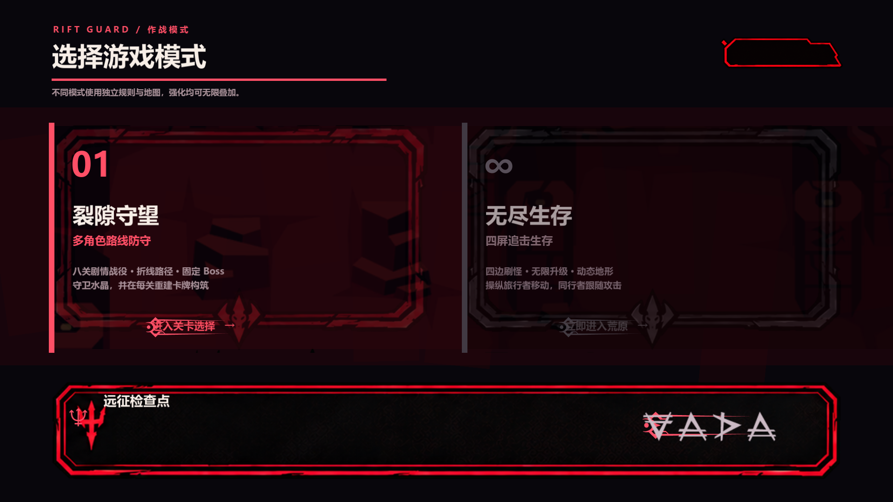
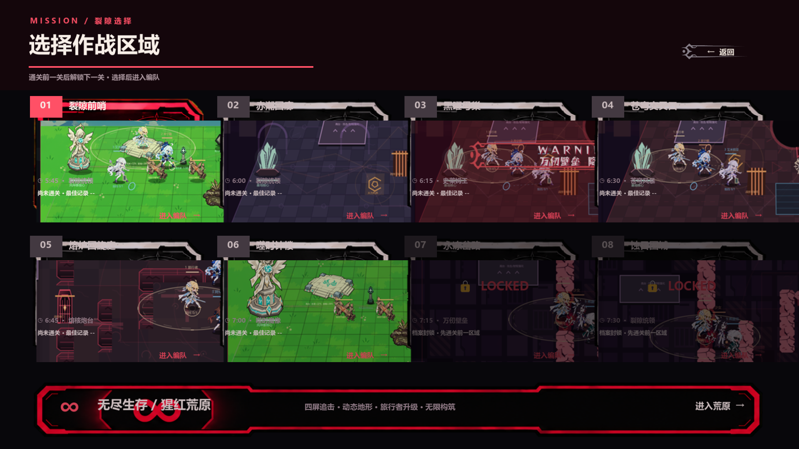
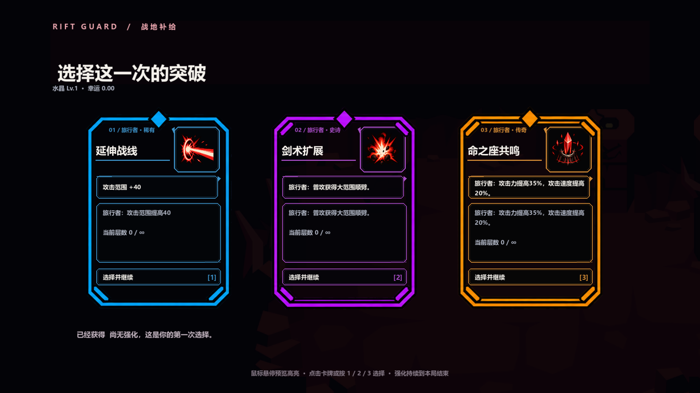
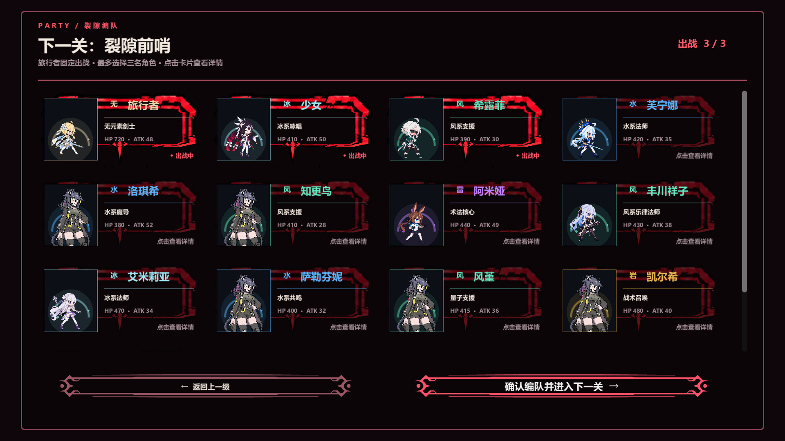
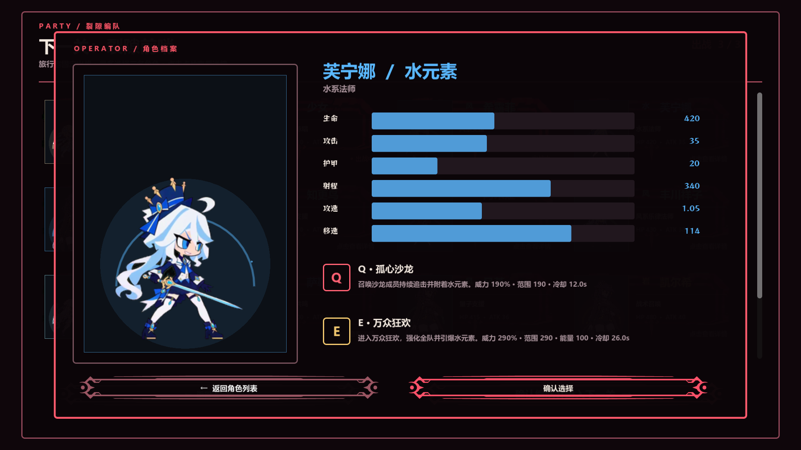
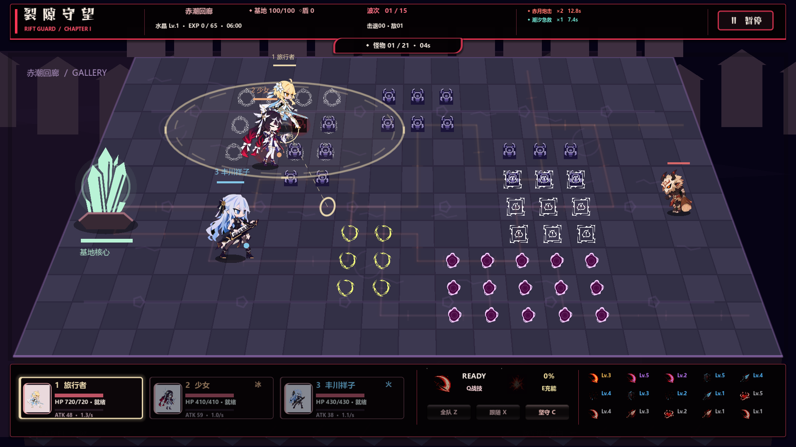
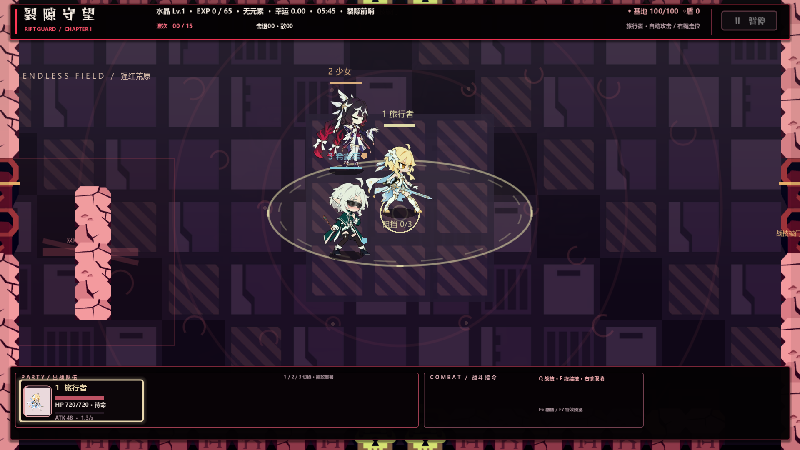
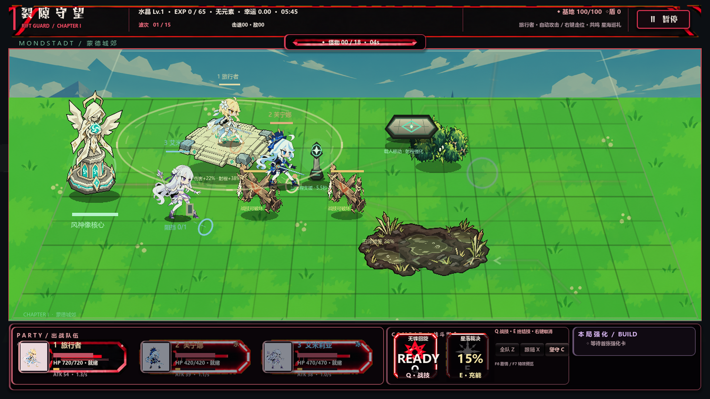
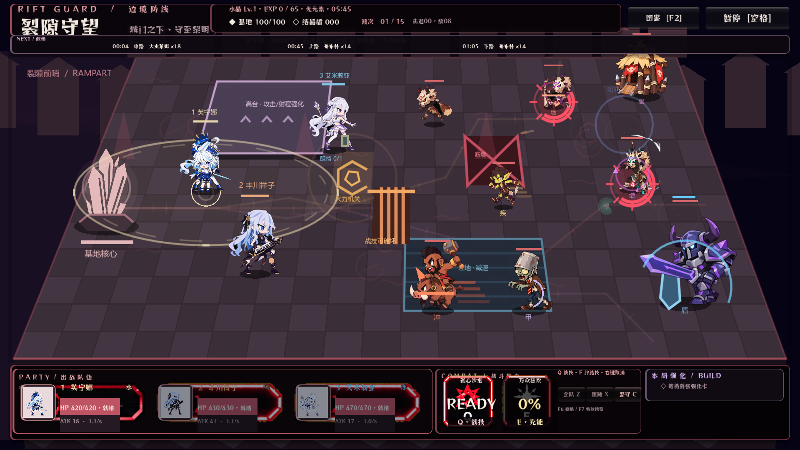
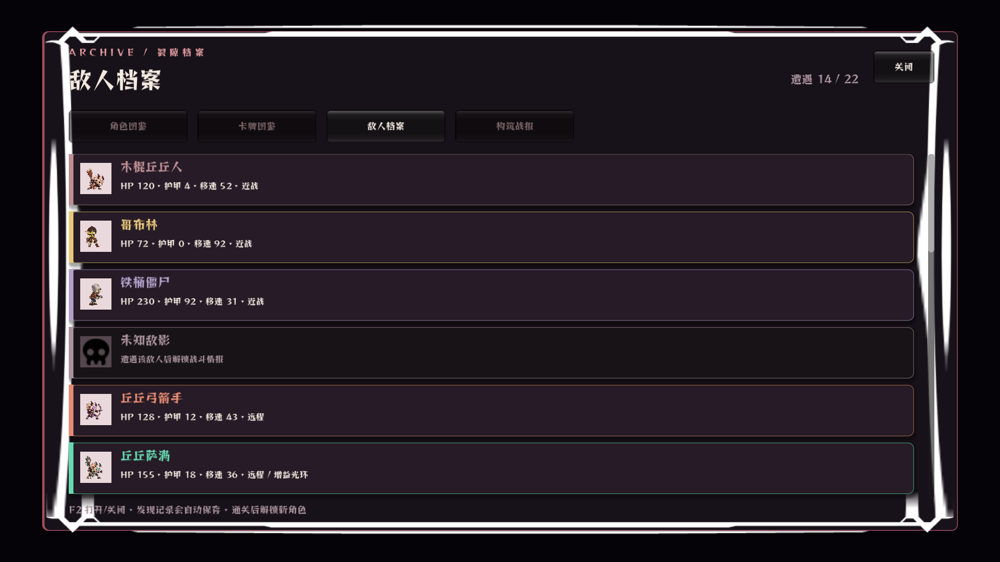

# 裂隙守望 · Rift Guard

《裂隙守望》是一款将多角色路线防守、Roguelike 构筑与分支剧情结合的 2.5D 动作防守游戏。工程以 Godot 4 制作，运行与验收规格为 1920×1080。

## 当前界面

模式选择、关卡选择、编队、角色档案、剧情和三选一增益已统一为红黑视觉体系。界面素材保持原始宽高比，按钮、卡片与内部信息遵循安全边距。

## 角色界面

当前具有正式立绘和动作素材的可用角色为：旅行者、少女、希露菲、芙宁娜、艾米莉亚、丰川祥子、阿米娅。缺少正式立绘或动作素材的角色保持未解锁，旧存档也不会绕过该限制。

## 战斗

普通模式包含路线防守、可交互地形、Boss 阶段和关卡推进；无尽模式支持四屏地图、动态刷怪、角色独立移动与屏外单位降频模拟。Q/E 技能显示冷却和能量状态，角色普通攻击、技能和元素反应使用独立反馈。

## 地图与怪物

第一关使用蒙德草地、七天神像、高台、沼泽、自动机关和可破坏栅栏；后续关卡保持暗色格子主题。敌人包含史莱姆、丘丘人、弓箭手、萨满、哥布林、哥布林茅房、大型怪物与多阶段 Boss。

## 运行

- Godot 工程：`game/project.godot`
- 设计与验收分辨率：`1920×1080`
- UI 实验台逻辑坐标：`1280×720`，运行时等比缩放
- Windows 发布包：`builds/rift-guard-v64/RiftGuard-V64.exe`

使用 Godot 4.4.1 打开工程后运行主场景即可。UI 布局与素材替换方法见 [Godot UI 编辑手册](docs/UI-GODOT-EDITING-MANUAL.md)。

## 操作

- `WASD`：移动当前角色
- 鼠标右键：移动或取消技能瞄准
- `1 / 2 / 3`：切换角色
- `Q`：主动技能
- `E`：终结技
- `Space`：暂停
- `F2`：图鉴
- `F4`：关卡选择
- `F10`：设置
