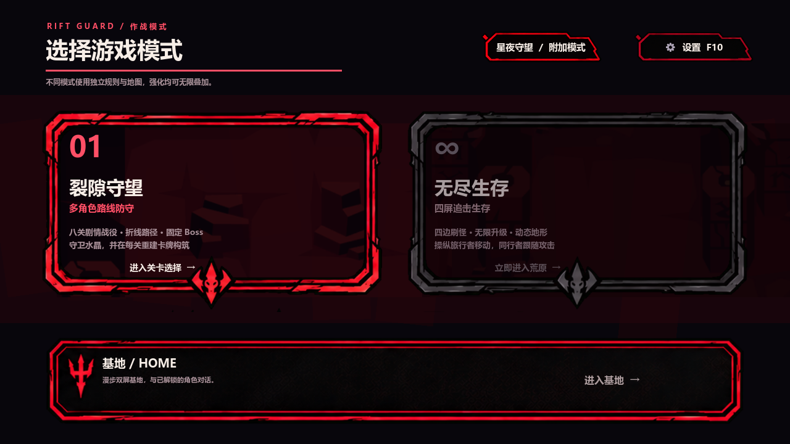
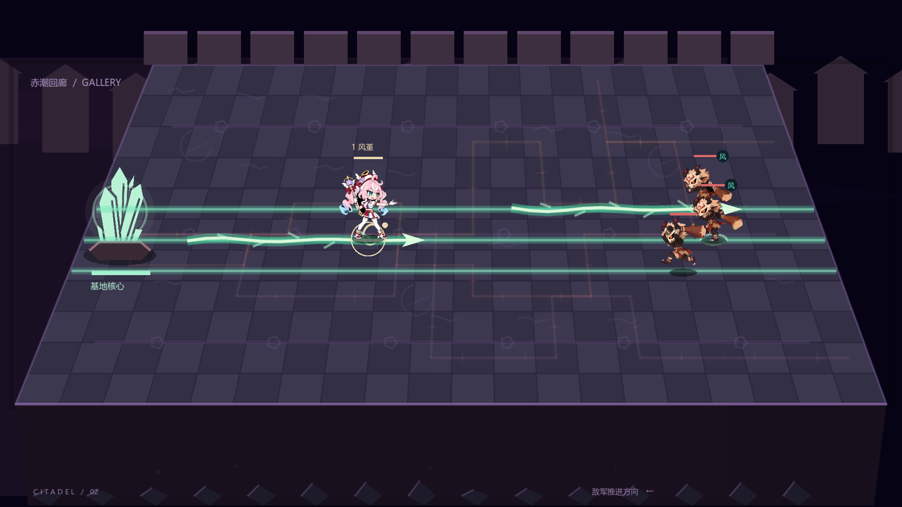
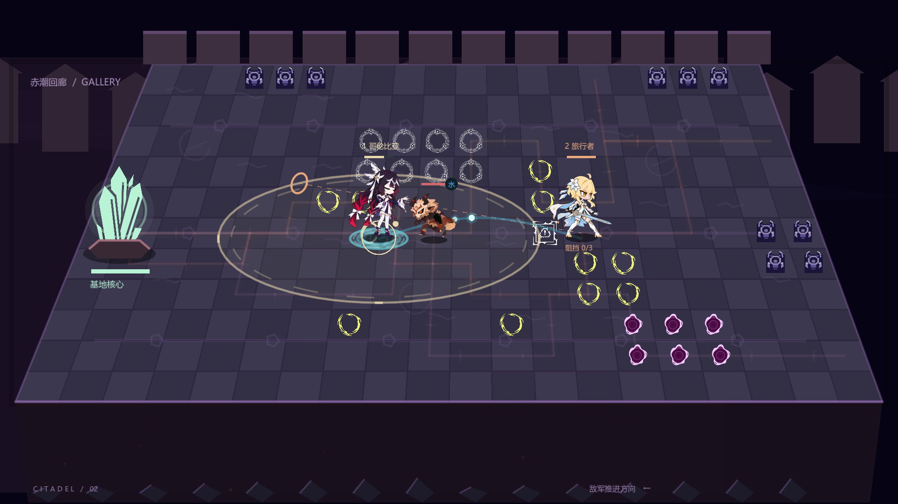
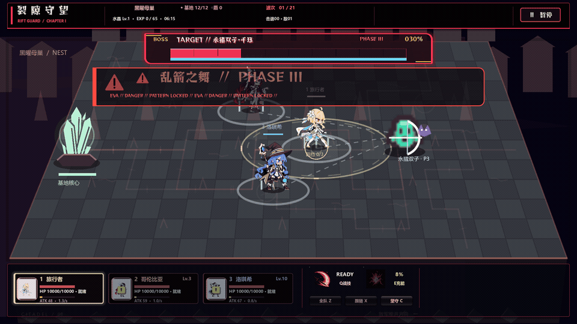
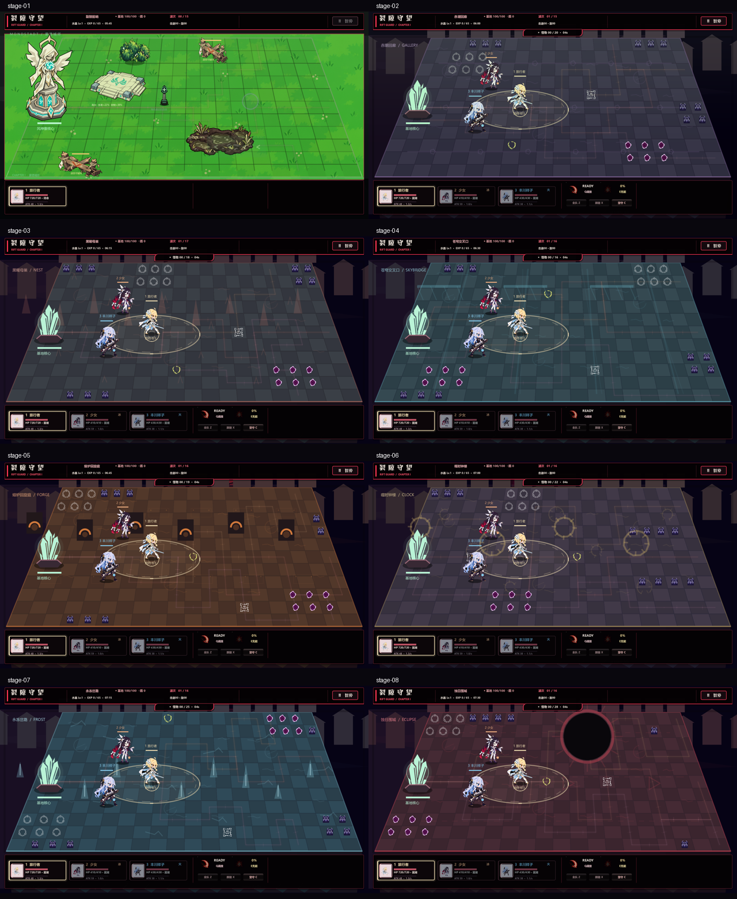
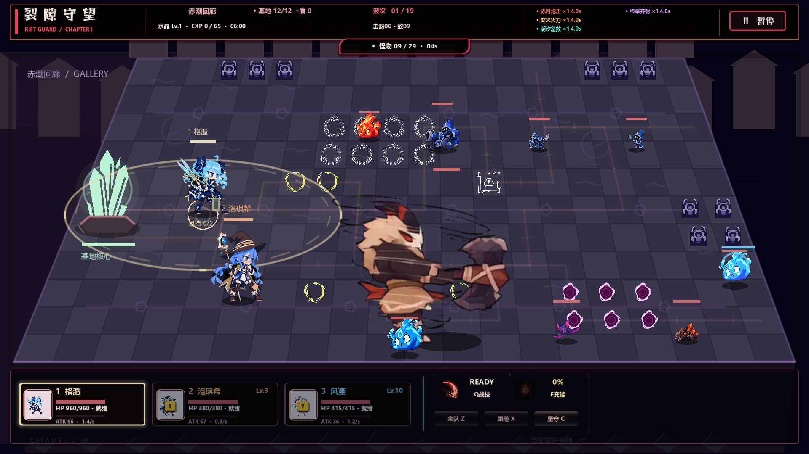

# 裂隙守望 · Rift Guard

## V100：经典玩法、漫画音画与自由工坊

[下载 V100 Windows 版](https://github.com/yzy-151/rift-guard/releases/tag/v100)。解压 `RiftGuard-V100-Windows.zip` 后运行 `RiftGuard-V100.exe`，保留同目录 PCK。源码工程为 `game/project.godot`，使用 Godot 4.6。

V100 汇总 V86 后的本轮改进：保留原角色／怪物素材、红黑叙事、二选一选项、七元素与卡牌体系；采用平面俯视战场，加入角色攻击分化、漫画特效、日语战斗语音、功能地形、家园探索与三张无尽地图。工坊支持自由布置、移动、双方攻击和技能观察；修复怪物排队倒退及结束流程，优化密集战斗。星夜守望保留为独立附加模式。

见 [V100 游玩与发布说明](V100-游玩与改动.md)、[V100 发布验证](docs/v100-validation/README.md) 和 [V95 实机预览及性能对照](docs/v95-validation/README.md)。下方 V86–V95 内容为历史改动记录。

## V95：漫画暂停、卷烟爆炸与自由工坊

运行 `releases/V95/RiftGuard-V95.exe`，保留同目录 PCK。按新参考重做暂停页与漫画爆炸，移除剧情骷髅空框，修复怪物排队倒退，开放工坊双方步行和自主战斗，并优化密集战斗与地图绘制。

见 [V95 游玩与改动](V95-游玩与改动.md) 和 [V95 验证及预览](docs/v95-validation/README.md)。旧发布包保留。
## V94：工坊工具栏与作战结束修复

运行 `releases/V94/RiftGuard-V94.exe`，保留同目录 PCK。工坊顶部改为红黑斜切工具栏；源石虫自爆半径参数 125 → 80，预警和闪光同步缩小。取消自动成就弹窗及旧胜利结算框：普通通关接下一关，最终通关和失败经过原动画后回到模式菜单；修复输入被吞和重复死亡动画。

见 [V94 游玩与改动](V94-游玩与改动.md) 和 [V94 验证记录](docs/v94-validation/README.md)。V93 等原发布包仍保留。

## V92：功能地形与动态战斗界面

运行 `releases/V92/RiftGuard-V92.exe`（保留同目录 PCK）。八个关卡和三个无尽地图新增驻守放电的电极、有限恢复泉台、敌我共用的顺风道、先预警再喷发的火道。战斗顶部重排状态与优先级通知，底部集中角色、Q/E、阵型与强化翻页，加入选中、掉血、就绪和获得强化的短促反馈。保留 V86 风格与原素材、玩法及 V91 内容；V91 包仍可单独运行。

见 [V92 游玩与改动](V92-游玩与改动.md) 与 [V92 实机动图、视频及验证](docs/v92-validation/README.md)。

## V91：角色攻击分化、战斗音画与探索

运行 `releases/V91/RiftGuard-V91.exe`（保留同目录 PCK），工程仍为 `game/project.godot`，Godot 4.6。保留 V86 红黑界面、叙事、逐个部署、元素与卡牌体系；更新十位角色的追踪/贯穿/往返/抛射攻击和线形/十字/扇形技能，修正怪物路线，压缩 HUD 并缩小单位，重做支援卡与三名 Boss 音画。新增雾灯港、月影温室、七段探索见闻与三张可选无尽地图。星夜守望保留为独立附加模式。

见 [V91 游玩与改动](V91-游玩与改动.md)、[角色技能表](docs/v91-validation/skills.md)、[实机 GIF / 视频 / 验证记录](docs/v91-validation/README.md)。十位角色都有日语战斗语音事件；部分使用对应角色原声，缺失部分使用明确标注的原创合成台词，详见 [声音覆盖与来源](game/assets/audio_v91/README.md)。

## 上一轮 V86 动效增强版（本地 V90.1）

默认入口恢复为 V86：原红黑主菜单、选角、剧情漫画、家园、逐个部署、元素觉醒和选卡构筑。普通关卡改为平面俯视；沿原战斗强化雷电、光球、出场漩涡、死亡爆炸和重击反馈，修正弹体提前扣血与冻结预警。保留源石虫、旋转丘丘人、蝙蝠等原怪物机制。源素材来自 V86 标签 `fede268`。

直接运行 `releases/V86-Enhanced/RiftGuard-V86-Enhanced.exe`，与同目录 PCK 一起保留。工程入口为 `game/project.godot`。见 [本次游玩与修改说明](V86-动效增强说明.md)。此前制作的星夜守望现在是原主菜单上的独立附加模式，可返回原主菜单；其说明见 [星夜守望](STARFALL-游玩说明.md)。

本次实际运行录像、截图与验证范围见 [V86 动效增强验证记录](docs/v86-enhanced-validation/README.md)。下文保留 V86 历史说明，其中旧截图及发布链接不代表本次本地成品。

《裂隙守望》是一款将多角色路线防守、Roguelike 构筑与分支剧情结合的 2.5D 动作防守游戏。工程以 Godot 4 制作，运行与验收规格为 1920×1080。

## 当前界面

模式选择、关卡选择、编队、角色档案、剧情和三选一增益已统一为红黑视觉体系。界面素材保持原始宽高比，按钮、卡片与内部信息遵循安全边距。

## 角色界面

当前具有正式立绘和动作素材的可用角色为：旅行者、哥伦比亚、希露菲、芙宁娜、艾米莉亚、丰川祥子、阿米娅，以及新加入的格温、洛琪希、风堇。缺少正式立绘或动作素材的角色保持未解锁，旧存档也不会绕过该限制。

## 战斗

普通模式包含路线防守、可交互地形、Boss 阶段和关卡推进；无尽模式支持四屏地图、动态刷怪、角色独立移动与屏外单位降频模拟。Q/E 技能采用固定伤害加攻击力倍率，冷却按强度区分；150 张卡牌（新增图标未交付前使用问号占位）和 26 个角色技能使用独立图标。角色普通攻击、技能和元素反应使用独立反馈。

## 地图与怪物

第一关使用蒙德草地、七天神像、高台、沼泽、自动机关和可破坏栅栏；后续关卡保持暗色格子主题。第一关 Boss 为史莱姆王，第二关为裂隙统领，第三关为永猎双子·千珏，并在残血阶段触发加里奥英雄登场。敌人包含史莱姆、丘丘人、弓箭手、萨满、哥布林、哥布林茅房、大型怪物与多阶段 Boss。

## 运行

- Godot 工程：`game/project.godot`
- 设计与验收分辨率：`1920×1080`
- UI 实验台逻辑坐标：`1280×720`，运行时等比缩放
- Windows 发布包：[下载 V78 Windows 版](https://github.com/yzy-151/rift-guard/releases/tag/v78)

使用 Godot 4.4.1 打开工程后运行主场景即可。UI 布局与素材替换方法见 [Godot UI 编辑手册](docs/UI-GODOT-EDITING-MANUAL.md)。

## 操作

- `WASD`：移动当前角色
- 鼠标右键：移动或取消技能瞄准
- `1 / 2 / 3`：切换角色
- `Q`：主动技能
- `E`：终结技
- `Space`：暂停
- 暂停菜单 `help`：调试用三选一卡牌抽取
- `F2`：图鉴
- `F4`：关卡选择
- `F10`：设置
