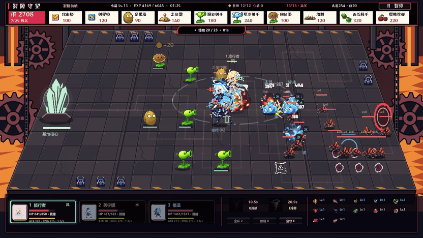
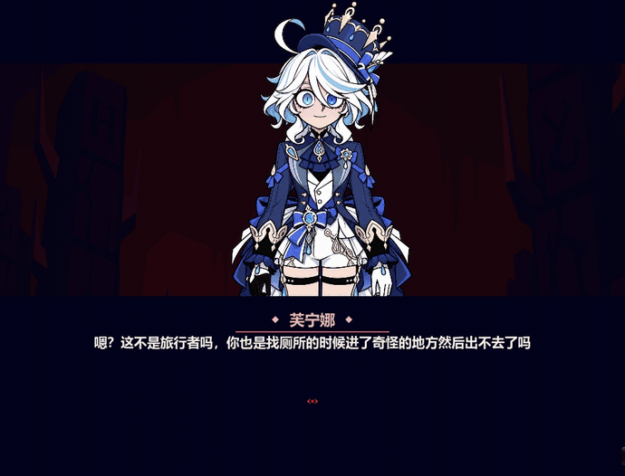
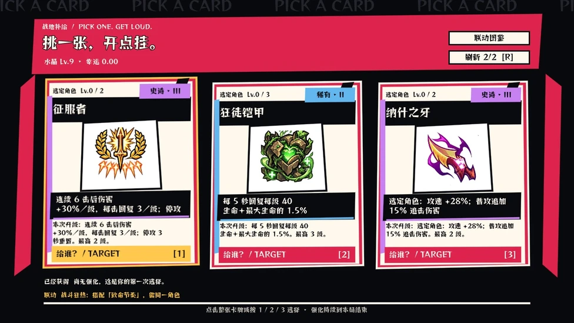
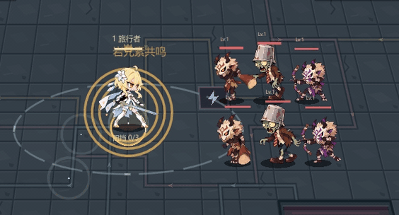
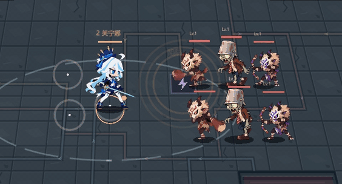
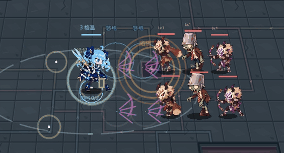
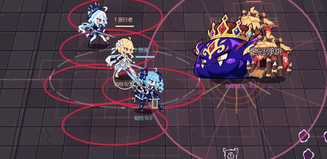
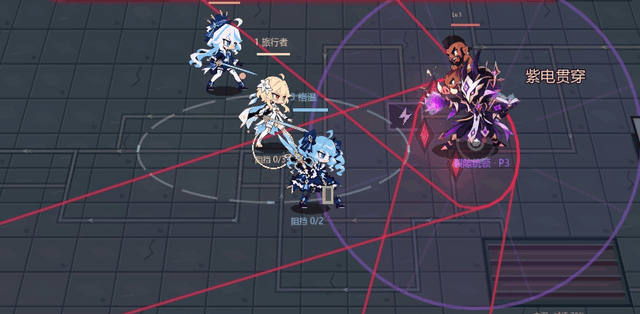
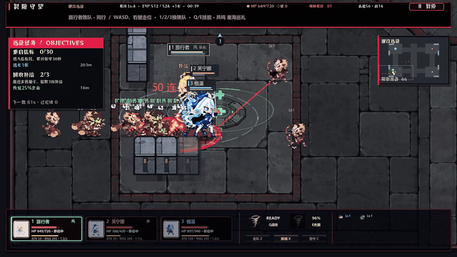
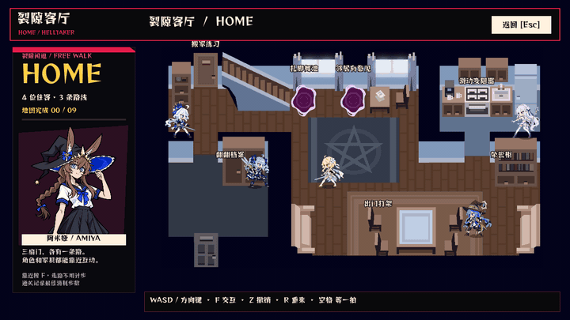

# 裂隙守望 · Rift Guard

> 怎么样旅行者，来壶开水充充饥吧
>
> ——芙宁娜，第一次见面

一款能把旅行者、坚果墙和丘丘暴徒放在同一条路上的实时小队塔防。芙宁娜拎着水壶来找你，格温已经在前线，左边还有一颗水晶要守。角色会自己攻击，你来决定谁上场、钱花在哪一格，以及 Boss 抬手时全队该往哪躲。

**三章试玩版 2026.11.21.1**　[下载 Windows 单文件版](https://github.com/yzy-151/rift-guard/releases/latest/download/RiftGuard.exe) · [下载 Android 安装包](https://github.com/yzy-151/rift-guard/releases/latest/download/RiftGuard-Android.apk) · [发行说明与校验值](https://github.com/yzy-151/rift-guard/releases/latest)

*第一关开战五分多钟后的防线。左侧是水晶，中间两排豌豆照着各自那一行打，角色可以在火力最吃紧的位置补位。*

## 第一次出发

选关后先看过场、接对话，再编队上场。新档从旅行者独自出发，芙宁娜会在第一关的出发剧情里遇见你。第一关场上还有一位临时帮手格温，这时选人页里没有她。守住前哨，完成战后的招募对话，她才成为下一关能带走的队友。

试玩依次开放 **裂隙前哨 → 赤潮回廊 → 黑曜母巢**。选关页能看到全部八关，第 4 至 8 关在此版锁定。继续下一章会重新选卡。在结算页转入无尽，可以带走这局已经成形的队伍和卡牌。

## 一条防线怎么搭起来

| 战场上发生了什么 | 你能做什么 |
| --- | --- |
| 敌人沿几条路线走向左侧水晶 | 从底栏拖角色上场，守交汇处。地面敌人可以拦，小蝙蝠会从头顶飞过，要给能对空的队友留一个位置。 |
| 击杀带来金币 | 在商店选机关，再点空格部署。普通关每格放一个机关，同时最多 25 个。向日葵每 8 秒产 20 金币，钱紧时也可以先买坚果堵路。 |
| 坚果开始开裂，敌群挤进同一行 | 豌豆沿本行向右直射，西瓜在落点造成范围伤害。土豆雷埋下 3 秒才武装，提前一格种才来得及。 |
| 水晶升级，弹出三张卡 | 看眼场上的东西再选。抽到「双发射手」，已经种下的豌豆也会双发。「铁坚果」让现有坚果和之后种下的坚果都获得 2.5 倍最大生命与 30 护甲。 |

## 前两关的三位同伴

### 旅行者 · 元素由这局的卡决定

初始拿剑上场，Q 是「无锋回旋」，E 是「星落裁决」。抽到元素卡会换整套技能。下图是岩系，Q「荒星」可以直接砸在敌人前面，留下一颗有生命值的落岩拦住地面部队，场上最多同时有三颗。E「群山回响」向外打出四道震波，并给全队加共享护盾。

同一个路口也能换一种打法。雷系 Q「雷索逐星」最多串起九个不同目标，敌人走到一起时出手最划算。水系 Q「涌泉恩典」能边打边给范围里的队友回血，适合让守路口的人多扛一波。

### 芙宁娜 · 把交火处变成舞台

Q「孤心沙龙」在指定位置展开 12 秒，三位沙龙成员各有自己的射速和水弹溅射范围。把舞台摆在两路汇合处，敌人经过时就会被轮番点名。芙宁娜自己的普攻还能对空，第一关遇到小蝙蝠时尤其有用。

E「万众狂欢」开幕时造成水伤，接下来的 12 秒舞台会跟着芙宁娜移动。圈内队友伤害提高 **35%**，每 2 秒回血一次。前排为了躲 Boss 换位置，记得让她也跟上。

### 格温 · 五秒免伤，十五根针

Q「丝缕缠流」保护施放时在她攻击范围内的队友，获得 **5 秒免伤**。先把格温站到能罩住两人的位置，再等 Boss 技能读条。E「引针簇射」朝选定方向连发三轮，每轮五根，针能贯穿并让敌人减速 2 秒。站在队伍侧面，沿着长长一列怪物瞄准，一次能照顾好几个。

## 第一关 · 裂隙前哨 / 史莱姆王

丘丘弓箭手、源石虫、小蝙蝠轮番赶来，丘丘暴徒会顶在队伍前面。把全部火力堆在一行，很容易忙着磨暴徒的血，眼看着另一行的小怪摸到水晶。留一名能换线的角色，给芙宁娜留出打空中的机会。

**5 分 45 秒，史莱姆王登场。** 王冠底下除了血条还有护盾。生命降到一半时，它会回盾、叫出援兵，技能也出得更快。下面先是「王冠弹跳」，接着是「五色黏爆」。看地面就能分清哪一招打完还不能站回去。

| 看到的招式 | 怎么应对 |
| --- | --- |
| 王冠弹跳 | 脚下依次出现落点，命中会把人推开。半血后从三处变成五处，移动前先瞄一眼相邻的圈。 |
| 五色黏爆 | 五枚黏弹在半血后增到十枚，落地留下黏池。绕到干净的一侧继续打，给近战留条回来时的路。 |
| 吞噬回流 | 它把近处的角色拉回身边，每多命中一人就多回一份盾。看见招名，优先把贴身的人拉走。 |
| 分裂王庭 | 残像分别冲向预告点。第二阶段还有一下以本体为中心的爆炸，躲过残像后稍等再贴脸。 |

## 第二关 · 赤潮回廊 / 裂隙统领

开场的炮车从上下两路进场，后面跟着铁桶僵尸、丘丘萨满和小蝙蝠。让坚果拖住一边，先带人打掉另一边的炮车。等两路压到中间，再让格温顺着队列放针。

**5 分 05 秒，裂隙统领登场。** 它在 **70% 和 35% 生命**时转阶段。最后一段最容易吃亏的习惯是沿着激光往后跑。图里先放第三阶段的三向贯穿，再放逐人点名的天降裂光，躲法各不相同。

| 看到的招式 | 怎么应对 |
| --- | --- |
| 紫电贯穿 | 预警线锁定方向后横向跨出去。最后阶段一束变三束，散开时也要看旁边那一束。 |
| 追魂法球 | 法球分批追人，末段会从十枚增到十八枚。队友彼此拉开，让追自己的球远离其他人。 |
| 天降裂光 | 起手时记下每个在场角色的位置。看见脚下标记再移动，三个人各自让开自己的落点。 |
| 裂隙爆环 | 以统领为中心整片判定，末段范围还会变大。离得远就及时撤出，近身队友来不及跑可以用格温的免伤接。 |

## 守完以后

**无尽生存。** 小队走出固定防线，在移动的安全区内边走边打。任务按生存时间成批刷新。「回收补给」要走到三只金色补给箱旁拾取，报酬是恢复生命。「击败首领」则能拿两次选卡并回血。补给、下一处安全区和正在逼近的敌群，往往分在三个方向。

**家园。** 进门就换了一套节奏。阿米娅守着左边的栏位，从大厅穿门可以挑战九张限步数的格子谜题。下面是「搬家练习」，绕到箱子背后才能把它推到想要的方向。图鉴里还能查看角色、卡牌和敌人档案。

## 下载与操作

Windows x64 下载 `RiftGuard.exe`，双击直接玩。Android 下载 `RiftGuard-Android.apk`，安装后横屏游玩，支持 arm64-v8a 和 x86_64。[Windows 下载](https://github.com/yzy-151/rift-guard/releases/latest/download/RiftGuard.exe) · [Android 下载](https://github.com/yzy-151/rift-guard/releases/latest/download/RiftGuard-Android.apk)

| 操作 | Windows | Android |
| --- | --- | --- |
| 上场 | 把底部角色卡拖到战场 | 按住角色卡拖到战场 |
| 移动 | 选中角色，右键点地或用 WASD | 点「移动」或「全队移动」，再点地面 |
| 技能 | Q / E，指向性技能再选位置或方向 | 点技能按钮，按提示点目标 |
| 机关 | 顶部商店选种类，再点空格 | 点种类，再点空格 |
| 暂停 / 全屏 | 空格或 Esc 暂停，F11 切换全屏 | 暂停按钮或系统返回键，横屏全屏 |
| 家园 | WASD 或方向键行走，F 交互 | 屏幕方向键和交互按钮 |

游戏使用 Godot 4.4.1 和 Compatibility 渲染器。源码入口是 [game/project.godot](game/project.godot)，导出环境和安卓验证范围见[试玩版发行说明](docs/release-20261121.md)。文中画面均录自 Windows 试玩版。角色和 Boss 段落用固定遭遇单独演示技能。
