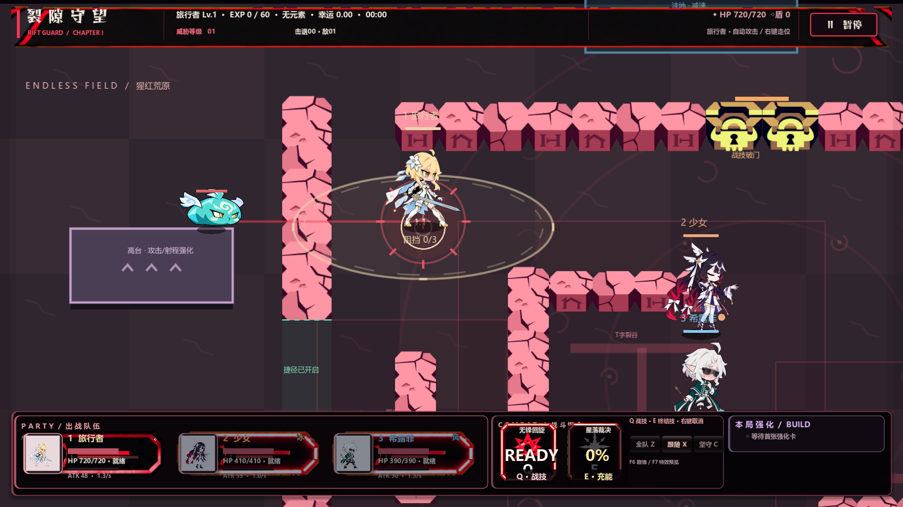
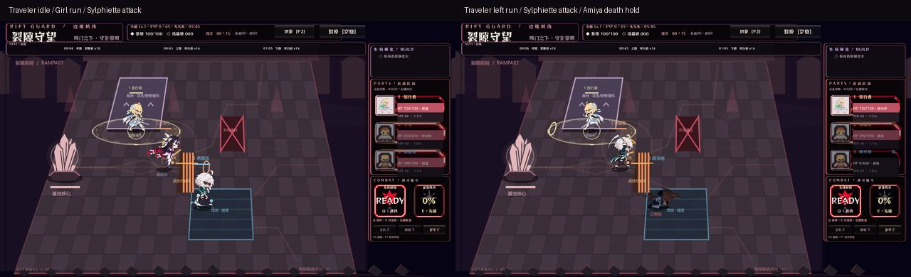
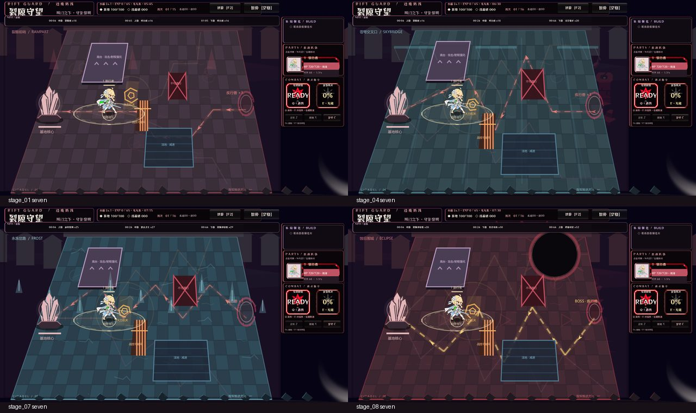

# 裂隙守望 · Rift Guard

《裂隙守望》是一款多角色路线防守、Roguelike 构筑与分支剧情结合的 2.5D 游戏原型。

## 当前玩法

- 普通模式包含八个关卡，敌人沿多条路线进攻，关卡结束后触发剧情、角色解锁与下一关入口。
- 无尽模式使用四屏地图，敌人从边缘持续追击，角色随旅行者移动并自动攻击。
- 每次升级三选一强化，卡牌可无限叠加并形成弹道、召唤、反应、护盾与支援联动。
- 十三名角色拥有独立主动技能、终结技、能量与冷却，Q/E 支持圆形范围和落点预览。
- 敌人包含近战、远程、飞行、护盾、增益与史莱姆家族，并配置六名三阶段 Boss。
- 火、水、雷、冰、风、岩元素参与反应，旅行者可在局内选择元素并通过高阶卡牌获得双元素。

## V50 动态角色数据、底部战斗 HUD 与无尽迷宫

V50 将角色强化卡的姓名和描述绑定到角色数据库，角色替换或改名后会自动更新卡牌文本。战斗角色栏改为底部横向三卡结构，HP 与能量条压缩，Q/E 和构筑信息集中在底部，战场横向扩展到接近全屏宽度；四名已替换角色的 HUD 图标直接读取素材清单中的真实立绘。

无尽模式加入由关卡数据驱动的墙网、丁字路口、十字路口、双向回廊、高台、洼地和四座独立可破坏门。角色、地面怪物及其远程攻击均不能穿墙，飞行怪物保持越障特性；门拥有独立生命值，需要连续使用战技或终结技破坏后才能通行。

- 地形配置：`game/data/v2/stages.json` 的 `stage_endless.terrain`
- 独立墙体与门素材：`game/assets/world/endless/`
- UI 布局数据：`game/data/ui_layout_profile.tres`
- V50 发布说明：`docs/V50-RELEASE-NOTES.md`
## V49 四角色全序列动画

V49 使用用户提供的透明帧序列替换少女、希露菲、旅行者和阿米娅的待机、奔跑、攻击与死亡表现。全部源帧均进入图集，默认 24 FPS；待机、奔跑和攻击循环播放，死亡播放一次并停在最后一帧。编队角色卡同步播放真实呼吸序列，角色名单补回少女并扩展为十三人。

- 动画清单：`game/data/v2/character_sequences.json`
- 可替换图集：`game/assets/characters/sequences/`
- 重新打包脚本：`tools/build_character_sequence_atlases.py`
- V49 发布说明：`docs/V49-RELEASE-NOTES.md`

## V48 七层地图与 V46 UI 实验台

V48 将八个普通关卡拆为背景、气氛、地面、路线、地形、建筑和前景七层，并为前哨、回廊、母巢、空桥、熔炉、钟楼、冰原和蚀日围城建立独立主题；V46 的八页 Godot UI 实验台继续保留。

- [图文指导书（PDF，可下载）](output/pdf/Rift-Guard-UI-Visual-Editing-Guide.pdf)
- [图文指导书（Markdown，适合在 GitHub 阅读）](docs/UI-VISUAL-EDITING-GUIDE.md)
- [Godot UI 素材与布局操作手册](docs/UI-GODOT-EDITING-MANUAL.md)

## 运行

- Windows 发布包：`builds/rift-guard-v50/RiftGuard-V50.exe`
- Godot 工程：`game/project.godot`
- 发布规格（窗口与验收截图）：1920×1080
- UI 实验台逻辑坐标：1280×720（运行时按 1.5 倍等比缩放）

## 操作

- WASD：移动当前角色
- 鼠标右键：移动或取消技能瞄准
- 1/2/3：切换角色
- Q：主动技能
- E：终结技
- Space：暂停
- F2：图鉴
- F4：关卡选择
- F6：剧情预览
- F7：特效预览
- F10：设置

## UI 与剧情编辑

### 可以手动调整的界面

UI 实验台目前覆盖八类运行界面：

1. `Dialogue`：剧情立绘、姓名、正文、两个分支选项框和底部操作区。
2. `Mode`：普通模式、无尽模式、存档区和设置入口。
3. `Mission`：关卡标题、八张关卡卡片、缩略图、状态和无尽入口。
4. `Squad`：角色选择面板、角色卡网格、呼吸动画预览和确认按钮。
5. `Campaign Battle`：普通战斗地图可视区、波次、右侧角色栏和 Q/E 技能格。
6. `Endless Battle`：无尽战斗四屏地图视口、角色栏、强化栏和 Q/E 技能格。
7. `Reward`：三选一强化卡、卡牌标签、标题、说明和构筑历史。
8. `Settings`：音量滑杆、全屏、减弱震屏、重置和关闭按钮。

### 在 Godot 中修改布局

1. 使用 Godot 4.4.1 打开 `game/project.godot`。
2. 打开“项目 → 项目设置 → 插件”，确认 **Rift Guard UI Lab** 已启用。
3. 在右侧 **UI 实验台**点击“打开实验台场景”，然后选择要调整的页面。
4. 在 2D 视口拖动红色半透明框修改位置，拖角点修改尺寸；也可以在 Inspector 精确填写 `Position` 和 `Size`。
5. 点击“校验并写回”，再运行对应界面确认效果；点击“刷新 / 撤销未写回”可放弃尚未保存的调整。

工程内部坐标为 1280×720，发布窗口为 1920×1080。将实机截图上的位移除以 1.5 即可换算为 Profile 坐标，例如截图向右移动 30 px，Profile 的 x 增加 20。

### 替换 UI 素材

UI 坐标的唯一数据源是 `game/data/ui_layout_profile.tres`，UI 贴图绑定的唯一数据源是 `game/data/ui_skin_profile.tres`，自定义透明素材放在 `game/assets/ui/custom/`。

将透明 PNG 放入 `game/assets/ui/custom/` 后，可以直接在 `ui_skin_profile.tres` 的 Inspector 中把图片拖到对应 `Texture2D` 字段；也可以在实验台选中 `Skin_字段名`，替换 `Texture` 后点击“校验并写回”。框体素材应保留完整四角和透明边距，需要伸缩的面板优先使用适合九宫格的图片。

Godot 右侧的“UI 实验台”可编辑 Dialogue、Mode、Mission、Squad、Campaign Battle、Endless Battle、Reward、Settings 和 Stage；完整操作见 [UI 手动编辑图文指导书](docs/UI-VISUAL-EDITING-GUIDE.md) 与 [Godot UI 素材与布局操作手册](docs/UI-GODOT-EDITING-MANUAL.md)。

剧情姓名、正文、人物素材、左右/上下位置、缩放与翻转由 `content/game_config.xlsx` 管理。战场地形、地板、前景遮挡和关卡色板使用 `game/data/stage_visual_profile.tres`，攻击特效使用 `game/assets/vfx/`，技能图标使用 `game/assets/ui/icons/`。

## 素材

项目当前混合使用 Helltaker 风格界面资源、用户提供角色素材、Kenney 素材与第三方透明特效素材；各第三方资源的许可证文件保存在对应素材目录。
