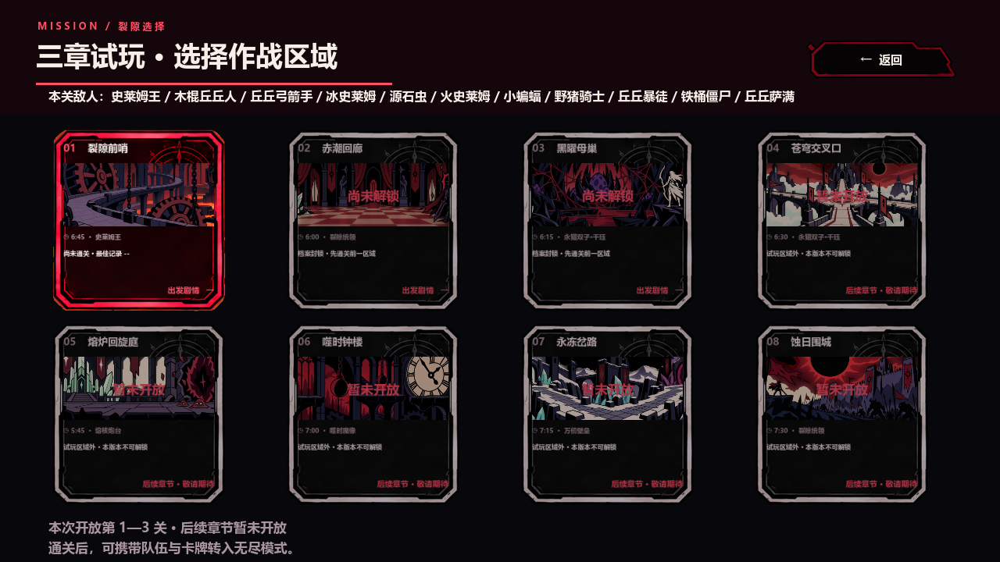

# 裂隙守望 · Rift Guard

角色构筑、路线防守、分支剧情与无尽生存。Godot 4.4.1 制作。

## 三章试玩版 · 2026.11.7.1

[下载 Windows 单文件版和 Android 安装包](https://github.com/yzy-151/rift-guard/releases/tag/demo-2026.11.7.1) · [版本内容与操作说明](docs/release-20261107.md)

全部八关保留并展示，试玩开放前三关、按顺序解锁，第4—8关固定显示暂未开放，通关或旧存档均不可解锁。初始旅行者独自出发，剧情中结识芙宁娜、格温；第三关有完整收尾，通关可以继续无尽模式。

拖动角色上场，搭配卡牌与植物机关，守住水晶并击败首领。保留家园、图鉴、分支剧情与示范工坊。

## 一键游玩

- Windows：下载 RiftGuard.exe，双击运行；F11切换全屏。
- Android：下载 RiftGuard-Android.apk 并安装，横屏触控；支持arm64-v8a和x86_64。
- 完整快捷键、触控说明与测试范围见[发行说明](docs/release-20261107.md)。

## 开发

用Godot 4.4.1打开 game/project.godot。界面以1280×720逻辑尺寸等比缩放，使用Compatibility渲染器。

[Godot UI编辑手册](docs/UI-GODOT-EDITING-MANUAL.md) · [历史V88版本](https://github.com/yzy-151/rift-guard/releases/tag/v88)
