# 裂隙守望 · Rift Guard

《裂隙守望》是一款多角色路线防守、Roguelike 构筑与分支剧情结合的 2.5D 游戏原型。

## 当前玩法

- 普通模式包含八个关卡，敌人沿多条路线进攻，关卡结束后触发剧情、角色解锁与下一关入口。
- 无尽模式使用四屏地图，敌人从边缘持续追击，角色随旅行者移动并自动攻击。
- 每次升级三选一强化，卡牌可无限叠加并形成弹道、召唤、反应、护盾与支援联动。
- 十三名角色拥有独立主动技能、终结技、能量与冷却，Q/E 支持圆形范围和落点预览。
- 敌人包含近战、远程、飞行、护盾、增益与史莱姆家族，并配置六名三阶段 Boss。
- 火、水、雷、冰、风、岩元素参与反应，旅行者可在局内选择元素并通过高阶卡牌获得双元素。

## V61 Helltaker素材化菜单与角色档案

V61将模式、选关、编队和角色档案按指定素材重新绑定：模式卡、关卡卡、检查点、无尽入口和底部按钮均使用对应Helltaker素材及明确的灰/红焦点状态；角色预览保持原始比例，档案页展示十三名角色各自的Q/E效果与数值。

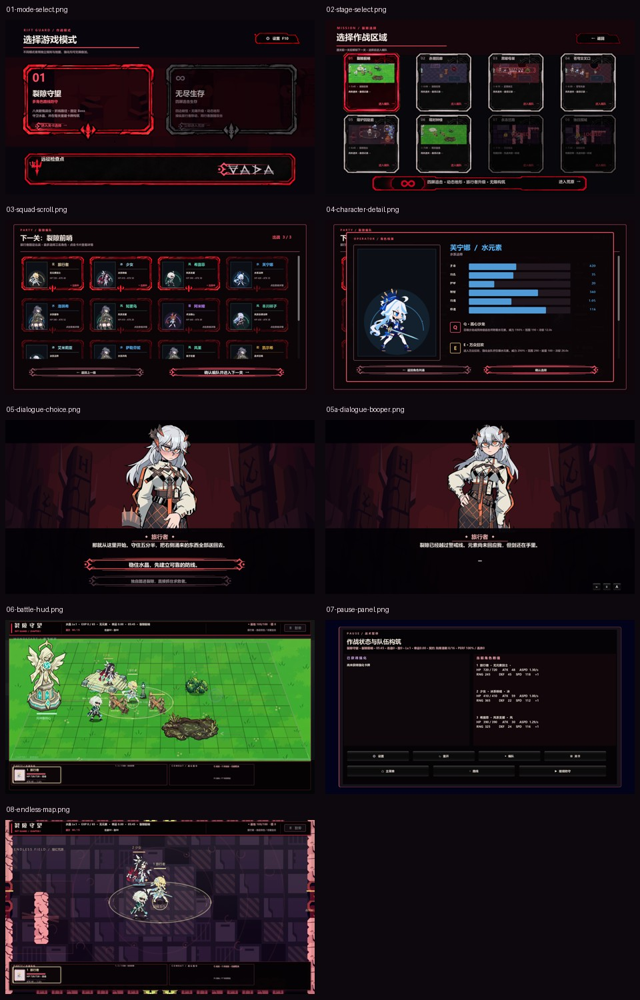

- V61发布说明：[V61-RELEASE-NOTES.md](docs/V61-RELEASE-NOTES.md)
- Windows发布包：`builds/rift-guard-v61/RiftGuard-V61.exe`

## V60 全页面UI与角色详情

V60统一重做模式、选关、编队、角色详情、剧情、暂停和战斗底栏。所有主要容器改用等比例或代码绘制的红黑面板，选关缩略图使用真实战斗截图，选角支持滚轮与breath动画详情，剧情改为点击画面推进并加入booper动态提示。

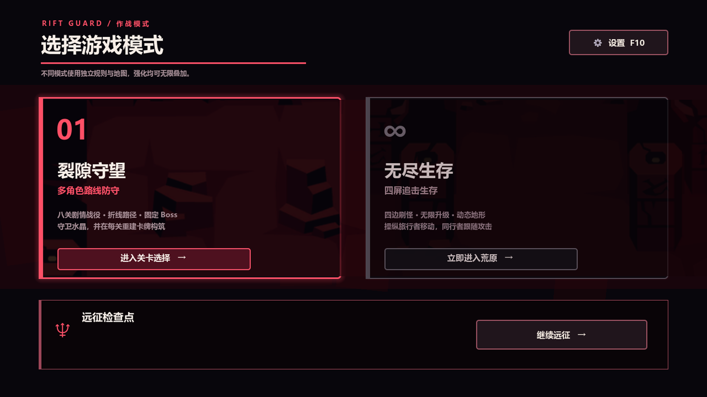

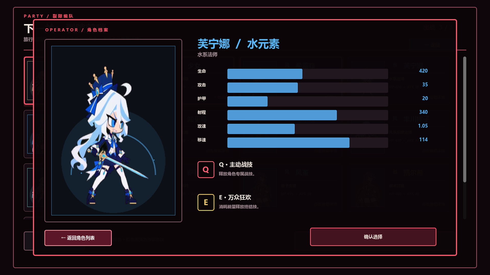

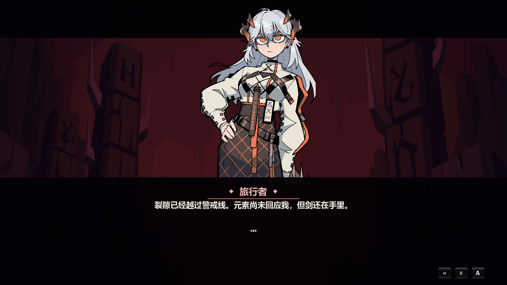

- V60发布说明：[V60-RELEASE-NOTES.md](docs/V60-RELEASE-NOTES.md)
- Windows发布包：`builds/rift-guard-v60/RiftGuard-V60.exe`
## V59 战斗UI与剧情死亡反馈

V59 重构了1920×1080战斗界面：顶部压缩为连续状态带，怪物数量改为中央小型徽标，底部改为单层指令台；角色卡、Q/E技能框、选队确认按钮、剧情选项框和Boss警告装饰均保持素材原始比例，不再通过任意宽高拉伸填充。

无尽模式使用8种Helltaker地板模块和Boss契约地板进行确定性拼接，继续沿用石墙与可破坏大门。剧情系统支持在选项中配置`death_reason`：错误选择播放`dialogueDeathExport0001-0009`死亡序列、显示死亡原因，然后返回原来的两个选项。

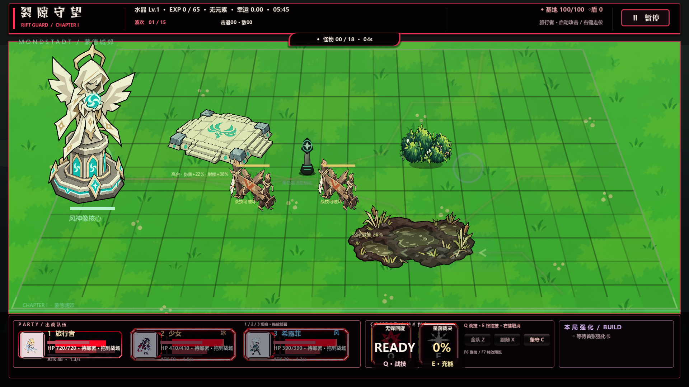

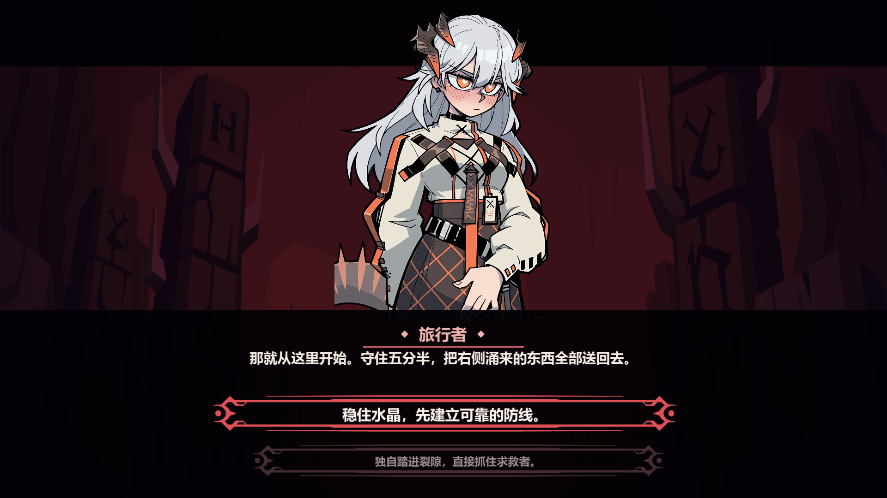

- V59发布说明：[V59-RELEASE-NOTES.md](docs/V59-RELEASE-NOTES.md)
- V59 UI尺寸规范：[V59-UI-SPEC.md](docs/V59-UI-SPEC.md)
- Windows发布包：`builds/rift-guard-v59/RiftGuard-V59.exe`
## V58 无尽模式休眠优化与角色战斗差异

V58 将屏外普通敌人从逐帧/半帧更新改为 5Hz 粗粒度推进：敌人仍会接近战场，但屏外不再持续执行完整寻路、特殊 AI 和表现事件；弹道目标改为常数时间索引，屏外命中事件在分配特效前直接丢弃。120 个以屏外为主的敌人专项基准降至约 7.28–9.90ms/帧。

无尽模式现在只有全队全部阵亡才会结束。三名角色均可独立选择并移动；手动移动非旅行者后会保持其独立目标，只有玩家选中并移动旅行者时，其他角色才恢复延迟跟随。

十三名角色加入差异化普通攻击模板，包括剑气斩、冰晶穿透、风种连锁、水泡溅射、重型潮汐弹、音符回响、术式贯穿、冻结花、量子门、Mon3tr 重击与以太连锁。攻击和命中音量提高，弹道、枪口与命中特效按角色攻击类型分层表现，并继续遵守高密度特效预算。

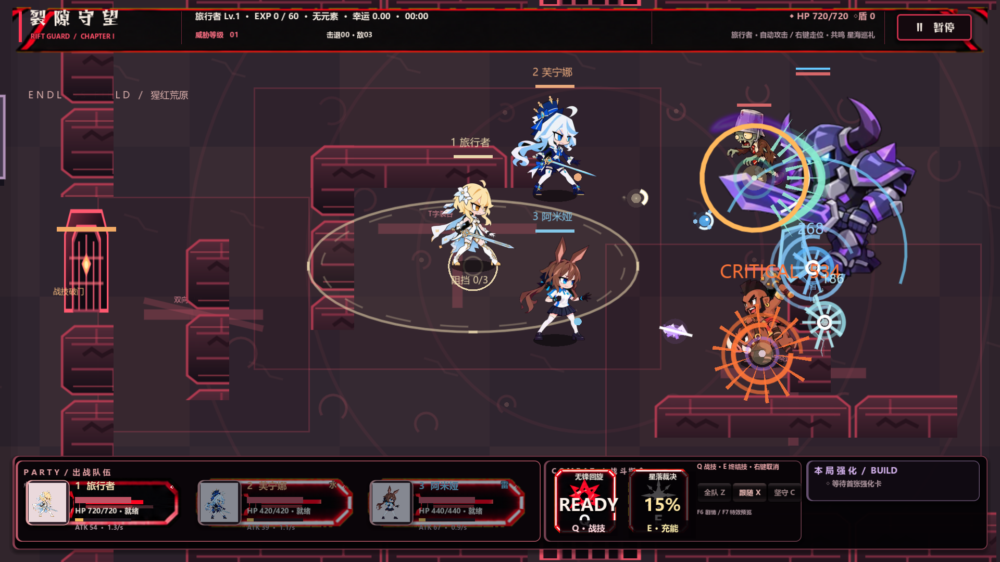

- V58 发布说明：[V58-RELEASE-NOTES.md](docs/V58-RELEASE-NOTES.md)
- Windows 发布包：`builds/rift-guard-v58/RiftGuard-V58.exe`
## V57 第一关地图定稿与无尽模式性能升级

V57 完成第一关蒙德战场的视觉与交互校准：草地和代码网格只覆盖战斗区域，区域外恢复简洁暗色背景；七天神像、高台、自动机关和木栅栏取消不自然的椭圆阴影，七天神像下移并保持血条位置不变；浮空平台移除，两座木栅栏统一为可破坏阻挡物，灌木碰撞改为贴合有效图形的不规则近似区域。

敌人界面移除“空”“远”和无意义的翅膀、横线等装饰，只保留护盾与增益等有战斗意义的标识。无尽模式加入动态人口预算、低阶怪收缩、高阶怪权重增长、分阶段生命与伤害倍率、屏外单位降频模拟、寻路缓存、支援光环降频扫描和屏外特效裁剪；后期通过提高怪物质量形成压力，不再只依靠无限增加低级怪物数量。

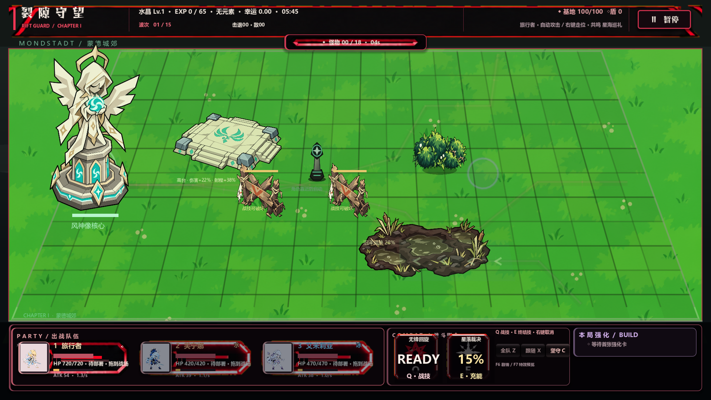

- V57 发布说明：[V57-RELEASE-NOTES.md](docs/V57-RELEASE-NOTES.md)
- V57 历史发布包已由 V58 替换。
## V56 第一关蒙德战场与地形机制修整

V56 将蒙德素材严格限制在 `stage_01`；`stage_02`、`stage_03` 及后续关卡恢复 V53 的暗色格子渲染和原始地形表现。第一关草地改为不透明地面，网格由代码绘制，蒙德背景只保留为远景层，并通过独立 CanvasItem Shader 统一饱和度、对比度和远景雾化。

七天神像在 V55 基础上放大 1.6 倍并保持脚底锚点；高台、移动平台、灌木、木障碍、自动机关和角色阴影全部重新贴地。两座木障碍均会阻挡角色和地面怪物，可被战技破坏；沼泽减速 28%，高台提供伤害与射程加成，移动平台会承载角色并提供射程强化，自动机关在角色靠近后每 5.5 秒进行一次超远程攻击。

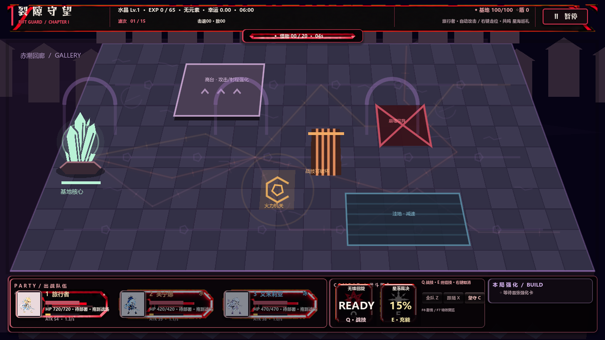

- V56 发布说明：[V56-RELEASE-NOTES.md](docs/V56-RELEASE-NOTES.md)
- V56 历史发布包已由 V57 替换。
## V55 战斗顶部 HUD 与第一章地图重构

V55 撤回上一版的全屏地图铺法：蒙德背景和无网格草地只绘制在 `battle_playfield_rect` 战场框内，角色、脚底阴影、地形与碰撞恢复共用原有 2.5D 投影。网格改为代码生成，强度独立于草地素材；风神像核心缩小，高台、洼地、灌木和木障碍重新回到战场层级。

顶部 HUD 重做为一条完整红黑信息带，品牌、等级、经验、元素、幸运、时间、基地、护盾、波次、击退数和状态分区对齐；暂停按钮改为同套红黑样式，怪物数量继续使用中央小徽章，避免遮挡战斗画面。

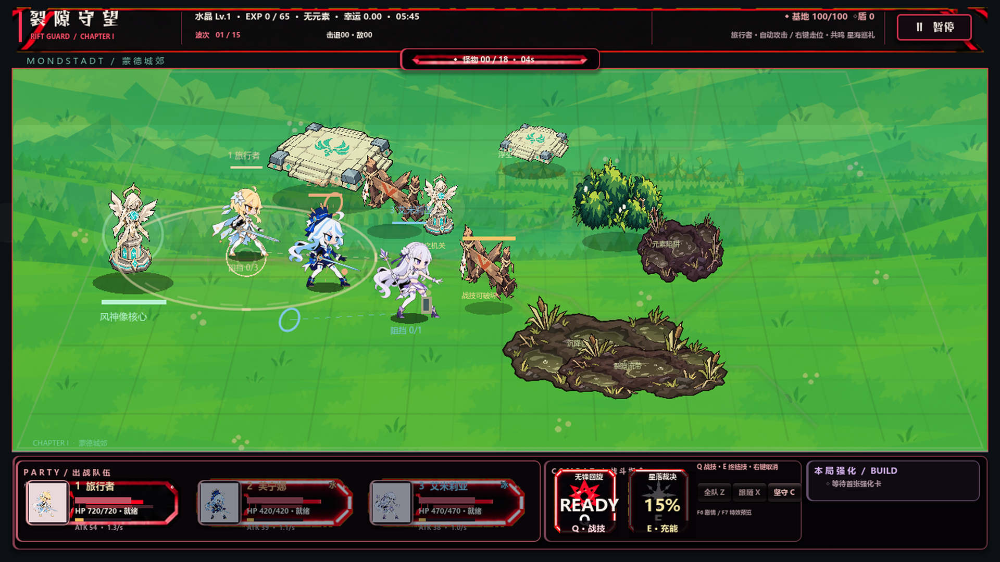

- V55 发布说明：[V55-RELEASE-NOTES.md](docs/V55-RELEASE-NOTES.md)
- V55 历史发布包已由 V56 替换。
## V54 第一章蒙德地图首轮替换

V54 将第一章 stage_01 至 stage_03 替换为蒙德城郊视觉：远景使用 1920×1080 蒙德背景，32×18 草地网格按素材拼接基准投射为 2.5D 战场，高台、洼地、灌木、木障碍和风神像核心均接入现有碰撞与地形逻辑。第二章与无尽模式保持原样。

战斗顶部同时改用独立 Logo 与九宫格状态条，等级、经验、元素、幸运、时间、基地生命和护盾改为单行显示，怪物数量收进小型居中徽章。

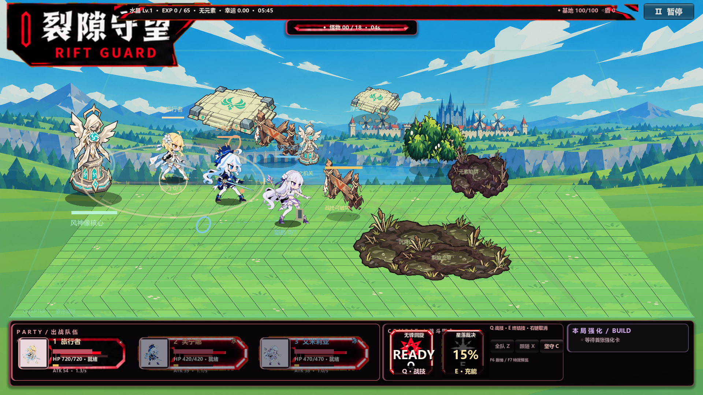

- V54 发布说明：[V54-RELEASE-NOTES.md](docs/V54-RELEASE-NOTES.md)
- V54 历史发布包已由 V55 替换。
## V53 战斗 HUD、Boss 演出与敌人逻辑升级

V53 将顶部三段敌情条收成中央小型敌情牌，队伍生命/能量条完整收进角色卡；Boss 使用更厚的风格化血条、红色场景染色与入场预警演出。近战敌人不再显示攻击范围，丘丘弓箭手射程降低且箭矢飞抵真实落点；高密度特效按空间合并但保留全部伤害，刷怪编队和墙门寻路也已重构。

剧情正文取消打字机，改为整段文字轻微放大后回落；小字与数值改用规整半粗字体，Helltaker 风格装饰字体仅用于大标题、关卡与 Boss。

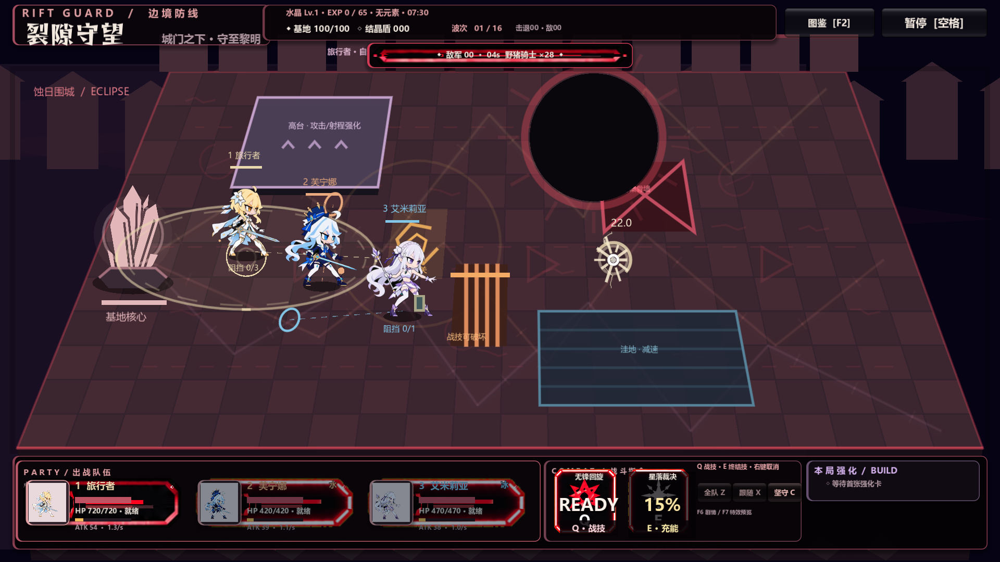

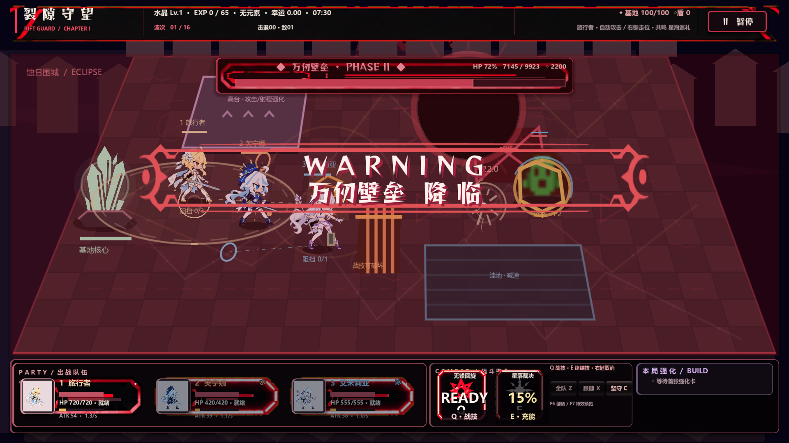

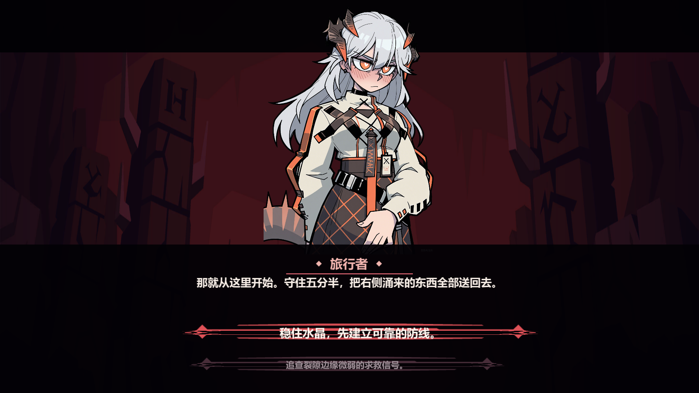

- V53 发布说明：[V53-RELEASE-NOTES.md](docs/V53-RELEASE-NOTES.md)
- Windows 发布包：`builds/rift-guard-v53/RiftGuard-V53.exe`

## V52 战斗表现、性能与音频修整

V52 移除芙宁娜全部旧运行时素材，只保留 `hero_03` 新帧序列；旅行者与芙宁娜放大至 106%，希露菲恢复原尺寸，皮卡超人提升为 3.75 倍大型单位。键盘移动不再生成点击标记，队友改为沿旅行者历史轨迹延迟跟随，底部角色生命条与能量条进一步压窄。

无尽模式限制低级怪物和哥布林茅房数量，强化高压阶段的敌人质量、寻路绕墙与特效预算。哥布林茅房单次只生成一个哥布林且不会贴边出现。攻击、命中、关卡进入、对话和菜单交互均接入对应音效。Boss 血条改为顶部居中的紧凑布局，宽 560、高 46，实际生命填充条高 9 像素，并可在 `ui_layout_profile.tres` 中继续手动调整。

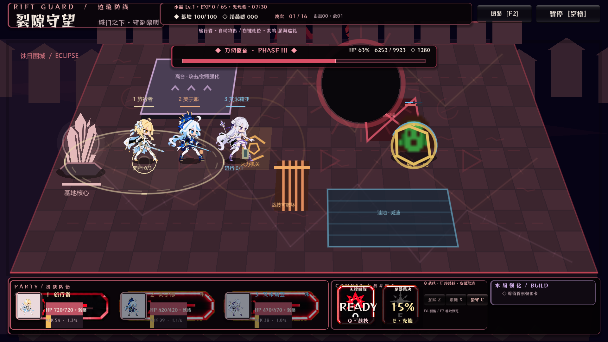

- V52 发布说明：[V52-RELEASE-NOTES.md](docs/V52-RELEASE-NOTES.md)
- V52 历史发布包已由 V54 替换。

## V51 三角色与八类怪物全序列动画

V51 将芙宁娜、丰川祥子和艾米莉亚的待机、奔跑、攻击、死亡素材完整接入 24 FPS 动画系统，并将希露菲缩小至原尺寸的 95%。木棍丘丘人、哥布林、铁桶僵尸、丘丘弓箭手、丘丘萨满、野猪骑士、皮卡超人和哥布林茅房也已使用新序列帧；弓箭手和萨满拥有独立远程弹道，皮卡超人为 2.5 倍大型慢速重甲单位，哥布林茅房会定时生产哥布林。

火、雷、风、水、冰史莱姆与史莱姆王已使用正式中文名称。全角色初始攻击范围及纵向覆盖得到提升，普通模式地图投影向左右扩展，绘制范围、命中判定和鼠标反投影保持一致。

- 角色和怪物素材位置：[V51 素材位置与替换表](docs/V51-ASSET-MAP.md)
- V51 发布说明：[V51-RELEASE-NOTES.md](docs/V51-RELEASE-NOTES.md)
- Windows 发布包：`builds/rift-guard-v51/RiftGuard-V51.exe`
## V50 动态角色数据、底部战斗 HUD 与无尽迷宫

V50 将角色强化卡的姓名和描述绑定到角色数据库，角色替换或改名后会自动更新卡牌文本。战斗角色栏改为底部横向三卡结构，HP 与能量条压缩，Q/E 和构筑信息集中在底部，战场横向扩展到接近全屏宽度；四名已替换角色的 HUD 图标直接读取素材清单中的真实立绘。

无尽模式加入由关卡数据驱动的墙网、丁字路口、十字路口、双向回廊、高台、洼地和四座独立可破坏门。角色、地面怪物及其远程攻击均不能穿墙，飞行怪物保持越障特性；门拥有独立生命值，需要连续使用战技或终结技破坏后才能通行。

- 地形配置：`game/data/v2/stages.json` 的 `stage_endless.terrain`
- 独立墙体与门素材：`game/assets/world/endless/`
- UI 布局数据：`game/data/ui_layout_profile.tres`
- V50 发布说明：`docs/V50-RELEASE-NOTES.md`
## V49 四角色全序列动画

V49 使用用户提供的透明帧序列替换少女、希露菲、旅行者和阿米娅的待机、奔跑、攻击与死亡表现。全部源帧均进入图集，默认 24 FPS；待机、奔跑和攻击循环播放，死亡播放一次并停在最后一帧。编队角色卡同步播放真实呼吸序列，角色名单补回少女并扩展为十三人。

- 动画清单：`game/data/v2/character_sequences.json`
- 可替换图集：`game/assets/characters/sequences/`
- 重新打包脚本：`tools/build_character_sequence_atlases.py`
- V49 发布说明：`docs/V49-RELEASE-NOTES.md`

## V48 七层地图与 V46 UI 实验台

V48 将八个普通关卡拆为背景、气氛、地面、路线、地形、建筑和前景七层，并为前哨、回廊、母巢、空桥、熔炉、钟楼、冰原和蚀日围城建立独立主题；V46 的八页 Godot UI 实验台继续保留。

- [图文指导书（PDF，可下载）](output/pdf/Rift-Guard-UI-Visual-Editing-Guide.pdf)
- [图文指导书（Markdown，适合在 GitHub 阅读）](docs/UI-VISUAL-EDITING-GUIDE.md)
- [Godot UI 素材与布局操作手册](docs/UI-GODOT-EDITING-MANUAL.md)

## 运行

- Windows 发布包：`builds/rift-guard-v53/RiftGuard-V53.exe`
- Godot 工程：`game/project.godot`
- 发布规格（窗口与验收截图）：1920×1080
- UI 实验台逻辑坐标：1280×720（运行时按 1.5 倍等比缩放）

## 操作

- WASD：移动当前角色
- 鼠标右键：移动或取消技能瞄准
- 1/2/3：切换角色
- Q：主动技能
- E：终结技
- Space：暂停
- F2：图鉴
- F4：关卡选择
- F6：剧情预览
- F7：特效预览
- F10：设置

## UI 与剧情编辑

### 可以手动调整的界面

UI 实验台目前覆盖八类运行界面：

1. `Dialogue`：剧情立绘、姓名、正文、两个分支选项框和底部操作区。
2. `Mode`：普通模式、无尽模式、存档区和设置入口。
3. `Mission`：关卡标题、八张关卡卡片、缩略图、状态和无尽入口。
4. `Squad`：角色选择面板、角色卡网格、呼吸动画预览和确认按钮。
5. `Campaign Battle`：普通战斗地图可视区、波次、右侧角色栏和 Q/E 技能格。
6. `Endless Battle`：无尽战斗四屏地图视口、角色栏、强化栏和 Q/E 技能格。
7. `Reward`：三选一强化卡、卡牌标签、标题、说明和构筑历史。
8. `Settings`：音量滑杆、全屏、减弱震屏、重置和关闭按钮。

### 在 Godot 中修改布局

1. 使用 Godot 4.4.1 打开 `game/project.godot`。
2. 打开“项目 → 项目设置 → 插件”，确认 **Rift Guard UI Lab** 已启用。
3. 在右侧 **UI 实验台**点击“打开实验台场景”，然后选择要调整的页面。
4. 在 2D 视口拖动红色半透明框修改位置，拖角点修改尺寸；也可以在 Inspector 精确填写 `Position` 和 `Size`。
5. 点击“校验并写回”，再运行对应界面确认效果；点击“刷新 / 撤销未写回”可放弃尚未保存的调整。

工程内部坐标为 1280×720，发布窗口为 1920×1080。将实机截图上的位移除以 1.5 即可换算为 Profile 坐标，例如截图向右移动 30 px，Profile 的 x 增加 20。

### 替换 UI 素材

UI 坐标的唯一数据源是 `game/data/ui_layout_profile.tres`，UI 贴图绑定的唯一数据源是 `game/data/ui_skin_profile.tres`，自定义透明素材放在 `game/assets/ui/custom/`。

将透明 PNG 放入 `game/assets/ui/custom/` 后，可以直接在 `ui_skin_profile.tres` 的 Inspector 中把图片拖到对应 `Texture2D` 字段；也可以在实验台选中 `Skin_字段名`，替换 `Texture` 后点击“校验并写回”。框体素材应保留完整四角和透明边距，需要伸缩的面板优先使用适合九宫格的图片。

Godot 右侧的“UI 实验台”可编辑 Dialogue、Mode、Mission、Squad、Campaign Battle、Endless Battle、Reward、Settings 和 Stage；完整操作见 [UI 手动编辑图文指导书](docs/UI-VISUAL-EDITING-GUIDE.md) 与 [Godot UI 素材与布局操作手册](docs/UI-GODOT-EDITING-MANUAL.md)。

剧情姓名、正文、人物素材、左右/上下位置、缩放与翻转由 `content/game_config.xlsx` 管理。战场地形、地板、前景遮挡和关卡色板使用 `game/data/stage_visual_profile.tres`，攻击特效使用 `game/assets/vfx/`，技能图标使用 `game/assets/ui/icons/`。

## 素材

项目当前混合使用 Helltaker 风格界面资源、用户提供角色素材、Kenney 素材与第三方透明特效素材；各第三方资源的许可证文件保存在对应素材目录。

