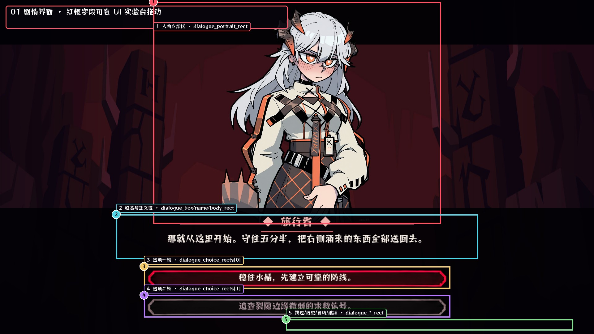
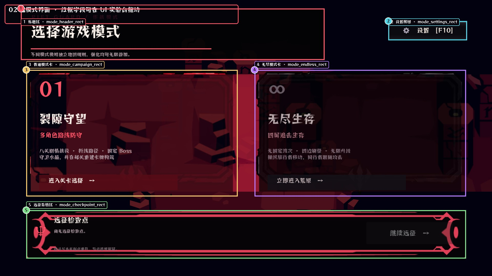
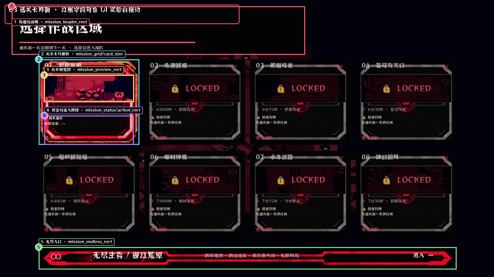
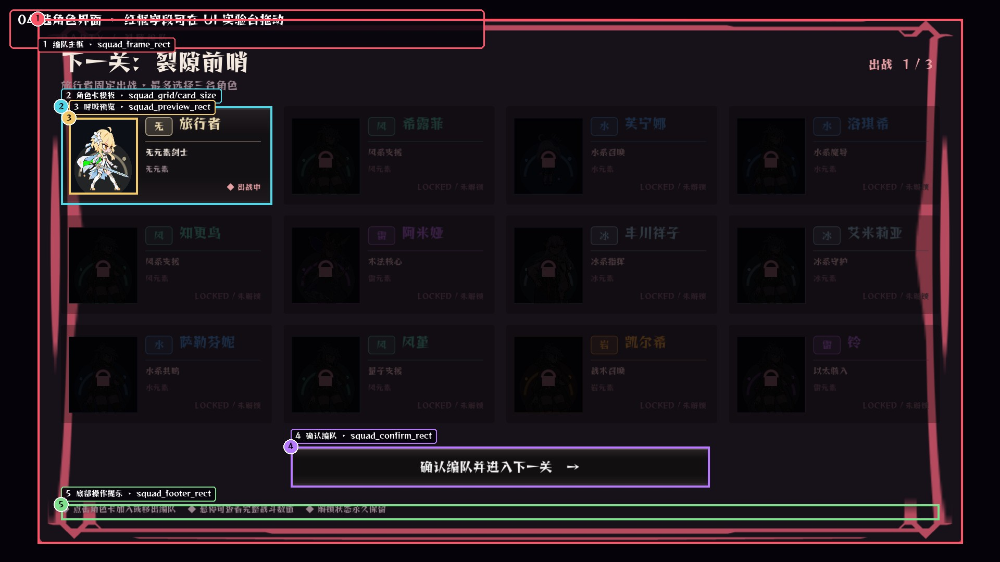
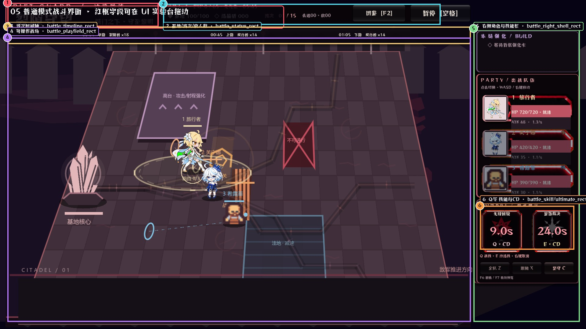
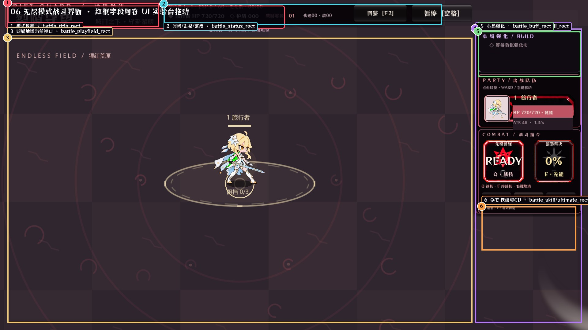
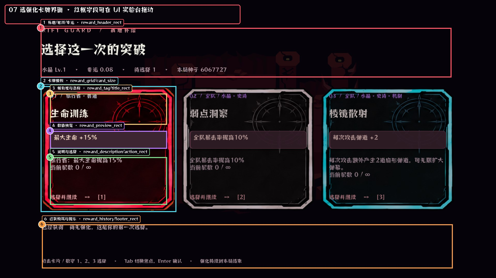
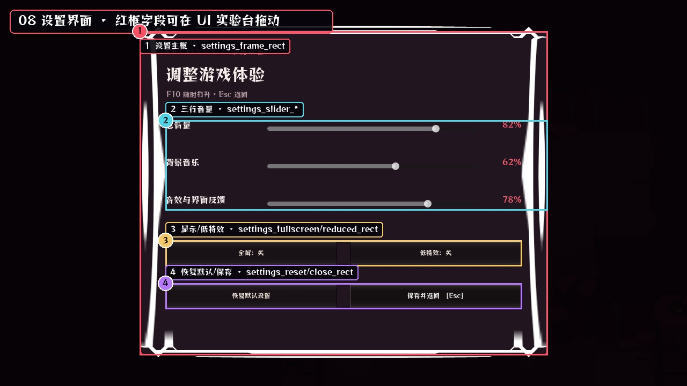

# Rift Guard Godot UI 手动编辑图文指导书

master 当前可以在 Godot 的 **UI 实验台**中参与调整八类界面：剧情、选模式、选关、选角色、普通战斗、无尽战斗、选强化卡牌、设置。普通战斗和无尽战斗使用不同参考截图，但共享 `battle_*` 几何字段，保证两种模式的 HUD 一致。

## 先认识三个文件

- `game/data/ui_layout_profile.tres`：唯一布局数据源，保存位置、尺寸、网格起点与间距。
- `game/data/ui_skin_profile.tres`：唯一 UI 贴图绑定源，保存背景、框体、按钮三态与技能框。
- `content/game_config.xlsx`：剧情姓名、正文、人物图名、上下左右位置、缩放、翻转等内容数据。

## master 每次修改的标准流程

1. master 用 Godot 4.4.1 导入并打开 `game/project.godot`。
2. master 打开 **项目 → 项目设置 → 插件**，确认 **Rift Guard UI Lab** 已启用。
3. master 在右侧 **UI 实验台**点击“打开实验台场景”，再从下拉框选择页面。
4. master 在 2D 视口点击红色半透明框，拖动改变位置，拖角点改变大小；右侧 Inspector 可精确输入 `Position` 和 `Size`。
5. master 点击“校验并写回”，再按 F6、F7、F4、F10 或运行主场景检查实机效果。
6. master 若要放弃未保存调整，点击“刷新 / 撤销未写回”。

> 工程内部坐标是 1280×720，发布窗口是 1920×1080。外部截图坐标除以 1.5 才是 Profile 坐标，例如截图向右移动 30 px，Profile 的 x 增加 20。

## 怎么替换素材

1. master 把透明 PNG 放入 `game/assets/ui/custom/`，不要直接覆盖系统素材。
2. master 打开 `ui_skin_profile.tres`，把 PNG 从 FileSystem 拖到 Inspector 对应 Texture2D 字段。
3. master 也可以在实验台向下滚动到 720 线以下，选中 `Skin_字段名`，把 PNG 拖到 `Texture`，再点击“校验并写回”。
4. master 应保留框体四角和透明边距；会拉伸的底板优先使用九宫格友好的素材。

## 1. 剧情界面（实验台页面：Dialogue）

| 字段 | 控制内容 | 素材或数据来源 |
|---|---|---|
| `dialogue_portrait_rect / partner_rect` | 人物立绘的位置与尺寸 | 立绘图片由 Excel 的 image 字段选择；位置、缩放、翻转也可由 Excel 行覆盖 |
| `dialogue_box_rect / name_rect / body_rect` | 对话底板、姓名、正文 | dialogue_box 绑定对话框 PNG；文字内容在 content/game_config.xlsx |
| `dialogue_choice_rects[0..1]` | 两个分支选项框 | choice_frame_gray/red 控制普通和焦点状态 |
| `dialogue_skip/history/auto/advance_rect` | 底部操作入口 | 使用 common_button_* 三态素材 |

master 修改这页时先选 `Dialogue`，按图中编号找到红框，再在 Inspector 输入精确值。

## 2. 选模式界面（实验台页面：Mode）

| 字段 | 控制内容 | 素材或数据来源 |
|---|---|---|
| `mode_header_rect` | 标题和说明区 | 文字在 mode_select_panel.gd；位置在 Profile |
| `mode_campaign_rect / mode_endless_rect` | 普通与无尽模式大卡 | mode_card_gray/red |
| `mode_checkpoint_rect` | 远征存档和继续按钮 | common_panel 与 common_button_* |
| `mode_settings_rect` | 设置入口 | common_button_* |

master 修改这页时先选 `Mode`，按图中编号找到红框，再在 Inspector 输入精确值。

## 3. 选关卡界面（实验台页面：Mission）

| 字段 | 控制内容 | 素材或数据来源 |
|---|---|---|
| `mission_header_rect` | 标题与说明 | 位置、尺寸可拖 |
| `mission_grid_origin / card_size / gap` | 八张关卡卡的起点、尺寸、间距 | mission_card_gray/red/locked |
| `mission_preview_rect` | 每张卡里的缩略图 | 关卡图在 assets/ui/rift_v2/stage_thumbnails |
| `mission_status_rect / action_rect` | 状态和进入按钮 | 卡内局部坐标 |
| `mission_endless_rect` | 底部无尽入口 | mission_endless |

master 修改这页时先选 `Mission`，按图中编号找到红框，再在 Inspector 输入精确值。

## 4. 选角色界面（实验台页面：Squad）

| 字段 | 控制内容 | 素材或数据来源 |
|---|---|---|
| `squad_frame_rect` | 整块编队面板 | common_panel；背景是 squad_background |
| `squad_grid_origin / card_size / gap` | 角色卡网格 | 起点、卡宽高和横纵间距 |
| `squad_preview_rect` | 卡内呼吸循环预览 | 角色素材由角色数据库 asset_key 决定 |
| `squad_confirm_rect / footer_rect` | 确认按钮与操作提示 | common_button_* |

master 修改这页时先选 `Squad`，按图中编号找到红框，再在 Inspector 输入精确值。

## 5. 普通模式战斗界面（实验台页面：Campaign Battle）

| 字段 | 控制内容 | 素材或数据来源 |
|---|---|---|
| `battle_title/status/timeline_rect` | 标题、状态、波次条 | 战斗顶部占用已经压缩 |
| `battle_playfield_rect` | 实际战场可视区 | 地图由 stage_visual_profile.tres 控制 |
| `battle_right_shell/party/hero_card_rect` | 右侧角色栏 | hero_frame_gray/red |
| `battle_skill/ultimate_rect` | Q/E 格、能量和 CD | skill_* 与 ultimate_* 两套状态图 |

master 修改这页时先选 `Campaign Battle`，按图中编号找到红框，再在 Inspector 输入精确值。

## 6. 无尽模式战斗界面（实验台页面：Endless Battle）

| 字段 | 控制内容 | 素材或数据来源 |
|---|---|---|
| `battle_title/status_rect` | 模式名、时间、击杀和密度 | 和普通模式共用 battle_* 几何 |
| `battle_playfield_rect` | 四屏地图的当前视口 | 世界地图层由 stage_visual_profile.tres 控制 |
| `battle_right_shell/party_rect` | 跟随角色栏 | 角色无需部署，仍可调右栏 |
| `battle_buff/skill/ultimate_rect` | 强化与 Q/E | 强化卡与技能 CD 实时刷新 |

master 修改这页时先选 `Endless Battle`，按图中编号找到红框，再在 Inspector 输入精确值。

## 7. 选强化卡牌界面（实验台页面：Reward）

| 字段 | 控制内容 | 素材或数据来源 |
|---|---|---|
| `reward_header_rect` | 标题、等级、幸运 | 位置和尺寸可调 |
| `reward_grid_origin / card_size / gap` | 三张卡的排列 | 三态贴图 reward_card_gray/red/cyan |
| `reward_tag/title/preview/description/action_rect` | 卡内文字区域 | 这些都是相对每张卡的局部坐标 |
| `reward_history/footer_rect` | 本局构筑和操作提示 | 位置和尺寸可调 |

master 修改这页时先选 `Reward`，按图中编号找到红框，再在 Inspector 输入精确值。

## 8. 设置界面（实验台页面：Settings）

| 字段 | 控制内容 | 素材或数据来源 |
|---|---|---|
| `settings_frame_rect` | 设置主面板 | settings_background + common_panel |
| `settings_slider_origin / gap` | 三条音量滑杆起点和行距 | 拖位置；Inspector 精调 gap |
| `settings_slider_track/value_rect` | 轨道和值的局部位置 | 相对设置主框坐标 |
| `settings_fullscreen/reduced/reset/close_rect` | 四个操作按钮 | common_button_* |

master 修改这页时先选 `Settings`，按图中编号找到红框，再在 Inspector 输入精确值。

## 地图与特效不是 UI Profile

master 修改战场地形、地板、前景遮挡和关卡色板时，打开 `game/data/stage_visual_profile.tres`。master 替换攻击特效时使用 `game/assets/vfx/`，角色技能图标使用 `game/assets/ui/icons/`，这些内容与 UI 布局分开维护。

## 与 CC 一起修改时的规则

- master 拖动 UI 前先点击“刷新”，避免拿旧数据覆盖 CC 的新字段。
- master 调完后点击“校验并写回”，然后 Ctrl+S。
- 实验台打开时会生成 `game/editor/ui_lab/.master_editing.lock`；CC 会先检查这个锁。
- 若出现“Profile 已被外部修改”，master 先刷新，再重新做本次拖动。
- `editor/` 只服务 Godot 编辑器，发布版不会依赖它；CC 后续重写运行时代码仍从两个 Profile 读取。

## 常见问题

- 红框看不到：master 确认打开的是 `editor/ui_lab/ui_lab_workspace.tscn`，并点一次“刷新”。
- 图片被压扁：master 使用与原素材接近的宽高比，或同时修改对应 Rect2。
- 运行后没变化：master 确认点了“校验并写回”，并彻底停止上一次运行后再启动。
- 角色图不对：master 修改角色数据库或 Excel 的图片名，不要把角色立绘绑定到 Skin Profile。
- Q/E 不显示 CD：master 先确认技能已释放；CD 秒数由运行时写入技能格，格子位置由 `battle_skill_rect` 与 `battle_ultimate_rect` 控制。
