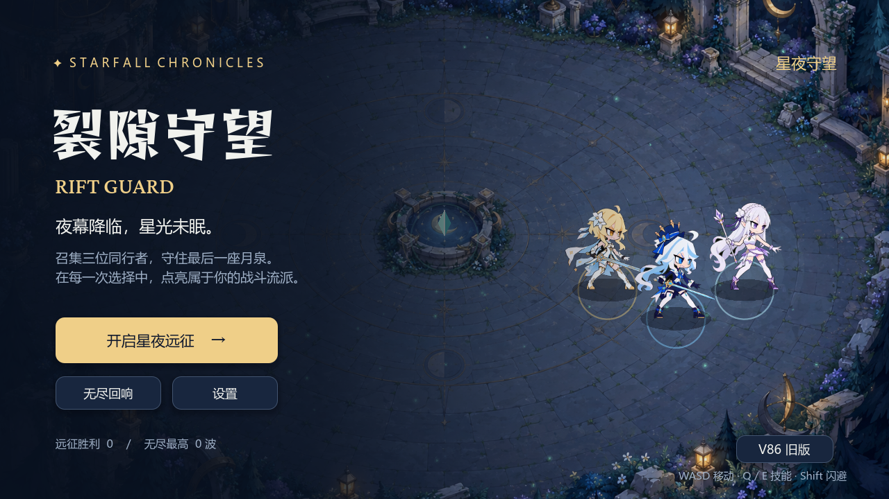
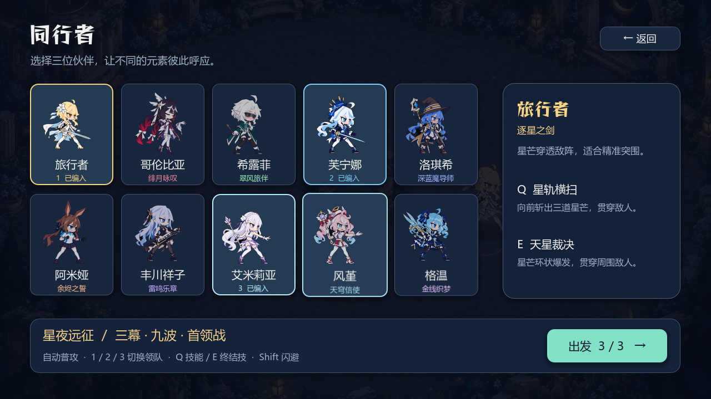
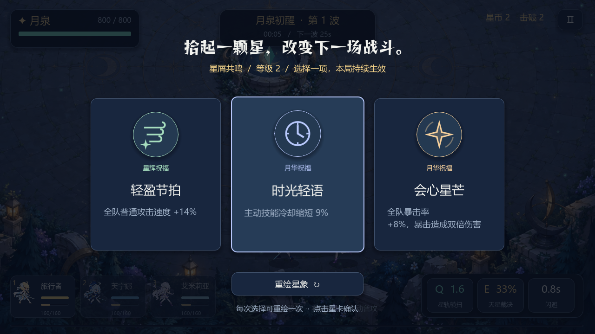
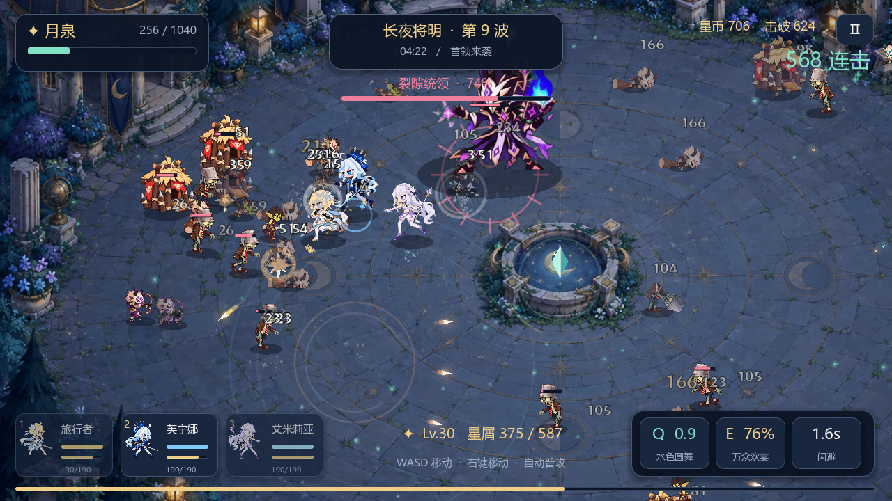
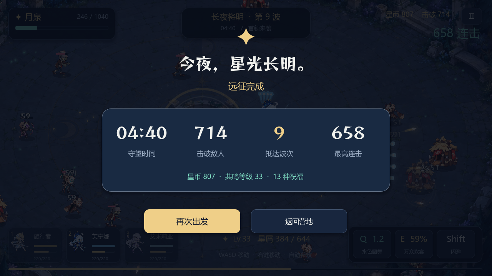

# 星夜守望交付与验证记录

此页保留此前独立星夜守望版本的验证记录。当前项目已恢复原 V86 主菜单，星夜守望从附加模式入口进入；最新成品和验证以 [V86 动效增强记录](../v86-enhanced-validation/README.md) 为准。

验证日期：2026-10-03。基线为上游 V86 标签，提交 `fede2683391953d082300ef577f2967bb82fd6a9`，本地分支 `astra/starfall-rebuild`。未推送远端。

## 交付内容

Windows 成品位于 `releases/Starfall/`，双击 `RiftGuard-Starfall.exe`，保留同目录的 `.pck`。正式工程入口为 `game/project.godot`，使用 Godot 4.6。新增代码和美术位于 `game/starfall/`。

新版是以 V86 原人物和怪物素材构建的独立战斗场景：十位角色中选择三人，切换领队、普通攻击、主动技、终结技、闪避、经验拾取和三选一构筑。提供三幕九波远征与持续升级的无尽模式。敌人包含冲锋、扇形射击、治疗、正面护甲、召唤和三阶段首领。远程弹体与冲锋均按实际路径判定命中。

新地图为生成的月夜庭院；原人物、怪物、美术、音频和字体文件保持原样。最终 `git diff --exit-code -- game/assets` 返回 0。原 V86 入口保留，旧场景在 Godot 4.6 下的启动检查返回 0；本次没有重测旧版所有剧情与关卡。

## 自动验证结果

| 检查 | 实际结果与范围 |
| --- | --- |
| 战斗模拟 | 201 条断言通过：真实弹道、锁定方向、冲锋接触、十位角色技能、冻结预警、阵型、升级、首领与胜负边界 |
| 正常数值远征 | 种子 11、22、33 均通过；模拟时间 270.2 / 280.7 / 270.2 秒，月泉剩余 745.6 / 246.6 / 556.5 |
| 无尽压力测试 | 600 秒、20 波、2723 击败；峰值 43 敌人、67 弹体、53 拾取物；未超实体池上限 |
| 原生 UI | 头像约束、月泉条、生命条、能量条、经验条布局检查通过 |
| 简化特效 | 实际切换原生设置按钮后粒子减少，敌方蓄力预警仍保留 |
| 控制流程 | HUD 焦点下空格暂停、暂停时间、设置返回、镜头移动后的鼠标瞄准、点击技能、升级选择和回营地通过 |
| 预警生命周期 | 远程兵和首领在冻结期间维持预警；击退后射击方向保持锁定；攻击完成或施法者死亡后预警消失 |
| 发布版界面 | 源工程目录之外启动 EXE；主菜单、编队、战斗、升级、首领、暂停、设置和失败结算八页截图成功，退出码 0 |
| 发布版完整远征 | 源工程目录之外运行最终 EXE，正常数值自动操作完成九波并胜利：280.7 秒、714 击败；运行日志无错误 |

正常数值远征由自动操作脚本通过移动、切换、施法、闪避和升级选择完成，没有提高角色或月泉初始生命。无尽压力测试**提高了生命值以持续施压**，用于验证实体数量与持续推进，不代表普通玩家可以无伤达到 20 波。

完整画面检查每个渲染帧执行三次 60Hz 模拟步以缩短验证时间。最终发布版记录平均帧时 18.46 ms、P95 23.80 ms，峰值 44 敌人、47 弹体、480 粒子。测试硬件为 RTX 3050 Laptop GPU，1280×720，OpenGL Compatibility。该结果是本机自动检查的观测值，不是跨设备帧率保证。

## 实际画面

以下均为 Godot 实际运行截图。











## 复现

五个无界面测试命令见仓库根目录的 `STARFALL-游玩说明.md`。发布版完整画面检查：

```powershell
& .\releases\Starfall\RiftGuard-Starfall.exe --log-file C:\Users\yzy\Desktop\codex\rift-guard\qa-campaign.log -- --starfall-qa=campaign --capture-dir=C:\Users\yzy\Desktop\codex\rift-guard\qa-campaign
```

界面检查使用 `--starfall-qa=gallery`，短时战斗检查使用 `--starfall-qa=smoke`。QA 运行不写入战绩。

Godot 编辑器使用官方 4.6 稳定版，位于 `C:\Users\yzy\Desktop\codex\tools\godot-4.6\`，采用 self-contained 模式，将编辑器缓存留在该目录。导出使用官方 Windows x86_64 release 模板；来源为 [Godot 4.6 官方归档](https://godotengine.org/download/archive/4.6-stable/)。

最终发布文件 SHA-256：

```text
RiftGuard-Starfall.exe  F9CB815A32A1AE3A73AD8699ED2B068CB76FE01636D7E8538243056FAC05F37B
RiftGuard-Starfall.pck  2A775D89E2ACF393BCB9FFB580C1EF079B09687FE7348599857863D1006D8A03
```

## 当前边界

新版以一个完整庭院战场承载远征与无尽，没有迁移旧版所有剧情、地图和养成系统。战绩与设置单独保存，暂不支持中途续关。新 UI 的布局仍由脚本生成，旧 UI 工作台没有重做。验证包含自动操作与实际画面检查，尚未经过长期真人平衡测试。
