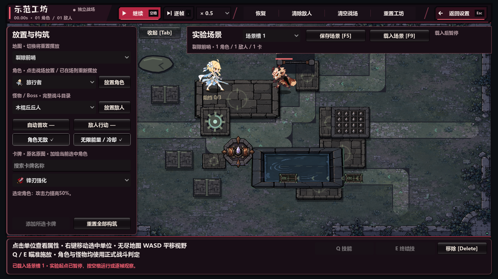
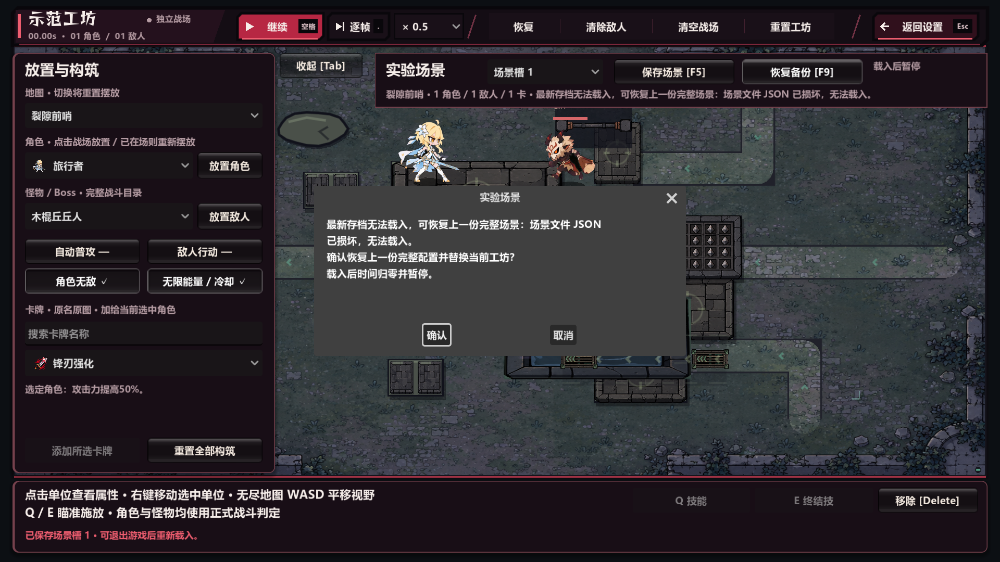

# V101 验收记录

2026-11-03 续做验收，Windows / Godot 4.6 stable / Compatibility / RTX 5060 Ti。

V101 从已发布 V100 提交 `18082a8151a66fa0df21f3dd1d8e51dcb04b5ccc` 继续；原工作区的 V88 分支与未提交改动保留，开发在独立 `v101-workshop-scenarios` 分支完成。

## 自动验收

| 范围 | 独立进程 | 断言 | 失败 |
| --- | ---: | ---: | ---: |
| 源码专项与回归 | 14 | 992 | 0 |
| 正式 Windows EXE/PCK | 10 | 660 | 0 |

详细退出码、耗时、汇总及哈希见 [发布报告](release-report.json)、[源码结果](evidence/source-results.json)、[发布包结果](evidence/release-results.json)。源码与发布包分别用两个不同 PID 共享同一隔离场景目录验证保存→进程退出→载入；玩家进度目录未用于测试。

- 场景逻辑 180 项：三个槽、schema/字段/类型/数量/文件体积校验、非法地图/英雄/敌人/卡牌/坐标拒绝、真实文件锁导致新代提交失败、原槽仍可读取、未完成临时文件忽略、保留两代、明确备份恢复、无有效代拒绝。
- 构筑重放覆盖创建与部署名册、晚加入角色、隐藏非直接卡目标、共享遗物、元素卡、休眠环绕物、重新部署与守卫构筑。
- V101 原生 UI 在 1280×720 / 1920×1080 各 46 项：鼠标入口、保存/载入与确认取消、F5/F9、地图/倍率/开关同步、特效清除、备份提示与显式恢复、损坏拒绝、返回设置。
- 回归覆盖 V93 工坊 82、V94 工具栏 54、UI Lab 16、模拟 78、暂停 72、剧情 42、爆炸 129、结束流程 111、经典内容与声音资源 96；实际发布包重复后六组与 V101 专项。
- 各最终进程退出码为 0，最终验收日志未检出 SCRIPT ERROR / ERROR / FAIL。

## 视觉与普通启动

人工查看两分辨率原生 GPU 截图：场景条位于工具抽屉右侧，无按钮重叠，文字与备份原因可读；地图保留可交互区域，载入状态与顶部暂停、倍率、单位数一致。

另以普通入口从发布目录启动 `RiftGuard-V101.exe`（仅带 QA 存储隔离参数，无测试流程参数），使用 Windows 原生输入检查主菜单 → F10 设置 → 鼠标工坊入口 → F5 保存 → F9 → 鼠标确认载入；观察时间归零、暂停与成功提示后 Alt+F4 关闭，进程已退出，日志无错误。日志见 [普通启动](evidence/normal-startup.log)。

本轮实际放置旅行者后保存和载入，原生操作截图见 [恢复后的普通工坊](evidence/normal-native-restored.png)。最终 ZIP 再解压到全新目录，逐个核对 EXE/PCK 与报告 SHA256；从解压目录自身 PCK 普通启动，原生 OpenGL 渲染后正常退出（代码 0），日志无错误，见 [ZIP 启动记录](evidence/zip-smoke.json) 和 [日志](evidence/zip-normal-startup.log)。

## 独立审查

需求审查首先复现两个缺陷：Windows 旧目标替换会先删文件；先放齐角色再重放共享卡会给晚加入角色追加加成。修复后，审查者用真实文件锁验证旧代保留，并验证共享遗物的晚加入角色攻击 59.0 → 59.0。

2026-11-03 独立需求审查逐项检查实际实现，未发现功能缺项；独立代码质量审查发现发布证据遗漏 Excel 配置，已将 `game/data/game_config.xlsx` 与编辑器优先读取的 `content/game_config.xlsx` 按原始字节绑定到指纹，复审关闭该问题。

发布工具另有 4 组 Python 回归：源码变动与换行一致性、排除生成缓存、EXE/PCK 替换、两份 Excel 的原始字节变化；结果见 `evidence/tool-tests.log`，未计入游戏断言总数。

冻结后的代码质量审查无未解决 P1/P2。首轮回归发现旧 V93 工坊和 V95 simulation 虽断言通过，但菜单 BGM 的 OGG 播放资源在退出时偶发泄漏（专项基线 12 次中 4 次）；停止音频并清空 stream 后，以单调时钟保证至少 120ms 的清理等待，避免长同步帧直接耗尽新建 Timer。修复后两个受影响专项各重复三次，均通过且无泄漏，见 `evidence/audio-exit-fix.json`；首轮失败日志亦保留，后续全量结果只使用最终代码。

## 构建与边界

`tools/build_v101.ps1` 使用官方 Godot 4.6 Windows x64 release template，资源导出为同名 PCK；`tools/package_v101.py` 生成 ZIP 并校验全部 ZIP 条目 CRC，包内包含 SHA256SUMS、声音/场景来源与验收证据。

本轮包保存于 `releases/V101-20261103/`，旧 `releases/V101/` 保留。`build-identity.json`、每个测试进程的 identity 与打包报告共同绑定游戏源码/配置和二进制 SHA256，打包前检查一致；源码指纹不覆盖图像/音频源文件，已导出的完整资源由 PCK 哈希覆盖。逻辑报告直接取自本轮 source/scenarios，禁止复用旧 logic 目录报告。

最终 ZIP：343,472,843 字节；SHA256 `0205373a82c5028b230f4409814a1c83ee61878b2acae4e613ed1e78391893bf`。打包后的 ZIP 启动记录保存在仓库证据目录；ZIP 内含打包前已完成的完整游戏验收与原生键鼠验收证据。

保存的是实验配置：不保存战斗伤害、弹道、技能计时或被破坏的地形；原地形阻挡中的单位位置会拒绝保存，需移到初始地图的合法位置。卡牌依据当前目录重放；本版没有对未来不兼容 catalog 提供静默迁移。没有进行新增的长时性能基准，V101 不改变战斗数值或逐帧模拟路径。
