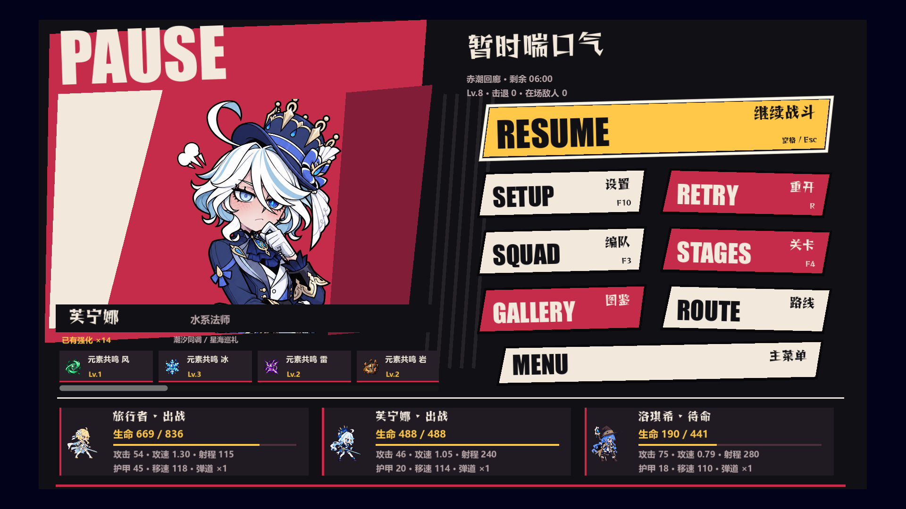

# V102 关卡模式与 UI 测试

2026-11-03，基线为 GitHub 最新 V101 `fde715d`，独立工作树和分支 `v102-mode-ui-regression`；原 `rift-guard` 的未提交工作保持原状。使用 Godot 4.6、隔离 QA 存档、原生 GPU 截图及 Windows 鼠标输入。

## 修复前发现

1. 暂停菜单没有编队及关卡鼠标入口：`pause_squad_button` 实际连接图鉴，`pause_stage_button` 被隐藏。保留图鉴/路线，恢复独立编队/关卡按钮。
2. 关卡选择 Esc 只隐藏面板，不触发返回处理；主菜单进入后 HUD 也是隐藏的，产生无菜单可操作的战场背景。鼠标返回与 Esc 行为不一致。
3. 从暂停经 F3/F4 打开的编队/关卡没有记录来源，取消会进入关卡选择或主菜单，不能回到原暂停；编队 Esc 被吞掉。无尽地图后的编队取消也跳过地图层级。
4. `choose_stage()` 在编队确认前写入当前战斗的 `mode_id`；无尽暂停中预览普通关卡后取消，会污染当前模式并使后续编队入口失效。将模式提交推迟到确认编队时，并测试取消不改变当前模式。
5. 关卡选择打开时，F3 可再打开编队层，导致两个选择面板重叠；编队入口增加关卡面板守卫。

以上先记录再修复；前四个直接复现的失败布尔值见 [基线日志](baseline.log)，新增专项覆盖修复及跨模式取消、面板互斥。

## 最终验收

| 范围 | 独立用例进程 | 通过断言 | 失败 |
| --- | ---: | ---: | ---: |
| 最新源码 | 12 | 1014 | 0 |
| 实际 Windows EXE/PCK | 10 | 818 | 0 |

最终日志、退出码、时间与源码/二进制 SHA256 见 [源码结果](evidence/source-results.json)、[发布包结果](evidence/release-results.json) 和 [发布报告](release-report.json)。所有最终用例退出码 0，日志没有 ERROR、FAIL 或资源泄漏。

- 模式专项在 1280×720、1920×1080 各 84 项：主菜单设置、普通/无尽鼠标入口；关卡锁定与通关后解锁刷新；第一关编队与开场剧情；关卡 1→2；三张无尽地图；部署拖拽、右键移动、Q/E 实际瞄准落点和能量消耗；三选一卡牌及目标选择；暂停返回链和取消跨模式预览；F3 面板互斥。
- 暂停专项两种尺寸各 74 项：八入口 Tab/Enter/鼠标循环、暂停计时冻结、角色血量/属性刷新、14 张强化的横向滚动、低特效、图鉴和合法路线入口、重开确认/取消及实际重置、主菜单。
- 剧情 42 项、结束流程 111 项：原剧情与成功选项、新成员迎接/重新编队、原成功/死亡动画确认、普通通关接下一关、最终关回主菜单、普通/无尽失败、重复操作、已读/缺失剧情回退、成就持久化且不阻塞流程。
- 回归：战斗模拟 78、经典玩法与四段 15 秒战斗/资源音频 96、爆炸 129、工坊 UI 46；源码另加场景保存逻辑 180、UI Lab 16。

查看两种分辨率的原生 GPU 截图：主要按钮、卡牌文字、强化滚动条、角色状态和剧情选项均在可视范围内；暂停新增入口未覆盖角色状态和强化区。所有存档使用独立 QA 目录。

## Windows 真实输入

从 `releases/V102-20261103` 直接启动 EXE，仅携带存档隔离参数，没有测试流程参数；Windows Computer Use 发送真实鼠标/键盘输入。核对主菜单→普通模式→第一关编队→Esc 两次回菜单；主菜单→无尽模式→血门回廊→确认编队→战斗；鼠标暂停→编队→Esc、关卡→返回、设置→保存返回、重开→取消、主菜单。生存计时在返回各页面后仍为 00:10，生命 720/720，原局没有被重置。

截图 `evidence/native-01-menu.png` 至 `native-15-return-menu.png`，日志 [native-startup.log](evidence/native-startup.log)；Alt+F4 后确认进程退出，日志无错误。

## 测试过程与边界

首轮新专项漏等设置关闭动画、未推进开场剧情，导致连锁假失败，已修正测试驱动；旧经典测试的 V101 版本断言更新为 V102。复用剧情助手的截图目录也已修正，测试图片不进入游戏资源包。

一次源码测试与资源重新导入重叠，发生临时 ctex 读取错误；一次多窗口并行时鼠标入口用例失败。日志分别保留在 `source-import-contention.log`、`release-parallel-focus.log`，两项均在无导入、单窗口条件下重跑通过，源码与二进制指纹保持一致，工具拒绝合并不同指纹结果。后续应先完成导入/构建，再串行执行图形测试。

通关边界、等级和能量由测试夹具设置，实际状态转换和关键按钮通过 Viewport 输入派发；另用 Windows 实际鼠标验证入口，未将 `pressed.emit()` 作为新增模式专项的点击证据。此次没有逐秒人工打完八关，也没有新增长时性能或所有随机构筑穷举测试。

## 重现与构建

Godot 4.6 官方 Windows x64 release template，`tools/build_v102.ps1` 构建；`tools/validate_v102.py --phase source|release --executable <路径>` 验收；`tools/package_v102.py --package releases/V102-20261103` 校验指纹、打包并检查 ZIP CRC。源码、包和测试均在独立 V102 工作树，原目录的未提交工作保持原状。

最终 ZIP 为 375,167,391 字节，SHA256 `491e2c5e3048431d13eef1534c2c991be90b3e7054fb48f26f9e20cd115ae677`；再从 ZIP 提取 EXE/PCK 到全新目录，逐文件哈希匹配后进行普通 OpenGL 启动，退出码 0、无错误，见 [ZIP 启动结果](evidence/zip-smoke.json) 和 [日志](evidence/zip-startup.log)。ZIP 内保留打包前的自动验收与 Windows 原生输入证据，打包后的 ZIP 启动证据另存仓库。
