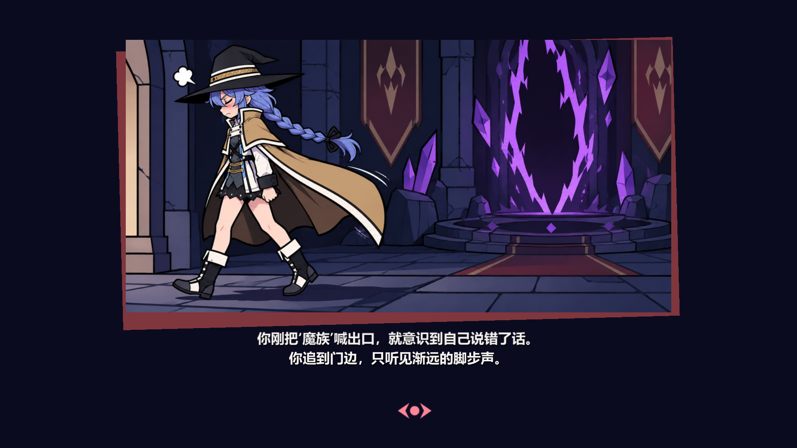

# Rift Guard V78 · 漫画分镜剧情

- 洛琪希第一关分支改为 NPC 单人立绘对白，玩家选项均为说出口的台词；失败后播放离场漫画。
- 90 段主线和家园剧情统一去除旅行者立绘与旁白页，家园部分保留多轮分支。
- 漫画页按 2:1 比例居中，缩为参考画面的约 68% 屏宽，新增两行字幕、红色倾斜背框与继续提示。
- 包含本地 V75–V77 阶段已有的成就墙、无尽模式及关卡预览素材更新。

验证：Godot 4.4.1 导入、UI Lab、剧情与家园定向测试、漫画实机截图、Windows 导出和启动检查。

