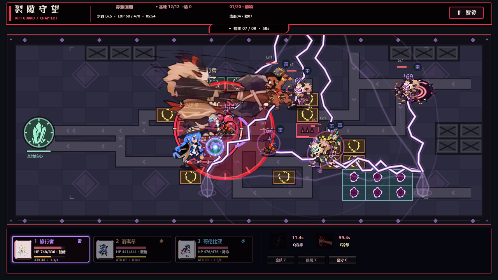
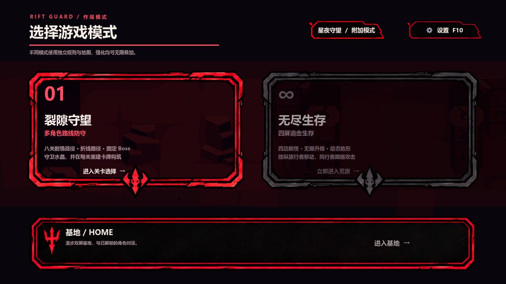
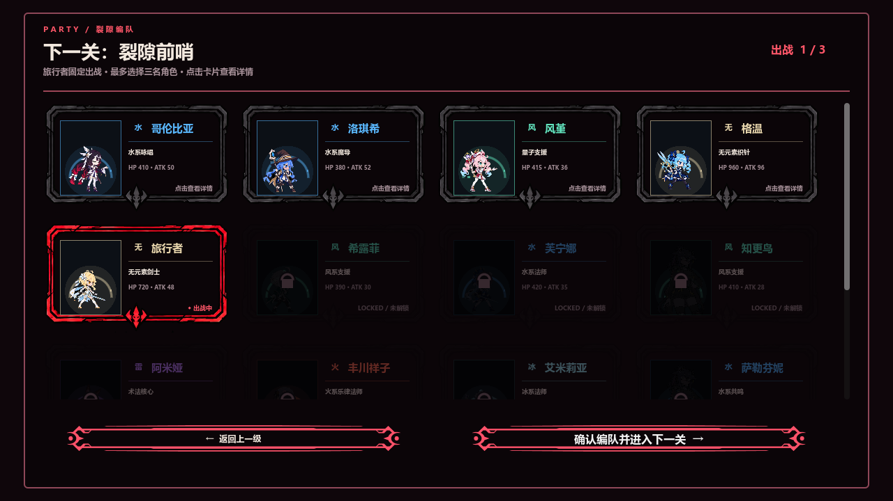
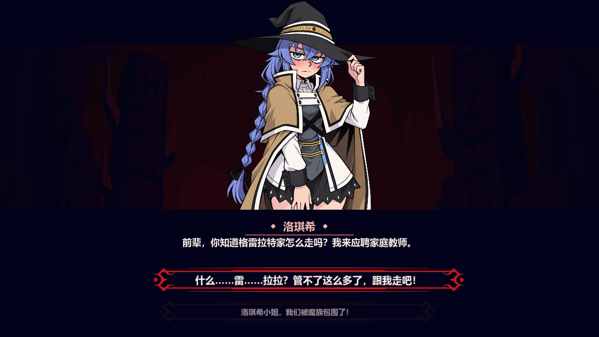

# V86 动效增强验证记录

本地版本 V90.1，2026-10-03。基线为精确 V86 标签 `fede2683391953d082300ef577f2967bb82fd6a9`，默认入口恢复 `res://main.tscn`。Windows 版本由官方 Godot 4.6 stable 模板生成，实际渲染使用 OpenGL Compatibility / NVIDIA RTX 3050 Laptop GPU。

## 实际画面

[战斗动态演示](combat-preview.mp4)为自动布置角色和敌人的实际 Godot 片段，攻击、技能、命中与反馈使用游戏模拟。它用于展示动效，不是完整正常数值通关录像。



录制条件、实际事件与特效专项检查见 [演示说明](preview-notes.md)。







另附发布版 [家园](02-home.png)、[普通战斗](04-campaign.png)、[无尽战斗](05-endless.png)。两张发布版战斗截图来自提高角色生命的 15 秒自动测试，不能用于判断难度平衡。

## 验证范围

| 检查 | 结果 | 证据 |
| --- | --- | --- |
| 新战斗回归 | 246 项通过；真实弹体、固定瞄准、阻挡、冻结、无尽目标、出场配额、平面命中，以及独立旧无尽几何对照 | `classic-combat-final.log` |
| 平面投影与八关地形 | 645 项通过；投影逆变换、等距轴、圆形范围、地形面积、稀疏地图空洞和机关计时 | `classic-flat-final.log` |
| 特效状态与容量 | 15 项无界面检查通过；回收池、上限、冻结后延迟落点预警 | `classic-vfx-final.log` |
| 原菜单与附加模式 | 真实窗口通过原菜单→家园→选关/选角→原过场→星夜守望→原菜单，并验证全屏偏好恢复 | `classic-shell-window.log` |
| Windows 成品 | 17 项通过；原菜单、家园、选角、附加场景打包存在、两个 15 秒普通/无尽战斗模拟、五张实际截图 | `classic-release-final.log` |
| 原 V86 选卡 | 60 种子、180 个选项、两次刷新资格、8 配方、真实伤害/治疗、继承与 UI 通过 | `original-v86-cards.log` |
| 原剧情 | 16 场景、38 分支、3 漫画，立绘变化、结果表情、点击门槛、招募回战斗通过 | `original-v85-story.log` |

专项回归还覆盖原怪物策略、旅行者元素、裂隙首领、史莱姆王、加里奥、无尽目标与三个种子的查询一致性。此前星夜守望的独立模拟及正常数值远征检查记录保留在 `../starfall-validation/`。本次没有宣称完整打通原 V86 的八关长流程，也没有将自动测试作为人工长期游玩平衡验收。

原千珏专项的断言通过，但该旧测试退出时出现 ObjectDB 清理警告；未将它计入「退出日志干净」项目。上表的新战斗、原菜单往返及实际 Windows 成品检查退出码均为 0，日志无脚本错误。

## 保留内容

`git diff --exit-code -- game/assets game/data game/scripts/rewards game/scripts/dialogue_director.gd` 通过：原人物、怪物、技能图标、强化图标、卡牌和剧情数据没有被本轮重写。Godot 重新生成的原素材导入配置已还原，避免导入噪音混入改动。

原觉醒池实际是风、雷、火、水、岩、冰六种，另有未觉醒状态；没有新增草元素。主菜单第三个战斗入口为星夜守望附加模式。UI 实验台未在本次修复。

## 重跑

下列 `godot` 指 Godot 4.6 控制台程序；在仓库根目录运行。`--qa-output` 必须使用桌面 `codex` 下的绝对缓存目录，以隔离真实存档。

```powershell
godot --headless --path game --script res://tests/qa_classic_combat_regressions.gd
godot --headless --path game --script res://tests/qa_flat_projection.gd
godot --headless --path game --script res://tests/qa_comic_combat_vfx.gd -- --qa-output=C:/Users/yzy/Desktop/codex/rift-guard/recheck/vfx
godot --path game --script res://tests/qa_classic_shell.gd -- --qa-output=C:/Users/yzy/Desktop/codex/rift-guard/recheck/shell
./releases/V86-Enhanced/RiftGuard-V86-Enhanced.exe -- --classic-release-test --qa-output=C:/Users/yzy/Desktop/codex/rift-guard/recheck/release
```

## 成品校验

- `RiftGuard-V86-Enhanced.exe` SHA256：`F9CB815A32A1AE3A73AD8699ED2B068CB76FE01636D7E8538243056FAC05F37B`
- `RiftGuard-V86-Enhanced.pck` SHA256：`E6734F16F7257E9E736434F02910E6E0F56EEECB4CCC01959E3B14EECEB8AAC1`

EXE 与 PCK 必须放在一起。打包脚本为 `tools/build_v86_enhanced.ps1`。此版本仅本地交付，未推送或上传。
