# V91 实机演示与验证

本页对应 V91 发布包的原生 Godot 4.6 画面。重新制作场景材质、光弹与命中层次后录制，保留 V86 人物、红黑叙事与构筑体系。可玩包在 `releases/V91/`，旧 V90.1 包另留在 `releases/V86-Enhanced/`。

GIF 没有音轨。查看日语语音和音效请播放 [怪物与 Boss 实机视频](v91-combat-showcase.mp4) 或 [三地图无尽与角色技能视频](v91-endless-showcase.mp4)。这些演示控制了出怪、血量、计时器或充能，战斗过程仍使用真实模拟、碰撞、动画与音频；不作为自然通关或难度平衡证明。

## 怪物行为

源石虫：真实触发预备与自爆，命中才产生爆炸反馈。

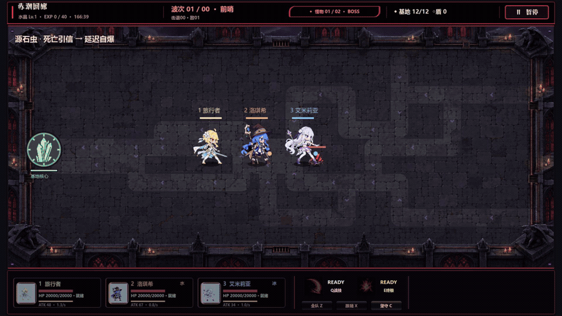

冲刺：锁定攻击方向后突进，结束后恢复接敌距离与路线。

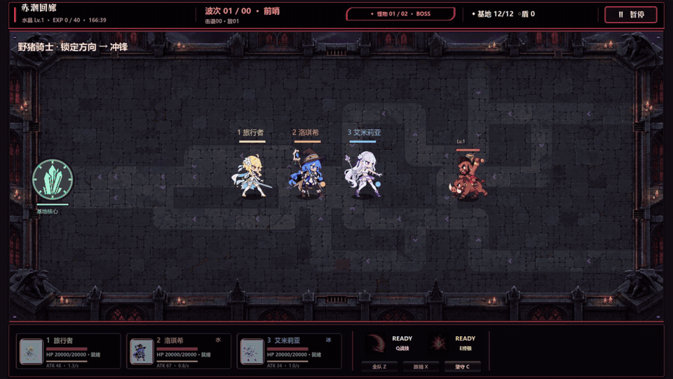

丘丘暴徒：使用素材自带攻击帧，不再附加旋斧光圈、额外刀刃或碎片。

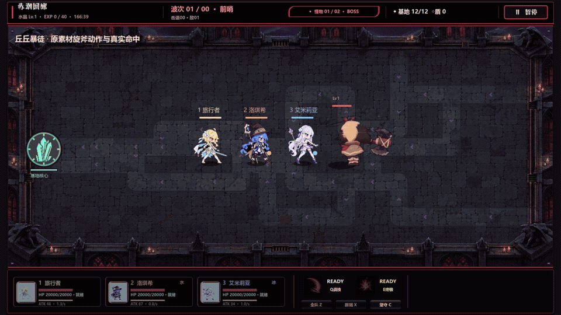

蝙蝠：切入后撤退，沿用其飞行规则。

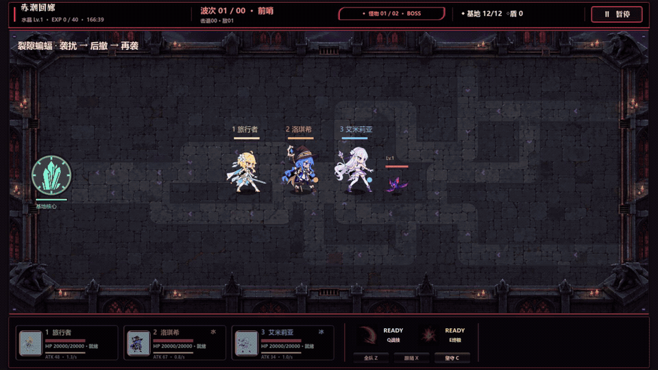

近战身位：怪物实际追击、选择站位、停在角色前方攻击；满员后等待补位。

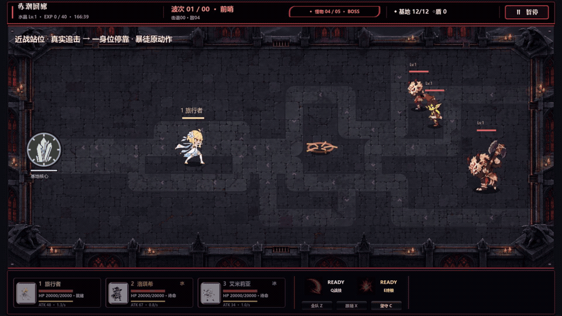

## Boss 与场外支援

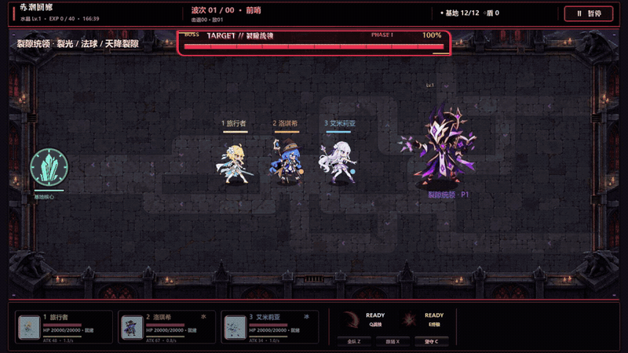

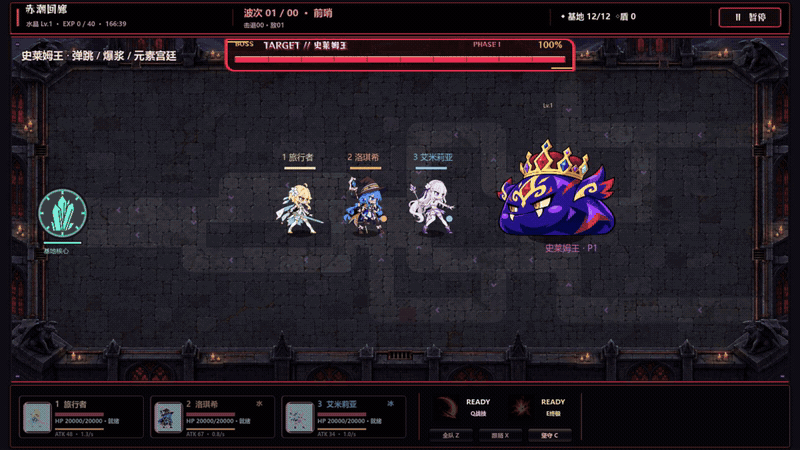

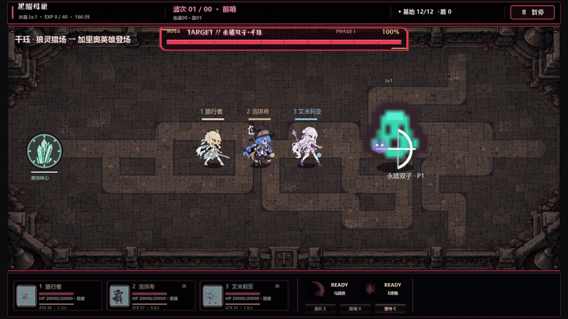

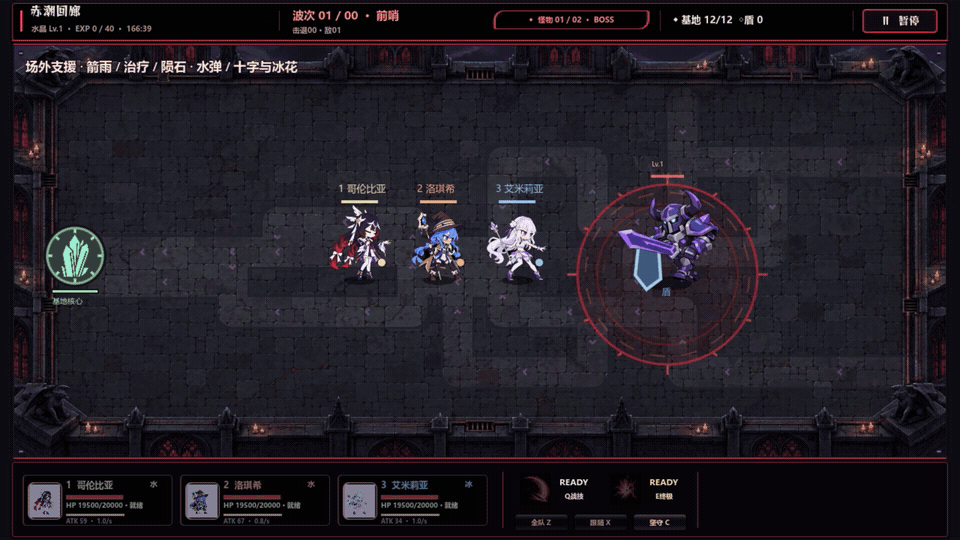

具体技能时点和视频段落见 [行为说明](showcase-gallery.md)；[真实模拟事件证据](showcase-behavior-evidence.json) 与 [媒体校验](showcase-media-validation.json) 保留在同目录。

## 无尽地图与角色差异

三张地图沿用原追击生存规则，在主菜单先选图，再进入原队伍界面。十位角色的普攻与 Q/E 机制见 [完整技能表](skills.md)。以下三段分别集中展示贯穿/十字冰雷、追踪/多条音轨、往返风刃/多排攻击。

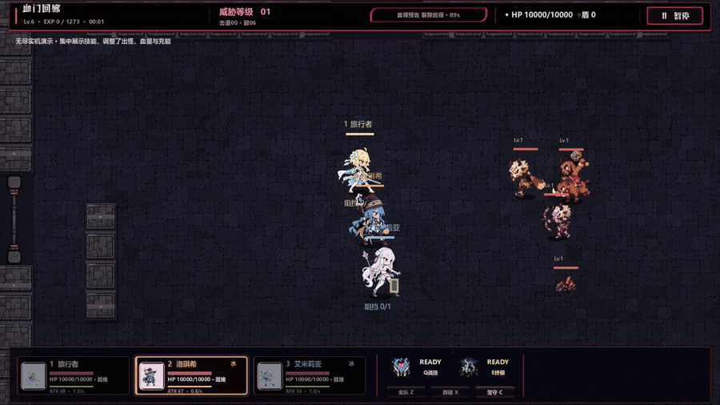

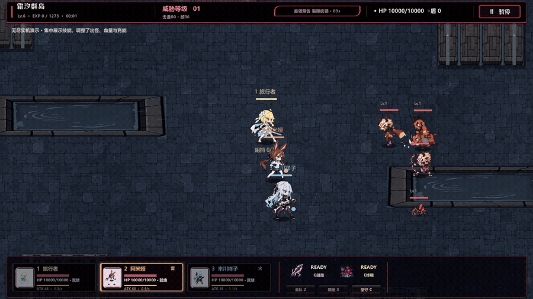

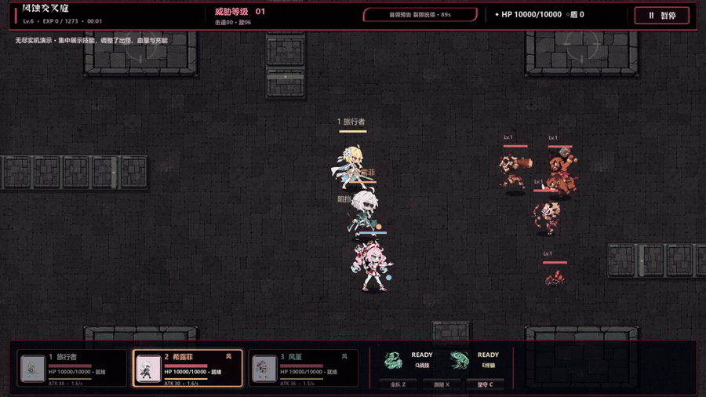

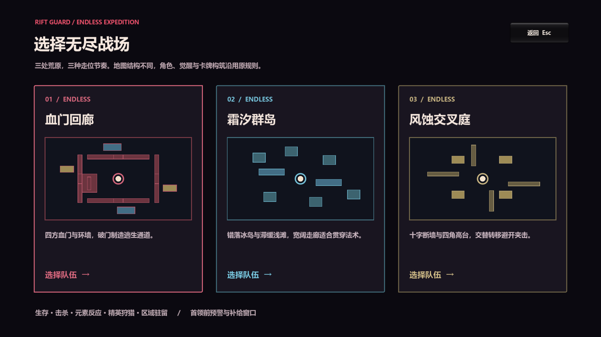

## 家园与地图

基地出口可通往雾灯港，再前往月影温室；往返与区域剧情接入原对话/过场系统。七位区域访客各有带选择的见闻，探索不会直接解锁战斗角色。

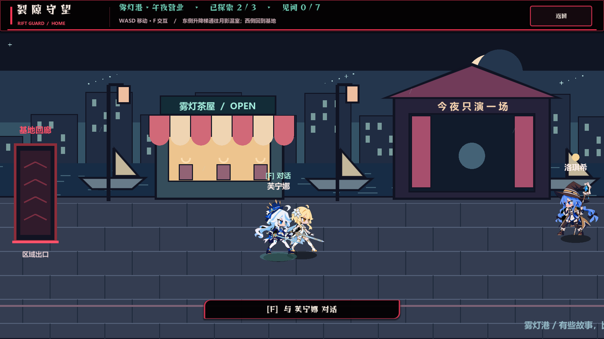

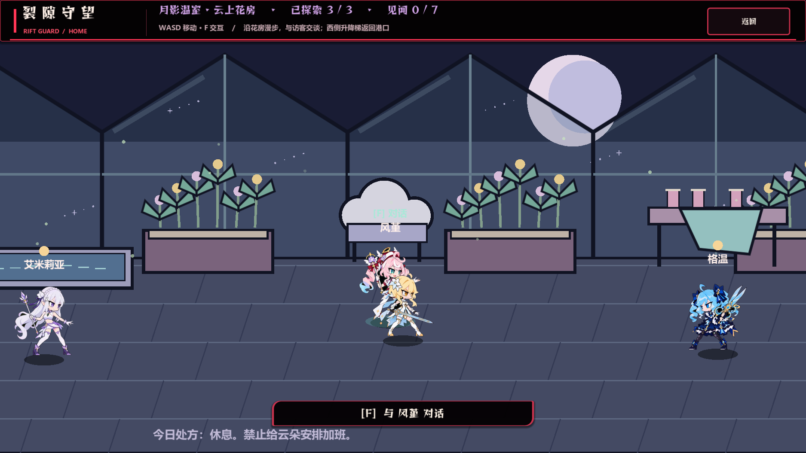

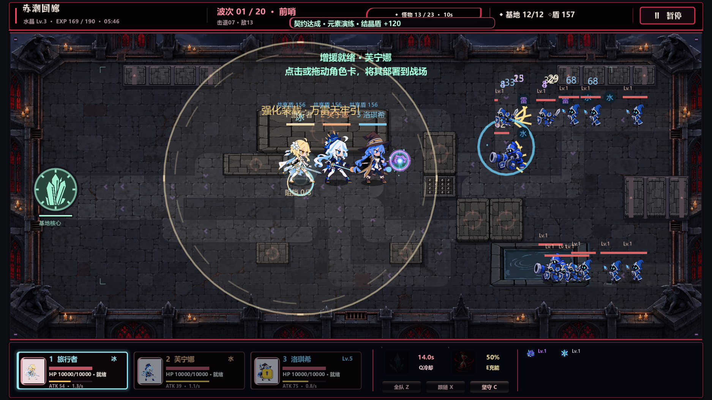

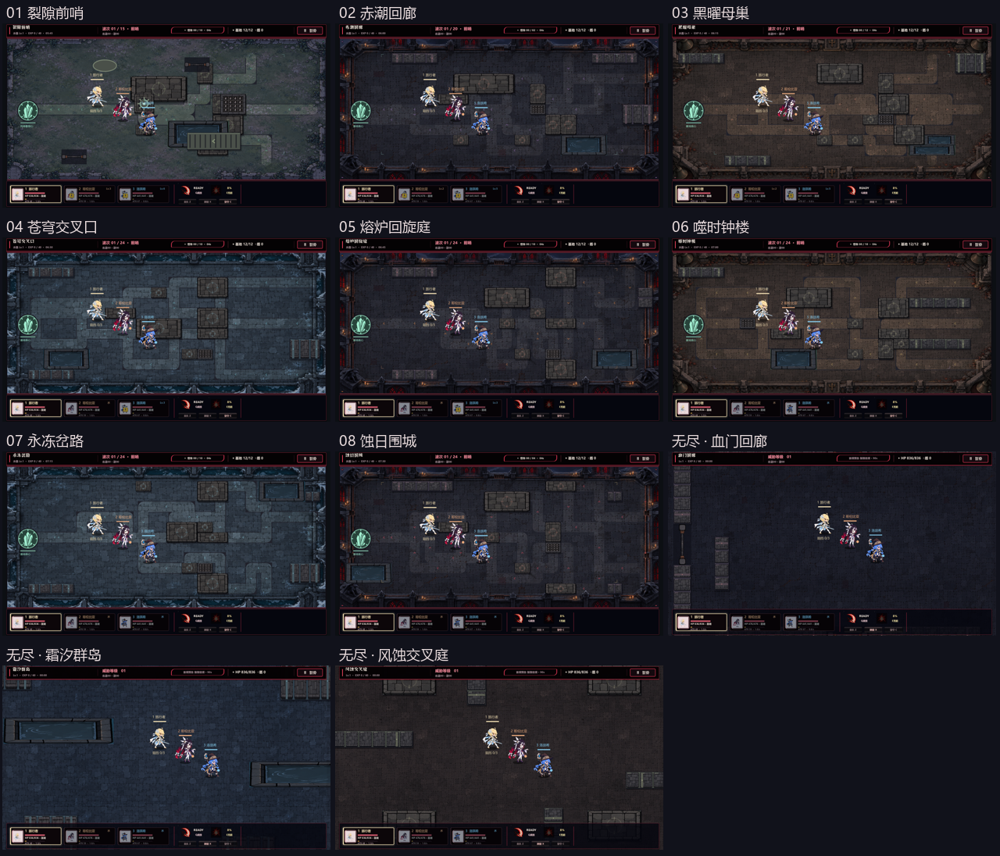

## 验证范围

- [模拟与近战站位](simulation-validation.md)：八关路线、六类普攻投递、不同技能形状、十位角色、卡牌与觉醒、无尽任务和成长、占位距离、密集围攻性能、跨墙补位；也明确列出未通过或过时的历史测试。
- [音频来源与验证](audio-validation.md)：十位角色四个语音事件、真实录音与合成台词区分、静音、并发、重开/换关清队列、原生混音。并非所有台词都是原声。
- 家园纯状态与剧情分支 40 项，原生窗口验证出入口、对话返回和存档。无尽选图用真实鼠标点击测试三张卡片、编队确认与返回。
- 地形显示在八关与三张无尽图上采样验证：合并连续水池/平台后不填补可走缺口，新场景纹理可以加载。该项是几何/资源检查，不代表用户已认可美术。
- 导出的 Windows EXE 独立运行内置验收，核对原菜单、附加模式资源、家园新区域、三张选图、角色界面、四段各 15 秒战斗、40 个语音槽位及实际音频加载。最终结果与文件哈希见 [发布验收](release-validation.md)。

目前没有把八关全流程人工通关、数小时无尽平衡或所有显卡兼容性宣称为已验证。画面证据来自本机原生 OpenGL Compatibility 渲染。
