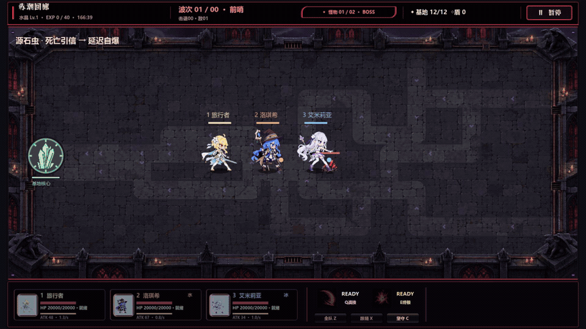
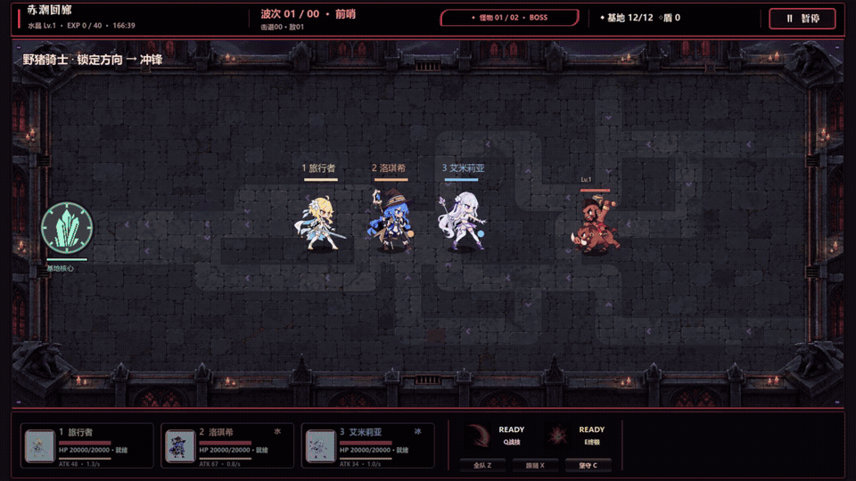
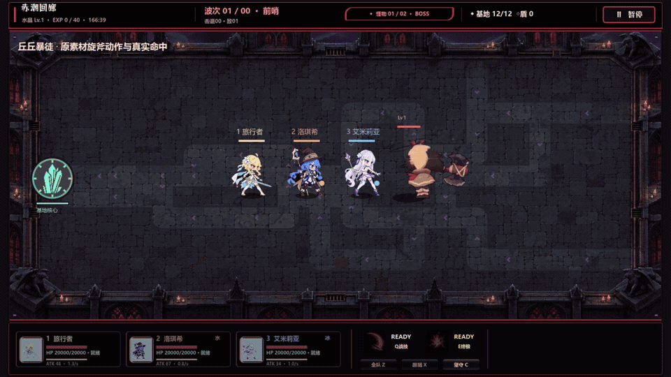
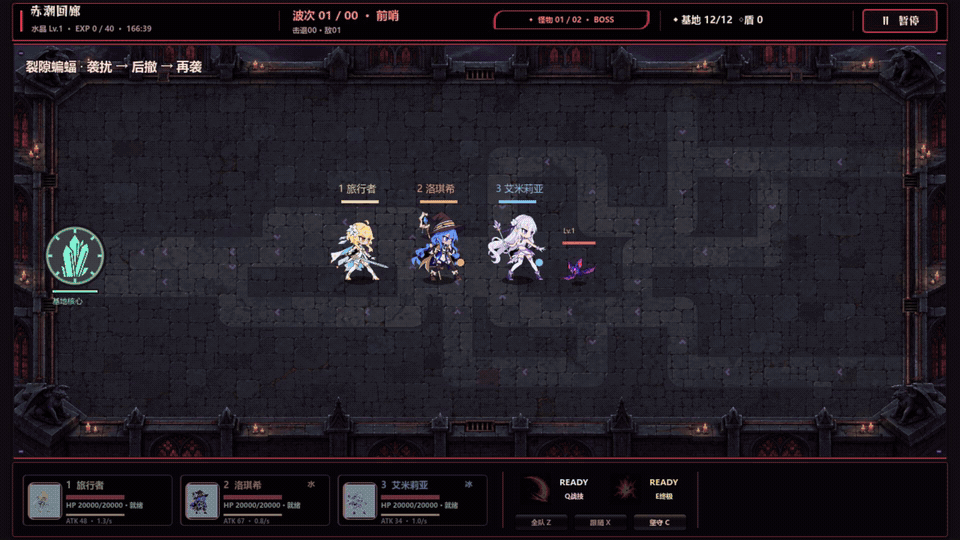
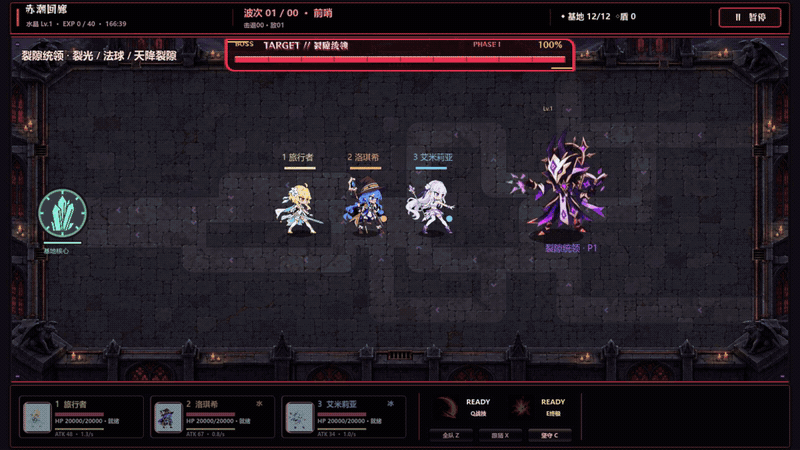
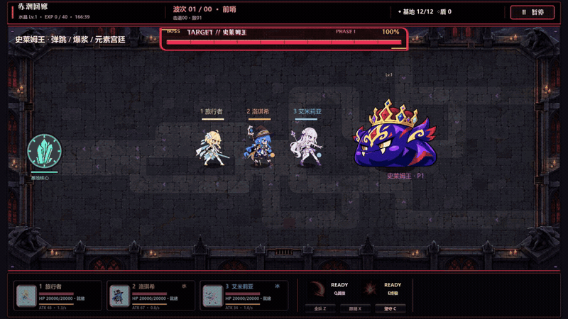
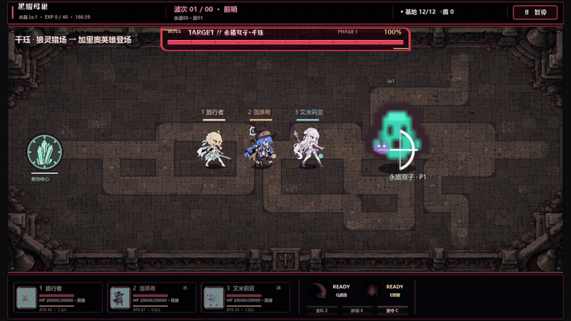
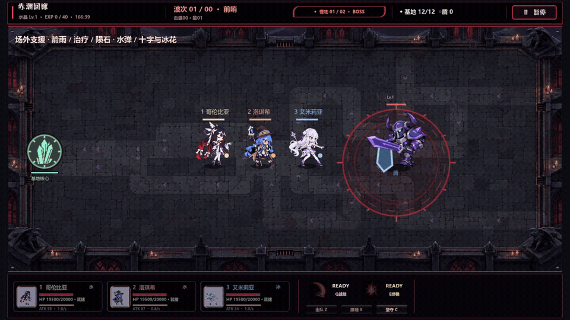
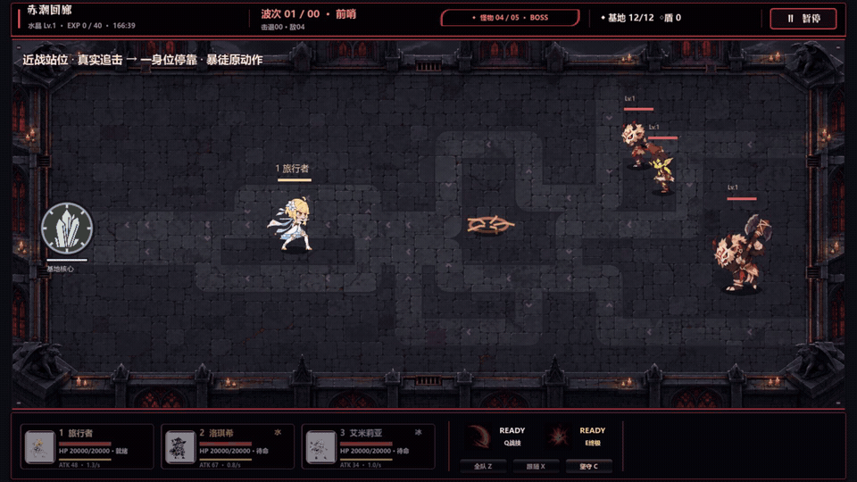

# V91 实机战斗片段

[完整 MP4：87 秒，含实机音轨](v91-combat-showcase.mp4)

这组 GIF 和视频来自真实战斗模拟。录制时提高双方生命值、关闭随机出怪、缩短首轮招式等待，并固定小队初始站位，以便看清完整动作；伤害与招式时序仍由模拟执行。近战站位片段从远处生成敌人后让它们自行追击、选择站位和攻击，没有逐帧摆放敌人。GIF 自动循环且无声，声音请看 MP4。

| MP4 时间 | 片段 | 观察重点 |
|---|---|---|
| 00:00–00:06 | [源石虫](monster-originium.gif) | 虫体死亡后延迟引爆，危险提示与实际受伤分开出现。 |
| 00:06–00:13 | [野猪骑士](monster-charge-jump.gif) | 先锁定方向，再沿预警方向冲锋并造成伤害；此段展示冲锋。 |
| 00:13–00:20 | [丘丘暴徒](monster-spin.gif) | 自行接近至攻击位，使用原素材攻击帧；没有额外旋斧、光圈、碎片或大红预警圈。 |
| 00:20–00:27 | [裂隙蝙蝠](monster-bat.gif) | 接近、袭扰、后撤，再次接近。 |
| 00:27–00:39 | [裂隙统领](boss-rift.gif) | 裂光、法球和天降裂隙；真实命中处短促白亮，紫色窄边电光迅速收尾。 |
| 00:39–00:51 | [史莱姆王](boss-slime.gif) | 弹跳落地、爆浆、元素宫廷和回流；落地亮峰与水滴短散射。 |
| 00:51–01:06 | [千珏与加里奥](boss-kindred-galio.gif) | 狼灵猎场、追猎箭、恐惧标记与低血量援军；加里奥落地沿真实伤害时点闪光。 |
| 01:06–01:17 | [场外支援与角色技能](support-shapes.gif) | 连续水球、箭雨、治疗、交叉火力、加速下落的火球；十字雷域与冰域靠区域内光流、冰花呈现。 |
| 01:17–01:27 | [近战一身位](monster-spacing.gif) | 普通怪和暴徒从远处真实追击，分槽停靠和候位。普通前排停距约 60–67，暴徒约 96 世界单位；受队友阻挡的普通怪在外侧等待。 |

人物、怪物及技能图标沿用原资源。普通光弹保持小亮芯和短尾；火球具有不规则亮核与两条弯曲收尖尾，接触后约 0.09 秒亮峰，随后短尘碎消散。持续区域不再全程描画大框；实际瞄准预览和必要的危险范围仍使用真实判定形状。

三名 Boss 另做了逐帧伤害对照：66 个释放/命中时点均在同一模拟帧进入表现，其中 63 个时点有实际生命值下降。美术检查以导出的连续帧和 GIF 为准，事件记录用于确认演示确实发生。

[真实事件与追击距离](showcase-behavior-evidence.json) · [GIF 帧数、循环和时长](showcase-media-validation.json) · [Boss 伤害时点对照](boss-hit-alignment.json)
