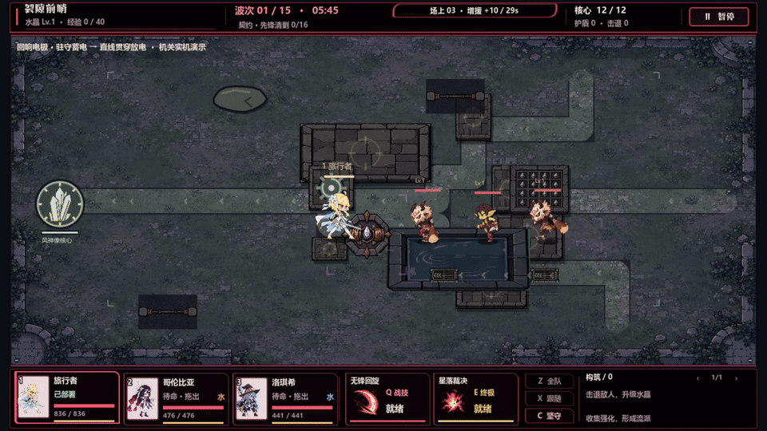
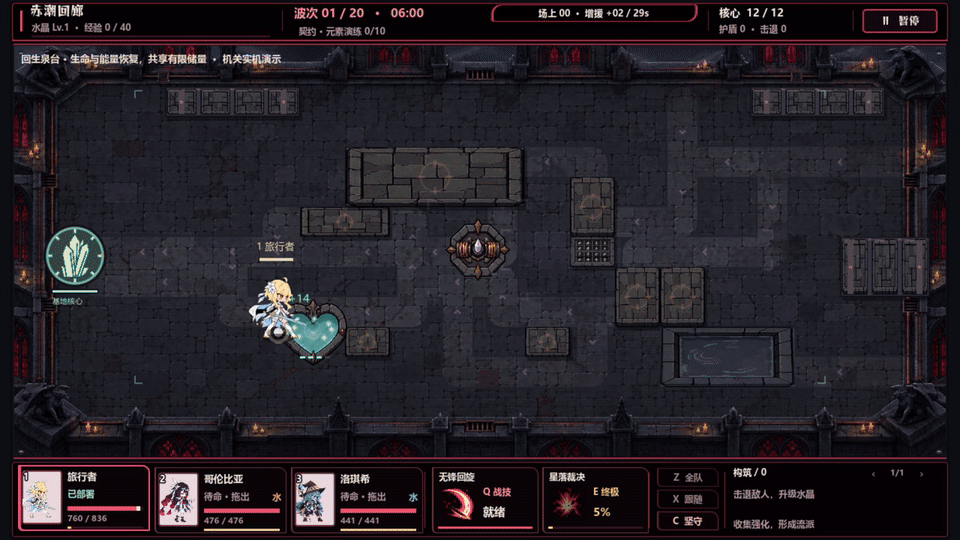
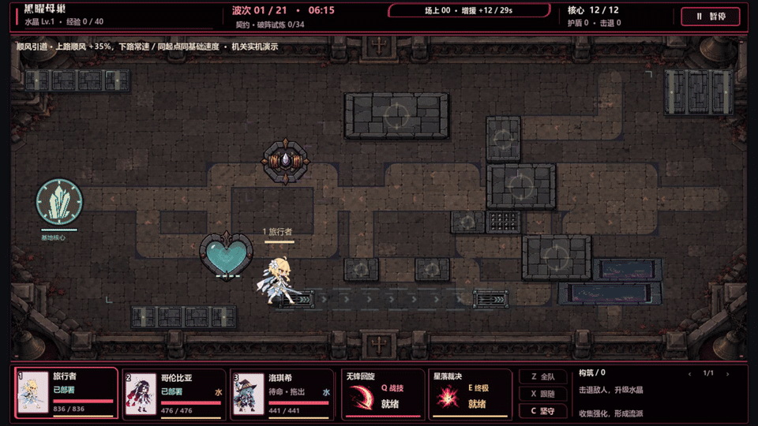
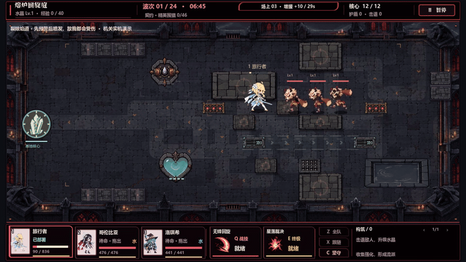
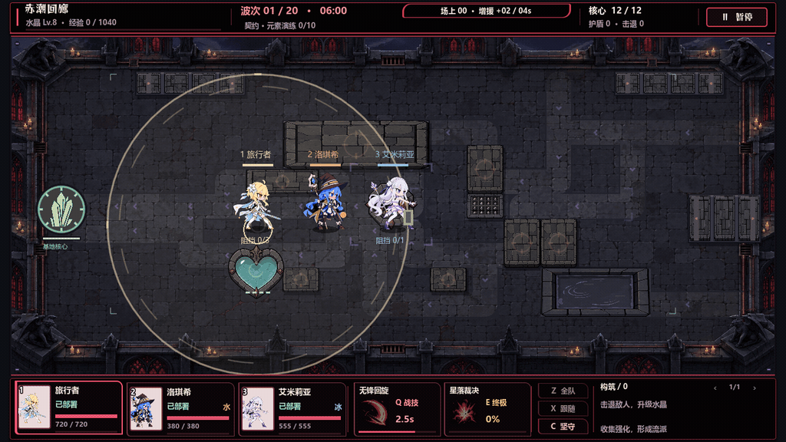
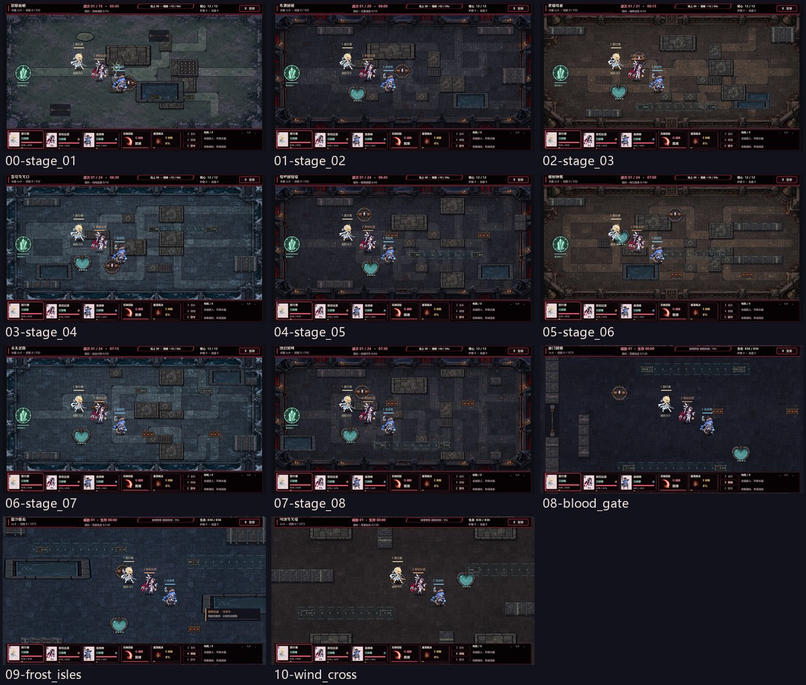

# V92 实机与验证

V92 增加功能地形，重排顶部、底部信息并加入短促反馈。沿用 V86 红黑风格、原角色/怪物、技能/强化图标、剧情、元素和卡牌玩法；V91 内容继续保留。

## 机关实机

[32 秒有声视频](terrain-showcase.mp4)：依次展示电极、泉台、风道、火道，各 8 秒。以下 GIF 无声音。

**驻守电极：蓄电、预警、直线放电与原元素反应。**



**有限泉台：生命和能量实际恢复，储量逐步消耗。**



**顺风引道：相同起点和基础速度，上路顺风、下路常速。**



**裂隙焰道：范围预警、三次伤害脉冲、角色离开火线。**



录制运行真实模拟、渲染和音频。为集中展示机关，普通出怪推迟 25 秒，控制目标站位、移动和攻击计时；角色普通攻击暂缓，泉台与火道片段降低初始生命，风道对照角色使用相同基础速度。演示不代表自然流程的难度。

泉台实际回复 56 生命和 24 能量，储量从 80 降至 8；火道三名目标生命各从 110 降至 56，角色受伤后移动离开。电极触发既有元素反应，附带反应范围不等同于电极的直线判定。[模拟证据](terrain-simulation-evidence.json) 记录了各段实际事件和前后数值。

## HUD 实机



[6 秒 HUD 视频](hud-motion.mp4) 无音轨。片段人为触发掉血、获得经验/强化、能量就绪和角色选择，用于检查动效；拖放部署、技能瞄准、阵型、暂停和强化翻页另由真实控制器输入验证。

[普通战斗](hud/06-input-deployed.png) · [长名字与多强化](hud/02-long-name-many-buffs.png) · [Boss 预警](hud/03-boss-warning.png) · [低特效](hud/04-reduced.png) · [无尽](hud/05-endless.png) · [待解锁状态](hud/07-locked.png)

## 地图布置



| 场景 | 新机关数量 | 截图 |
| --- | ---: | --- |
| 第一关 | 1 | [第一关](maps/00-stage_01.png) |
| 第二关 | 2 | [第二关](maps/01-stage_02.png) |
| 第三关 | 3 | [第三关](maps/02-stage_03.png) |
| 第四关 | 3 | [第四关](maps/03-stage_04.png) |
| 第五关 | 4 | [第五关](maps/04-stage_05.png) |
| 第六关 | 4 | [第六关](maps/05-stage_06.png) |
| 第七关 | 4 | [第七关](maps/06-stage_07.png) |
| 第八关 | 4 | [第八关](maps/07-stage_08.png) |
| 无尽血门回廊 | 5 | [血门](maps/08-blood_gate.png) |
| 无尽霜汐群岛 | 5 | [霜汐](maps/09-frost_isles.png) |
| 无尽风蚀交叉庭 | 5 | [风蚀](maps/10-wind_cross.png) |

地图截图为水晶 6 级、清空敌人的固定站位检查。原墙体与路线仍参与移动判定；旧传送地面和圆形障碍调整外观，保留原功能。

## 验证结果

2026-10-04，Windows、Godot 4.6 stable，OpenGL Compatibility / RTX 3050 Laptop。

| 范围 | 结果 |
| --- | --- |
| 功能地形模拟、影响范围、资源、时序与布局 | 150 检查，0 失败 |
| HUD 无头 / 原生窗口 | 45 / 52 检查，均 0 失败；原生包含 7 次截图 |
| 独立 HUD 生命周期复核 | 9 检查，0 失败 |
| 地形表现与资源边界复核 | 13 检查，0 失败 |
| 音频、音频集成、近战、经典战斗回归 | 333 + 17 + 42 + 246 检查，均 0 失败 |
| 原模拟与展示回归 | 294 / 93 检查，均 0 失败 |
| **实际 V92 EXE** | **88 检查，0 失败，退出码 0，标准错误为空** |

EXE 验证包括四段各 15 秒战斗、三种无尽布局、原入口与选角、港口/温室往返、机关图集和布局、40 个语音槽资源及真实音频流播放。存档隔离在规定的缓存目录。同关同种子重开不再残留通知、危险条或泉台反馈。

导出成功且没有脚本错误；导出编辑器日志有 9 条 Beckett 开发通道拒绝无效握手的告警，原生包验收没有该告警。媒体全量解码通过；[媒体清单](media-manifest.json) 记录时长、音轨与 SHA-256，[包清单](package-manifest.json) 记录 EXE/PCK 哈希。这些检查不替代长时间通关、难度平衡或其他机器的性能验收。

[地形表现复核](terrain-presentation-validation.md) · [HUD 生命周期修复](hud-lifecycle-validation.md) · [音频与战斗回归](regression-results.md) · [最终 EXE 日志](release-native.log)

## 复现

```powershell
# 在源码根目录构建，V91 不会被覆盖。
./tools/build_v92.ps1

# 直接验证发布 EXE，参数放在 -- 后面。
./releases/V92/RiftGuard-V92.exe -- --classic-release-test --qa-output=C:/Users/yzy/Desktop/codex/rift-guard/v92-verify
```

新图集及实际生成提示词见工程 `game/assets/world/v92-devices/README.md`。机关声音复用 V91 已标注来源的音效。本轮没有新增角色语音，也没有改变原声和合成语音的标注。
