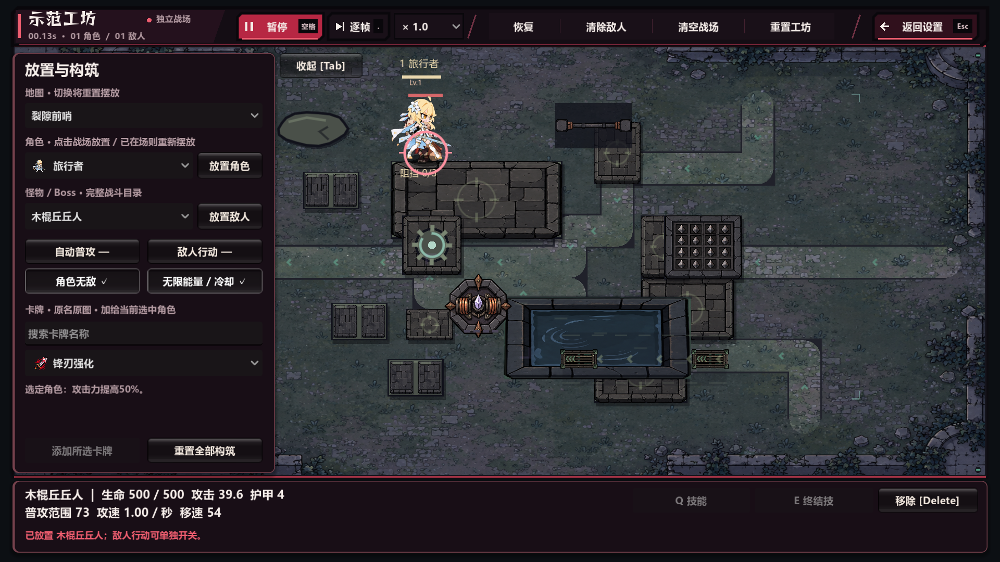
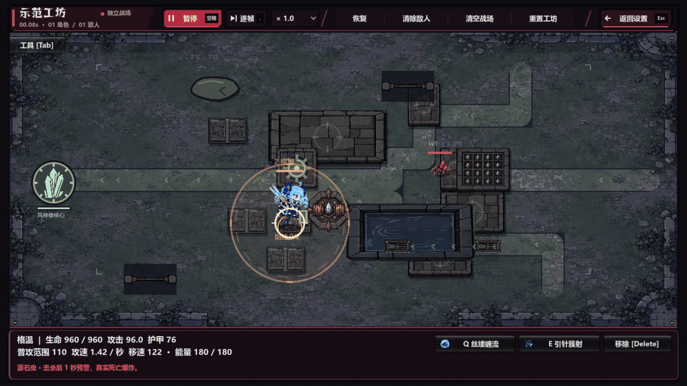

# V94 验证记录

2026-10-04，Godot 4.6 stable，Windows OpenGL Compatibility。正式运行入口为 `releases/V94/RiftGuard-V94.exe`，与同目录 PCK 一起保留。

## 可见改动

工坊顶部保留原有地图空间，以扁平斜切色块分组播放、单帧、倍率、恢复／清场及返回操作。对 1280×720 和 1920×1080 实际截图进行了人工检查。

源石虫自爆参数 125 → 80，普通关卡圆形半径缩小 36%；无尽模式保留原投影，两个方向均缩小。警告、伤害和闪光一致。

原生 Godot 工坊实际录制：两次真实击杀源石虫、各等待一秒后自爆，最后展示暂停／单帧／继续。没有合成攻击画面。可播放 [带声音的 1080p 视频](workshop-bug-preview.mp4)。

作战结束不再显示自动成就弹窗或旧胜利结算框。普通胜利接原有剧情、漫画与转场，然后进入下一关编队；最终胜利返回模式菜单；失败由原死亡动画接模式菜单。已看过或缺失的通关剧情也能继续。成就和通关记录仍然保存。

## 源工程检查

| 检查 | 结果 |
| --- | --- |
| 工坊原有功能回归 | 无头及原生 1280 各 78/78 |
| 新顶部鼠标操作 | 无头 54/54；原生 1280、1920 各 56/56 |
| 自爆引信／边界／预警／闪光 | 90/90 |
| V93 初始攻击、路线与移速回归 | 124/124 |
| 作战结束流程 | 无头及原生各 111/111 |
| 原战斗 HUD | 45/45 |
| 原连续失败检查 | 连续两次点击返回菜单通过 |
| 独立收尾审查补充 | 普通失败选项 15/15；最终失败选项 14/14；暂停时最终剧情预览 6/6 |

结束流程使用 `Viewport.push_input` 派发鼠标和按键，保留真正的动画与输入锁；通过正常模拟 tick 触发胜利或失败，验证连续失败、重新入场、普通／最终通关、已看过／缺失剧情、单次记录、无旧弹窗、成就重新加载。其详细说明见 [收尾问题调查](endflow-investigation.md)。

其他说明：[工坊操作与布局](workshop.md)、[源石虫范围与绘制](blast.md)。源石虫旧机制测试中有两条 V93 之前的路线／钻地预期已经过时，未计为本次通过项，详见范围验证说明。

## 发布包检查

实际 V94 EXE：原生结束流程 **111/111**，无头结束流程 **111/111**，原生完整发布回归 **96/96**，均退出 0，日志无脚本错误或清理警告。发布回归覆盖四组各 15 秒的受控战斗、地形与探索、三个无尽地图、40 个语音事件槽和已打包声音、工坊隔离与返回。

`release-report.json` 和 `release/` 保存实际 EXE 的运行结果、截图及 SHA-256。发布包检查与源工程检查分别记录，不以成功导出代替实际启动验证。

这些检查通过受控战斗 fixture 及原生输入覆盖本次修改，并不代表八个关卡均进行了全流程人工通关。
