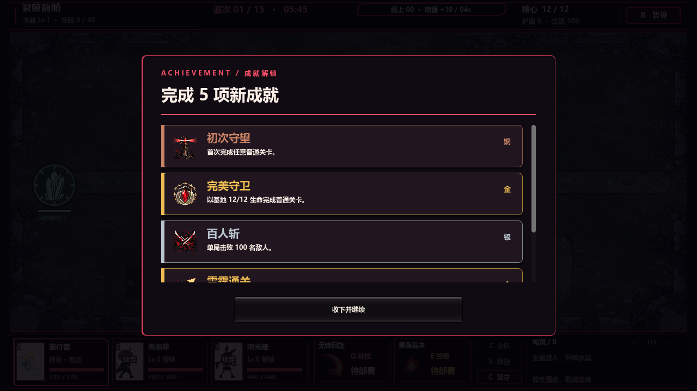
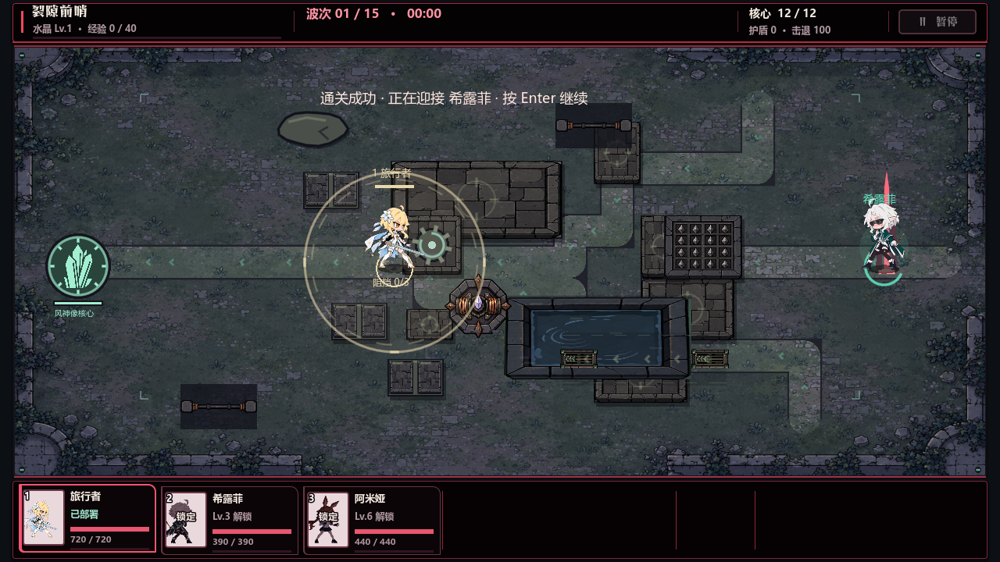

# V94 ending investigation

Investigated the V93 game on Godot 4.6, 2026-10-04. The initial red reproduction was `game/tests/qa_v94_endflow.gd`; after proving the failure it became the release-compatible RefCounted runner `game/scripts/qa_v94_endflow.gd`, with source wrapper `game/tests/run_qa_v94_endflow.gd`. Gameplay setup advances the normal simulation scheduler to a terminal condition; all acknowledgements, narrative choices, popup clicks and key presses go through viewport `push_input(event, true)`. The script never emits a button signal or calls an input handler directly. Every run supplies an absolute `--qa-output` and writes saves beneath that directory.

## Reproduced failures

| Scenario | Native action | Observed state | Result |
| --- | --- | --- | --- |
| Ordinary stage_01 win | Click `收下并继续` | Popup stays open; `campaign_prelude_active=true`, `state=won`, story inactive | Blocked |
| Ordinary stage_01 win | Enter | Same popup and state | Blocked |
| Final stage_08 win | Click `收下并继续`, then Enter | Same popup and state | Blocked |
| Campaign loss, with a new achievement | Enter after acknowledging death | Popup stays open; a second death animation starts (`death_playing=true`) | Wrong action; no return to menu |
| Endless party wipe, with a new achievement | Enter after acknowledging death | Same popup and second death animation | Wrong action; no return to menu |
| Campaign loss, with a new achievement | Click `收下并继续` | Popup closes and main menu opens | Working comparison |

The stage_01 window capture confirms the visible unwanted screen is the large earned-achievement popup. Its footer button is present and unobstructed within its own CanvasLayer, yet an actual pointer click has no effect. The underlying HUD remains visible beneath its dark veil.

## Root causes

Line numbers below refer to the V93 source read before production fixes.

1. `main.gd:1335-1339` sets `campaign_prelude_active=true` for the victory `stage_exit` action and the final victory, then awaits `_show_pending_achievements()`. That method (`main.gd:2134-2140`) opens the popup and awaits its `dismissed` signal. Meanwhile `main._input` at `main.gd:964-966` marks **every event handled** while the prelude flag is true. Native GUI dispatch never receives the popup's mouse press, and `AchievementPopup._unhandled_input` at `achievement_popup.gd:75-78` never receives Enter/Space/Escape. The coroutine cannot resume to clear the flag. This is a state/input deadlock, independent of the popup's mouse-filter or appearance.

2. Loss does not set the prelude flag, so the pointer comparison works. However, `main._input` has no achievement-modal branch. Enter is handled as a gameplay command at `main.gd:1118-1121`; while `sim.state=lost`, `primary()` calls `restart()` (`main.gd:841-844`), and restart begins another awaited death animation (`main.gd:872-873`). The popup's Enter handler is in `_unhandled_input`, after the event has already been consumed. Space and Escape are likewise consumed by gameplay pause handling (`main.gd:1115-1117`). Modal input must have one authoritative owner before gameplay commands run.

3. There is no legitimate endless win condition in V93. `combat_simulation.gd:1176-1180` permits the timed v2 victory only when `not endless_mode`; endless ends through the `party_wiped` loss condition (`combat_simulation.gd:1162-1168`). Endless ending coverage therefore uses a real party wipe, not a fabricated `state=won`.

## Why earlier tests missed the failures

`qa_v81_loss.gd` puts the game directly into `lost`, calls `game._input(click)` directly, and gives no achievement-producing run stats. It verifies only death-animation acknowledgement and repeated return to menu. `qa_v17.gd` also emits `pressed` directly for headless button tests. Those routes bypass the actual viewport GUI and `_unhandled_input` ordering that failed here. The V94 reproduction uses the actual loss/win state transition and seeds 100 kills to deterministically earn `hundred_slayer` on a fresh isolated save.

## Baseline evidence

All caches and captures are beneath the required task directory:

`C:/Users/yzy/Desktop/codex/rift-guard/v94-2026-10-04/endflow/`

- `baseline/stage.log` and `baseline/endflow-results.json`: stage_01 pointer and Enter failures, process exit 1.
- `baseline-final/final.log` and `baseline-final/endflow-results.json`: stage_08 pointer and Enter failures, process exit 1.
- `baseline-loss/loss.log` and `baseline-loss/endflow-results.json`: loss Enter starts a second death animation, process exit 1.
- `baseline-endless/endless.log` and `baseline-endless/endflow-results.json`: endless party-wipe Enter failure, process exit 1.
- `baseline-loss-mouse/loss-mouse.log` and `baseline-loss-mouse/endflow-results.json`: working native loss pointer comparison, process exit 0.
- `baseline-window-stage/stage-window.log`, `baseline-window-stage/endflow-results.json`, and `baseline-window-stage/stage-win-popup-before-input.png`: real OpenGL window reproduces both stage_01 input failures with a capture, process exit 1.

The final baseline runs had no GDScript parse or runtime errors. Some aborted scenarios logged shutdown ObjectDB/resource-leak warnings because the deliberately blocked popup and animation coroutines were still awaiting signals when the test instance was removed; these warnings are recorded separately from the reproduced input failures.

## Final verification

The user-requested change removes both the automatic achievement popup and the old won result card, while keeping original comics, authored conversations, success/death animations, field exits, and next-stage squad selection. The source headless and real OpenGL window runs both passed **111 checks with zero failures**, process exit 0. Neither run logged GDScript errors, runtime errors, or shutdown resource warnings.

The final suite covers:

- Campaign loss acknowledged by native mouse, menu/stage/squad/opening-story/recruitment-squad reentry, then repeated loss acknowledged by Enter.
- Endless party wipe acknowledged by Space.
- Ordinary victory through original comics, successful authored choice, success-animation acknowledgement, and field exit with native Enter to the stage_02 squad.
- Final victory through its authored successful choice and original animations, returning to the menu.
- Both ordinary and final victory when the story is already seen or missing, including repeated terminal simulation ticks and repeated native Enter during the deferred fallback.
- Continuous absence of the unwanted popup/result card, guards released after completion, menu/squad opening once, and each result saved once.
- Silent achievement preservation: `first_watch` and `hundred_slayer` are checked in memory and reloaded from the isolated save file; nine terminal runs produce nine result records.

Reviewed native captures show the original success/death animation, clear field exit instruction, next-stage squad selector, and final main menu. The blocked V93 achievement popup is absent. Formal evidence is in [`endflow/`](endflow/): `endflow-headless.log`, `endflow-window.log`, `endflow-results.json`, and the selected screenshots.





Source invocation:

```powershell
& 'C:/Users/yzy/Desktop/codex/tools/godot-4.6/Godot_v4.6-stable_win64_console.exe' --headless --path 'D:/FILEEEEEEEEEEE/同人游戏/rift-guard-astra/game' --script res://tests/run_qa_v94_endflow.gd -- --qa-output=C:/Users/yzy/Desktop/codex/rift-guard/v94-2026-10-04/endflow/source-headless-green
```

The root agent also added the main-game `--v94-endflow-test` hook to run this same runner inside the exported executable. Packaged release validation is performed separately by the root agent. Production ending changes belong to the root agent; the investigation agent changed the new runner, wrapper and evidence documentation only.
