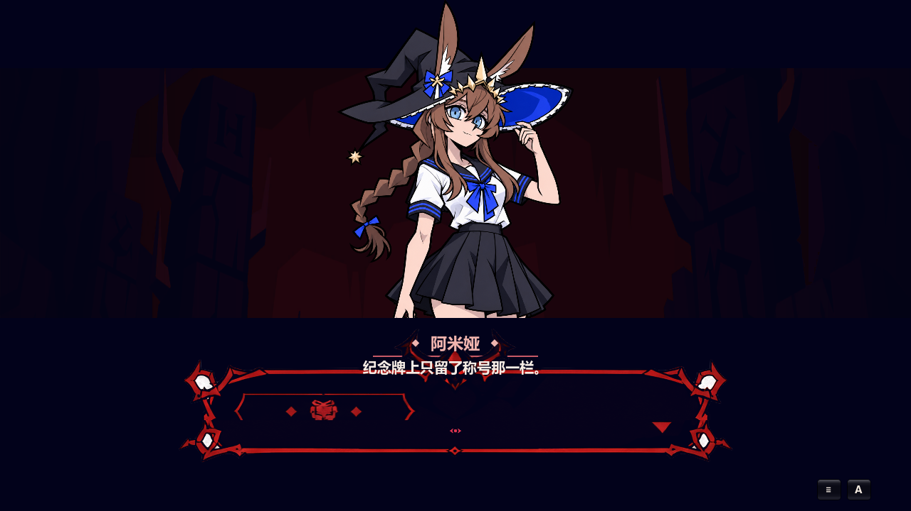
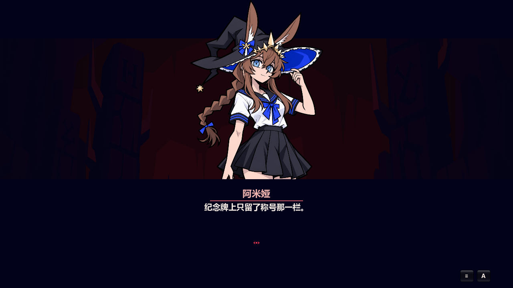
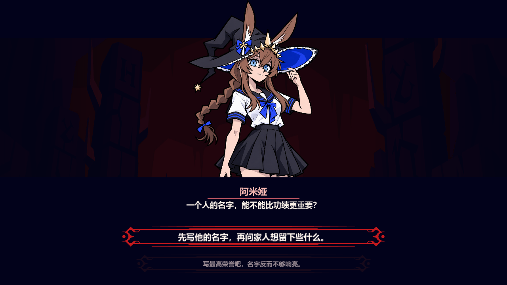

# V95 对话界面精简验证

按用户确认的“去掉骷髅边框和空框，保留剧情交互”，仅删除底部巨大骷髅装饰框。按后续“二选一的那个 UI 恢复”反馈，真实选项继续使用原红／灰选项框、焦点放大与亮度反馈。沿用现有深色文字背景；保留人物立绘、姓名、原剧情文字、键盘/鼠标交互、漫画和原成功/失败/过场动画。

## 复现与根因

在真实主场景中，由模式菜单进入基地，靠近阿米娅并通过原生 F 输入开始 `home_hero_06_4`。第一句没有任何选项，但底部仍显示巨大空装饰框。原生运行时确认纹理为 `res://assets/gothic/panel_main_horned.png`。

`dialogue_panel.gd` 在构建时创建并绑定 `dialog_frame` 九宫格节点。工作簿 UI 配置把默认纹理替换成了该骷髅素材；该行保存了 244px 高度、130px 顶部边距及 60px 底部边距。代码随后又恢复布局尺寸，导致装饰边框被压缩在对白下面。每次 `show_line()` 虽然先令它透明，但 `_animate_line_entrance()` 又无条件恢复不透明。因此普通对白和选项后的回应都会留下与剧情无关的空框。

真实选择按钮已经由 `_configure_choices()` 在普通对白中隐藏；截图中的空框来自独立装饰节点，而不是一个尚未填写的选择问题。

## 改动

- 删除 `dialog_frame` 九宫格节点及它的透明度/显示动画引用，旧工作簿中的装饰资源配置不会重新创建它。
- 保留真实二选一按钮的原红／灰框 TextureRect、选项文本、完整点击区域、焦点字号/亮度反馈、数字键及 Tab 操作。
- 隐藏选项时清空旧文本，使后续普通对白没有残留的空选项内容。
- 姓名直接显示角色名，沿用细红分隔线及现有文字背景，没有新增装饰框或素材。
- 保留角色离场、漫画、成功、失败和过场动画逻辑，仅移除这些动画中对已删除装饰框的引用。

实现位于 `game/scripts/dialogue_panel.gd`。新增验证入口为 `game/scripts/qa_v95_dialogue.gd`（RefCounted，可用于发行包），源工程包装入口为 `game/tests/run_qa_v95_dialogue.gd`。

## 验证结果

| 运行 | 检查数 | 失败数 | 结果 |
| --- | ---: | ---: | --- |
| 修改前，真实 OpenGL 窗口 | 39 | 8 | 所有失败都为预期的装饰删除断言；原剧情输入与动画流程可操作 |
| 修改后，headless 原生输入 | 40 | 0 | 通过 |
| 恢复二选一原框后，真实 OpenGL 窗口 | 42 | 0 | 通过；红／灰框及焦点切换均验证 |
| 修改后，完整 V94 结束流程回归 | 111 | 0 | 通过 |

最终通过的运行没有脚本/运行时错误或退出资源警告。源 headless 和窗口测试均用绝对 `--qa-output` 隔离存档，所有点击和按键均通过真实 viewport `push_input` 分发。

阿米娅验证包含：主菜单原生点击进入基地、F 开始原剧情、普通对白前进、显示真实选项、Tab 聚焦第二项、数字键提交一次选择、回应中移除选择控件、原成功动画确认、返回基地及 Escape 返回菜单。战役验证包含：原漫画确认、原开场对白、实际鼠标选择、原成功与过场动画、编队确认及进入战斗。

V94 回归继续覆盖重复失败、基地/模式重进、普通和最终通关、已读/缺失剧情分支、成就保存及菜单/编队/结果只触发一次。

## 原生截图

相同阿米娅场景、相同第一句对白，修改前：



修改后：



修改后的真实选项仍可操作：



完整日志、结果 JSON、回应与战役截图保存在 [`dialogue/`](dialogue/)。临时运行与验证存档位于 `C:/Users/yzy/Desktop/codex/rift-guard/v95-2026-10-04/dialogue/`，没有写入玩家正式存档。

源工程复验命令：

```powershell
& 'C:/Users/yzy/Desktop/codex/tools/godot-4.6/Godot_v4.6-stable_win64_console.exe' --headless --path 'D:/FILEEEEEEEEEEE/同人游戏/rift-guard-astra/game' --script res://tests/run_qa_v95_dialogue.gd -- --qa-output=C:/Users/yzy/Desktop/codex/rift-guard/v95-2026-10-04/dialogue/verify
```

发行包入口由主代理添加并单独验证；本文记录的是源工程及真实窗口验证。
