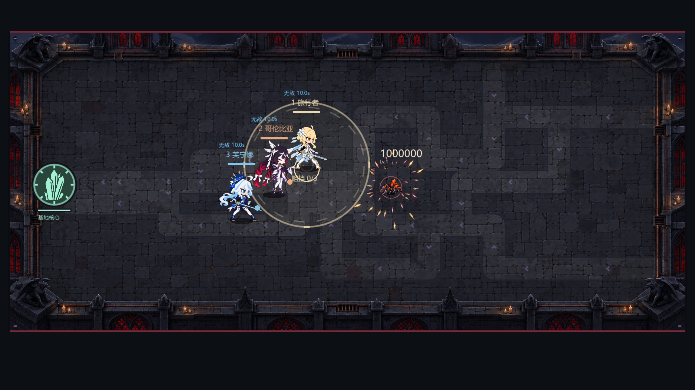
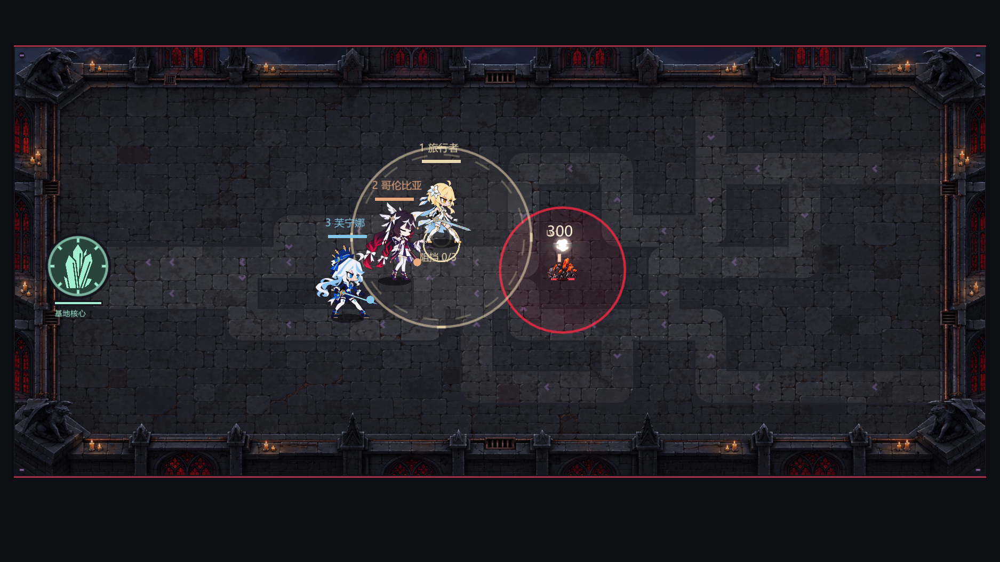
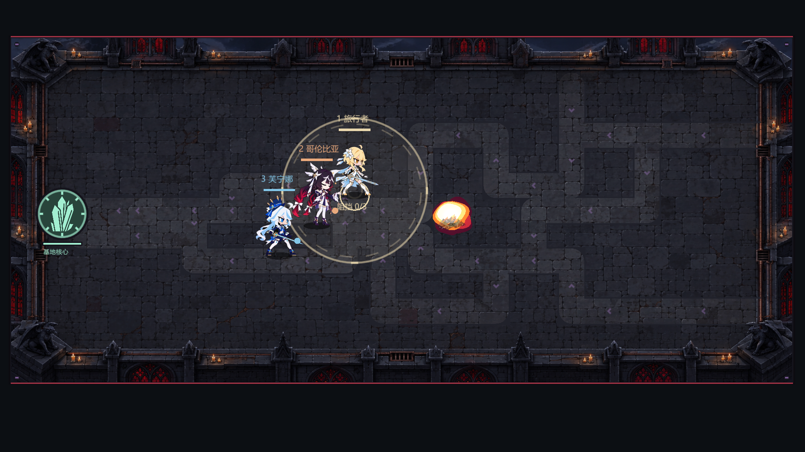
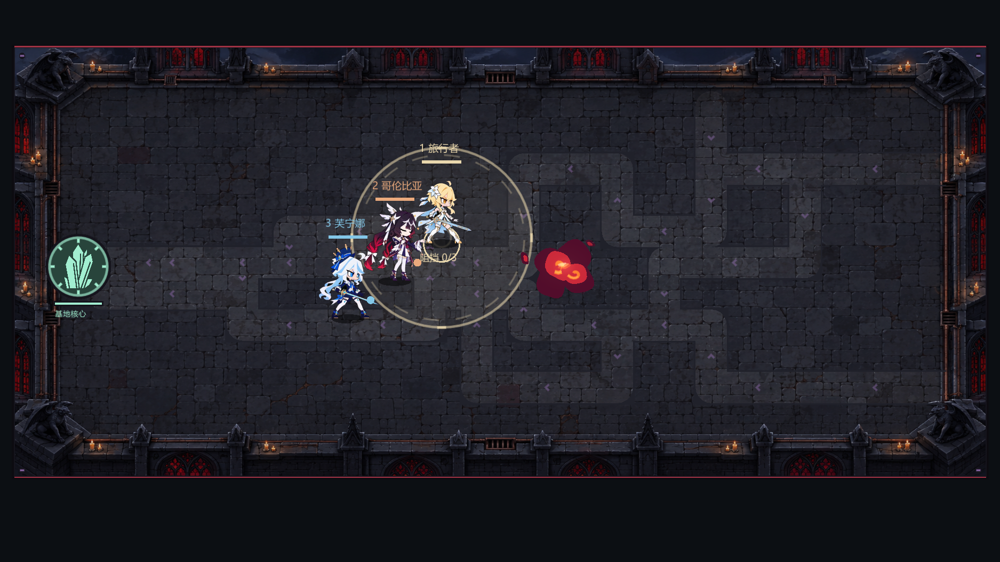
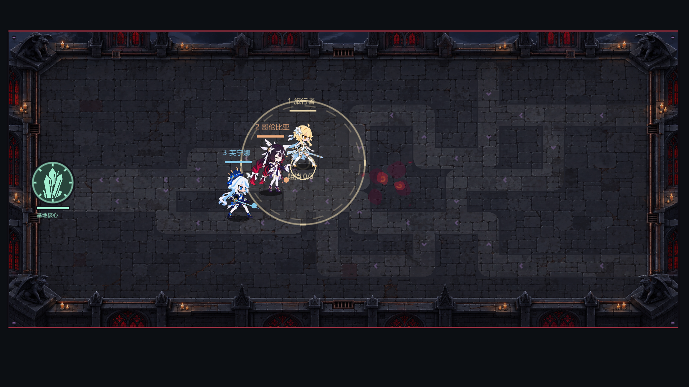
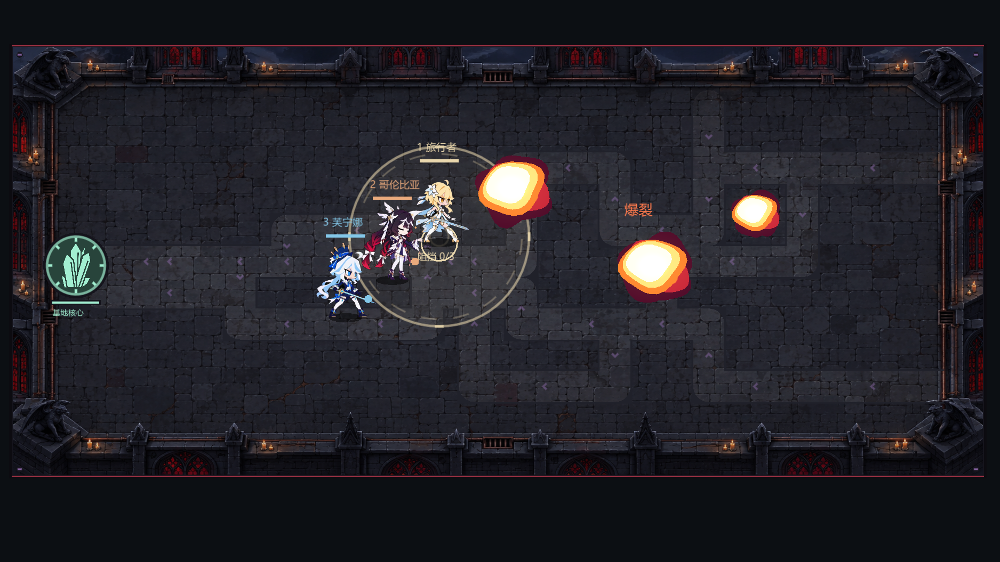
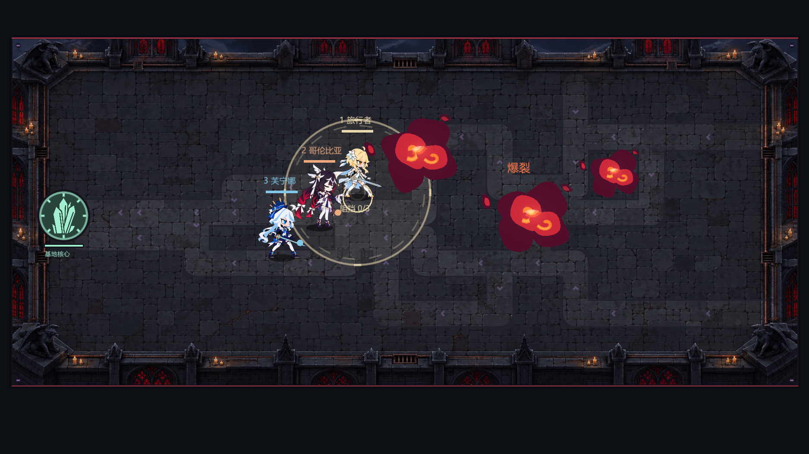
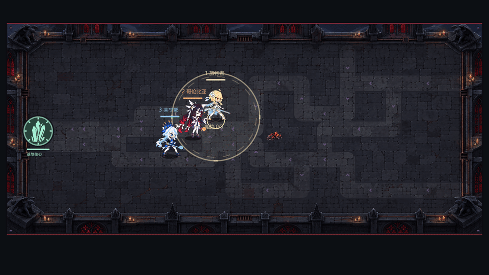

# V95 卡通爆炸验证

按用户给定的参考图，爆炸改为白黄挤压核心、互相重叠的深酒红烟块、中心橙红内焰和大小不等的豆形碎块。适用范围为通用 `death_burst`、非源石虫 `enemy_volatile`、允许附加效果的敌人死亡，以及源石虫一秒预警后的专用爆炸。原始敌人死亡图集、其他技能冲击、Boss 演出、闪电和传送门继续使用原有画法。

## 原因与实现

原来的 `comic_combat_vfx.gd` 爆发最终调用 `impact_flash_vfx.gd` 的 `Flash.burst`，由交替长短半径的尖角多边形和碎片构成。这个入口也被 Boss 和技能演出共用，因此不能直接全局替换。

新增 `cartoon_explosion_vfx.gd`，只在 `Comic.draw_accents` 的三类死亡／爆炸分支和 `EnemyTactics.draw_blast` 调用。保留原 `Comic.burst`／`Flash.burst` 共用接口。源石虫的普通 `death` 不再提前生成通用爆发，它的尸体和完整预警保留，专用 `bug_blast` 事件仍阻止第二层 Comic 特效。

动画长 0.48 秒：短暂扁平点火，白黄核心向上膨胀，深红烟块向右上翻出，最后缩小并淡出。最多四个重叠主烟块，橙红色集中在两片中央火舌，最多两处卷曲；三枚外围碎块的尺寸、角度和出现时机不同。精简效果保留三个主烟块、一片内焰和一处卷曲。

每个轮廓最多 24 点、卷曲 12 点。最终四阶段记录中，完整模式最多 18 条绘制命令；没有节点、Sprite 粒子、额外计时器或游戏随机数调用。烟块连通性由 `Geometry2D.intersect_polygons` 在 QA 中检查，防止重新变成环状花瓣。

源石虫画法直接读取事件半径并通过 `ability_area_screen_radii` 获取投影轴，所有采样阶段的实体烟块和碎块都落在真实预警投影内。未修改 `BUG_BLAST_RADIUS=80`、一秒引信、`damage*1.5`、英雄命中判定或结算次数。

## 验证结果

| 检查 | 结果 | 证据 |
| --- | --- | --- |
| 修改前原生复现 | 114 项，32 项预期失败；色彩／形状、提前死亡闪光及超出投影的碎片被捕获 | [baseline-red.log](explosion/baseline-red.log) |
| 最终源代码无窗口绘制／模拟检查 | 124 项，0 失败 | [headless.log](explosion/headless.log) |
| 最终真实场景原生 OpenGL 检查 | 129 项，0 失败，干净退出 | [native.log](explosion/native.log)、[完整绘制记录](explosion/explosion-results.json) |
| 原 V94 源石虫边界回归 | 90 项，0 失败；关卡／无尽、普通／易爆、横轴／纵轴全部保留 | [v94-bug-blast.log](explosion/v94-bug-blast.log) |
| 未改的共用爆发、光束、传送门、普通冲击、闪电 | 修改前后完整绘制命令逐项相同 | [unchanged-styles.json](explosion/unchanged-styles.json) |

模拟检查分别覆盖关卡和无尽的 79／81／120 距离边界：引信结束前不受伤，79 受到原伤害，81 和 120 安全；重复 tick 不再结算第二次伤害。普通死亡、爆发和易爆事件分别在完整及精简效果下记录 0.025、0.11、0.24、0.40 秒，检查有可见几何、有限轮廓点数、中心白黄核心、酒红烟块、橙红内焰以及无尖角碎片／辐条。

原生验证实例化真实 `main.tscn`，正常源石虫设置 125 HP，以正常 300 伤害致死，由原模拟引信和 `game.process_events()` 分发专用爆炸。预警期间同时走 `_enemy_tick` 的正常死亡清理、`battle.advance` 和 `fx.advance`，所以死亡单位不会被错误保留在活体列表，伤害标签也按原时间自然结束。

源石虫的原 `down` 图集是 25 帧／24fps，另有 0.16 秒尾帧，原视景总长约 1.202 秒。一秒引信结束时原尾帧仍会短暂渐隐；截图／视频把该视景的年龄同步到 `1.01 + 爆炸年龄`，并由原 `battle.advance` 到期清理。0.24 和 0.40 秒阶段正常没有尸体遮挡。没有为了验证或观感增加生产隐藏逻辑。

截图段冻结物理与独立渲染时钟，再设置精确阶段年龄，避免截图保存耗时改变爆炸阶段。仅测试视景时钟被控制；生产动画仍由正常渲染更新推进。根线程同时删除了爆炸事件上叠加的旧死亡圆环／主题环装饰，其他角色倒地和技能分支保持原样。

## 原生画面

修改前的实际尖角闪光：



源石虫保留原 80 范围、一秒预警：



短暂挤压核心（0.025 秒）、点燃膨胀（0.11 秒）、重叠烟团（0.24 秒）、消散（0.40 秒）：








三类通用事件的同场展示：





[实际场景 MP4：60 fps，0.5 秒](explosion/bug-blast.mp4)。下面 GIF 按半速展示同一批真实场景帧，便于观察形变：



## 运行方法

源代码入口为 `res://tests/run_qa_v95_explosion.gd`，调用可随发行版打包的 `res://scripts/qa_v95_explosion.gd`。传入绝对 `--qa-output` 使用隔离存档，例如：

```powershell
& 'C:/Users/yzy/Desktop/codex/tools/godot-4.6/Godot_v4.6-stable_win64_console.exe' `
  --headless --path 'D:/FILEEEEEEEEEEE/同人游戏/rift-guard-astra/game' `
  --script res://tests/run_qa_v95_explosion.gd -- `
  --qa-output='C:/Users/yzy/Desktop/codex/rift-guard/v95-2026-10-04/explosion/source-validation'
```

原生运行移除 `--headless` 并使用 `--rendering-method gl_compatibility`，同时保存四阶段截图及 30 张真实场景帧。所有临时记录均位于项目专用 Codex 临时目录，正式证据保存在本页链接的项目验证目录。
