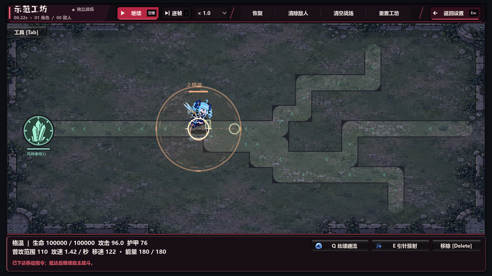
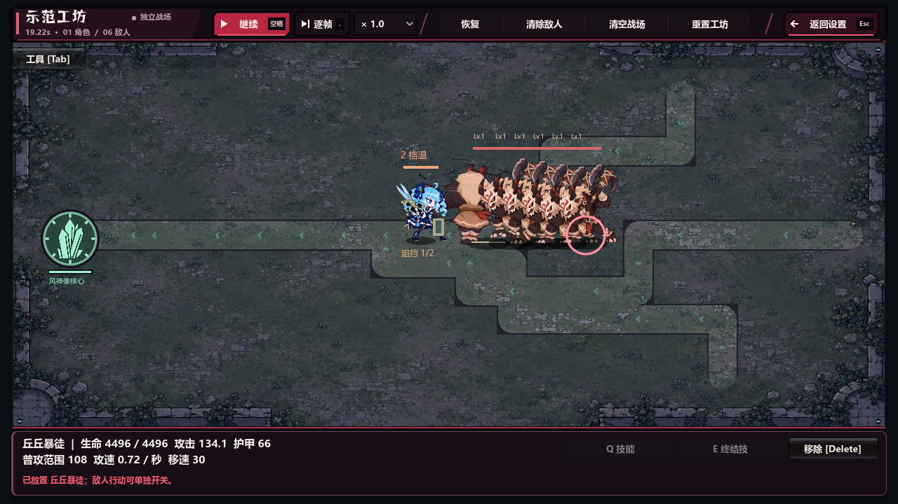

# V95：路线队列、工坊移动与模拟开销

验证日期：2026-10-04。Godot 4.6 stable，Windows，Compatibility / RTX 3050 Laptop。

## 修复原因和行为

旧道路队列会逐敌人扫描、排序前方整群敌人，再把“理想排队间隔”当作实际移动目标。队列变长时，目标落在当前位置后方；旧 `recover_lane_spacing` 又主动把重叠单位往道路上游推。两者叠加，使前线附近的暴徒群不断离开防守角色。

现在普通后排只向道路前方靠近或原地等候，排队压力不会生成后退指令。敌人已侵入角色身体间距时仍可后退恢复站位；当前排真实侵入角色身体时，同一队列允许临时有界让位，避免后排把前排困在角色体内，前排恢复身体间距后立即停止这种让位。真实击退、冲锋、潜地、首领跳跃照常执行。离开道路的真实位移仍先返回被打断的路段。

前后相邻的道路单位在下一步会加剧身体重叠时停下，拐角也检查尚未取得攻击站位的单位。不同道路的平行段和交叉段分别通行，实际合流后再参与身体排队；这是避免距离只有40像素的原版道路互相卡死所必需的。原有多道路通行和绕墙压力测试保留完整。

工坊默认开启角色自动攻击和敌人行动。右键给角色与敌人设置行走目的地，逐帧按实际移速移动并绕开地形；敌人抵达后继续自主接近、攻击。无尽工坊使用 `workshop_navigation.gd` 的目标专属BFS场，不借用自主追击角色的流场；命令改写或地形导航版本变化会重建，抵达立即清除。移动指令排在已经发动的冲锋、旋斧、潜地、首领招式之后。暂停、逐帧、两个独立行动开关、手动技能、恢复和重置继续可用。移速为0的固定建筑保持静止，需要通过重新放置改变位置。

## 缓存范围与失效

- `enemy_crowd_index.gd` 在每次敌方更新开始时重建身体、预约站位和障碍候选网格；真实位置变化当场更新身体格子，后续单位看见新位置。
- 战役中，同一防守角色与道路段只排序一次并计算累计站位间隔；生成顺序反转仍得到正确前排。下个更新自动重建，真实位移、击退、死亡和首领招式会使本次排队缓存失效。
- 无尽站位和身体步进只查附近格子；保留原始距离、角色间距、墙体和攻击准备条件。零位移不再重复遍历身体。
- 地形只缓存障碍候选，不替换原椭圆、矩形、网格点判定和障碍先后顺序；门的生命值仍读取实时字典，破门当次立即通行。
- 缓存只在敌方同步更新期间启用。编辑地形、换图、工坊放置和其他阶段使用原始查询，下次敌方更新重建。没有降低敌人数、逻辑频率、特效质量或攻击次数。
- 近战已有 `EnemyMelee.advance` 时，不再先执行一次随后被覆盖的 `_orthogonal_enemy_step` 地形碰撞。

## 红绿回归与原生证据

初始新测试46项中13项失败，包含后退、工坊默认禁用行动与右键瞬移。独立复核又发现真实角色重叠恢复被后排阻挡、无尽手动目标使用错误流场；新增回归先出现5项失败，再修复。最终扩展为78项，全部通过。

| 检查 | 结果 |
| --- | --- |
| `run_qa_v95_simulation.gd` | 78 / 78 |
| `qa_v93_workshop.gd`，真实输入与暂停/逐帧 | 82 / 82，无头；行为实现后原生82 / 82，缓存完成后原生独立9 / 9 |
| `qa_v91_melee_spacing.gd` | 43 / 43 |
| `qa_v91_melee_pressure.gd`，60/80/96只、移动队伍、交汇、绕墙 | 18 / 18 |
| `qa_v92_terrain.gd` | 151 / 151 |
| `qa_v93_balance_routes.gd` | 124 / 124 |
| `qa_v94_bug_blast.gd` | 90 / 90 |
| 原生工坊右键、逐帧、互相攻击、暴徒队列 | 9 / 9，stderr为空 |
| 独立复核后的原生重叠恢复、完整长墙绕行及抵达状态 | 3 / 3，stderr为空，三张截图已查看 |

78项新检查包含水平/垂直道路、格温前方紧密暴徒队列、反向生成顺序、前排死亡、角色移位、真实击退与冲锋、160组身体/站位索引对照、240组精确地形判定对照及当次破门。额外复核覆盖角色(600,360)、两只步兵(600,360)/(640,360)在两种生成顺序下恢复身体间距并实际攻击；以及无尽角色(400,350)、敌人(700,350)、800像素长墙、目标(1100,350)全程绕墙抵达，逐步检查17像素碰撞并验证抵达后恢复自主行动。原生截图已人工查看：目的地标记与中间行走位置可见；暴徒前排仍从正确身体间距造成实际伤害。

V91/V92各有一项旧断言曾要求“起始仅7像素间距”的八只重叠单位最终被强制分开至38像素。这需要后排后退，和V95要求冲突。只将这两项改为不继续压缩、不后退、保持角色身体间距；各另加正常48像素出生间距的独立检查，仍要求最终至少38像素间距。没有删减交汇、绕墙或正常身体间距要求。

## 性能记录

以下为相同确定性fixture的诊断数据。最终安静窗口的原生A/B由主验证报告记录；本表原生数据采集时其他任务可能并发，不作为单帧保证。

| 场景 / 指标 | 优化前 | 优化后 |
| --- | ---: | ---: |
| 道路24只暴徒，`_enemy_tick`均值 | 2.44 ms | 1.34 ms |
| 道路48只暴徒，`_enemy_tick`均值 | 8.24 ms | 2.69 ms |
| 道路96只暴徒，`_enemy_tick`均值 | 29.58 ms | 6.64 ms |
| 原生完整无尽96只混合敌人，sim均值 | 41.87 ms | 12.66 ms |
| 同上，sim P95 | 64.23 ms | 16.60 ms |

道路A/B按顺序运行同一fixture：真实暴徒、固定种子、保持存活、相同时间步；优化前副本已包含“不后退”的行为修复。无尽使用主验证同一 `profile.gd` 的140帧fixture，前20帧预热，96只敌人混合暴徒、装甲、火史莱姆、奔行者、源石虫、冲锋者、裂隙蝠，保持全部存活，quality=1。

方法级临时计时确认第二个主要热点：每帧394次 `_terrain_blocker_on_segment` 约23.16ms，其中不断重复构造碰撞矩形。加入候选网格后该部分约1.73ms；碰撞矩形调用从每帧6415次降至237次。计时副本本身有额外开销，只用于定位。

复跑核心用 `Godot --headless --path game --script res://tests/run_qa_v95_simulation.gd`；发行内置入口为 `-- --v95-simulation-test`。性能入口为 `-- --v95-performance-test --qa-output=<绝对输出目录>`。临时日志、原生抓帧和对比副本统一保存在 `C:/Users/yzy/Desktop/codex/rift-guard/v95-2026-10-04/simulation/`。
